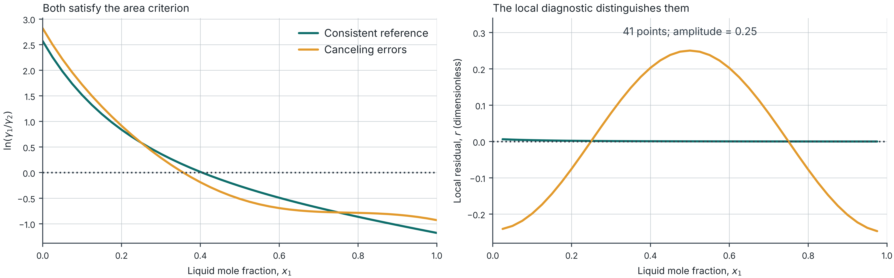

## Your independent lesson

::: {.your-action}
**Your action:** Open the worksheet and guide below. Keep this deck open, then advance to the schedule. Preparation is part of minutes 0–15.
:::

This holiday lesson takes **180 minutes, including your calculations, lab work and a break**. Work individually. No live demonstration or partner is required.

- [Practice worksheet, 4 pages](files/week03-practice.pdf): complete Sections A–I in order.
- [Lab guide, 3 pages](files/week03-lab-guide.pdf): exact controls and interpretation checks.
- [Worked solutions](files/week03-solutions.pdf): open each section **after your attempt**.

[Start page](week03-study.html) · [Printable slides](files/postmidterm-03-slides.pdf)

The [3-page background reading](files/preclass-week-03.pdf) is optional. All required instructions are here.

## The 180-minute route

::: {.your-action}
**Your action:** Start a timer. Use elapsed times as a guide and pause the slides to work. All required tasks fit inside this schedule.
:::

| Elapsed | Activity | Worksheet |
|---|---|---|
| 0–15 | Lab 08 review and one gamma calculation | p. 1, A |
| 15–35 | Gibbs–Duhem and applicability | p. 1, B |
| 35–50 | Area calculation by hand | p. 1, C |
| 50–90 | Lab 03 comparison and interpretation | p. 2, D–E |
| 90–100 | Break | |
| 100–120 | Stability and lever rule | p. 3, F |
| 120–165 | Lab 04 investigation | p. 3, G |
| 165–180 | Self-review, exit ticket and feedback | p. 4, H–I |

## Review attempt · 0–10 min

::: {.your-action}
**Your action:** Complete worksheet p. 1, A1–A3. Use this slide and a calculator. Attempt the questions before advancing.
:::

**A1.** Define liquid composition $x_1$, vapor composition $y_1$, overall composition $z_1$ and activity coefficient $\gamma_1$.

**A2.** For the synthetic Lab 08 observation, calculate:

$$\gamma_1=\frac{y_1P}{x_1P_1^{sat}}=
\frac{0.704857144627(158.707198211)}{0.5(150)}$$

Both pressures use kPa. Assume ideal vapor and negligible Poynting correction.

**A3.** Does a small model fitting error prove thermodynamic consistency?

If needed, revisit only the relevant chapter of the [Lab 08 video](lab08-video.html) within this review time.

## Review check · 10–15 min

::: {.your-action}
**Your action:** Check A1–A3. Write corrections beside your first answers. If you opened the Lab 08 video, close it and continue here.
:::

$x_1$ and $y_1$ describe compositions **within each phase**. $z_1$ describes the overall mixture. $\gamma_1$ relates liquid activity to composition: $a_1=x_1\gamma_1$.

$$\gamma_1=1.491545\qquad
\exp(0.399813)\approx1.491546$$

The small rounding difference is expected. Gamma is dimensionless.

A fit measures how well a selected model reproduces observations. A consistency test examines a thermodynamic constraint, subject to its assumptions and data coverage.

## Gibbs–Duhem · 15–21 min {#consistency-constraint}

::: {.your-action}
**Your action:** Read this slide, then complete worksheet p. 1, B1. Explain what the equation constrains in one sentence.
:::

For a binary liquid at **fixed temperature and pressure**:

$$x_1\,d\ln\gamma_1+(1-x_1)\,d\ln\gamma_2=0$$

The activity coefficients cannot vary independently with composition.

Define the dimensionless excess Gibbs energy:

$$\widetilde g^E=\frac{g^E}{RT}
=x_1\ln\gamma_1+(1-x_1)\ln\gamma_2$$

At fixed $T,P$, its slope equals $\ln(\gamma_1/\gamma_2)$. This connects the **local diagnostic** to the activity data.

## The experimental path · 21–27 min

::: {.your-action}
**Your action:** Complete worksheet p. 1, B2. State the omitted term for an isothermal path and the needed correction for an isobaric path.
:::

For changing $T$ and $P$, with molar excess properties:

$$\sum_i x_i\,d\ln\gamma_i
=-\frac{h^E}{RT^2}\,dT+\frac{v^E}{RT}\,dP$$

| Data path | What the diagnostic needs |
|---|---|
| Isothermal VLE, changing pressure | The lab neglects the excess-volume pressure term. |
| Isobaric VLE, changing temperature | A local test needs the excess-enthalpy term. |

For real isobaric data, missing independent $h^E$ prevents the lab from assigning a local consistency verdict. The synthetic correction comes from its generator.

## Which method applies? · 27–35 min

::: {.your-action}
**Your action:** Read the comparison and complete worksheet p. 1, B3. Use Lab guide p. 2 if you need the definitions. No Lab calculation yet.
:::

| Method | Evidence and limitation |
|---|---|
| Isothermal area | Full composition range, with the pressure-term approximation. Opposite errors can cancel. |
| Local differential | Checks a slope relation. Numerical differentiation amplifies noise. |
| Herington | Empirical allowance for an **isobaric** boiling range. It does not supply measured $h^E$. |
| Van Ness-type | Tests reproduction of $P$ and $y$ by a selected activity model. |

**“Not applicable,” “not assessed” and “not run” are different from “outside this criterion.”** Record the reason with the result.

::: {.notes}
Primary background: https://trc.nist.gov/TDE/Help/TDE103b_v4_0/VLE-DataSets-ConsistencyTests/Herington.htm ; https://trc.nist.gov/TDE/Help/TDE103b_v4_0/VLE-DataSets-ConsistencyTests/Point.htm ; https://trc.nist.gov/TDE/Help/TDE103b_v4_0/VLE-DataSets-ConsistencyTests/VanNess.htm . The lab uses teaching variants and states the differences below its controls.
:::

## Area exercise · 35–43 min

::: {.your-action}
**Your action:** Complete worksheet p. 1, C1–C3. Calculate the signed trapezoid areas, then repeat after adding 0.2 to every $L$ value. Stop before the solution.
:::

Synthetic values, with endpoint limits supplied analytically:

| $x_1$ | 0 | 0.25 | 0.50 | 0.75 | 1.00 |
|---|---:|---:|---:|---:|---:|
| $L=\ln(\gamma_1/\gamma_2)$ | 2 | 1 | 0 | −1 | −2 |

$$S\approx\sum_j\frac{L_j+L_{j+1}}{2}(x_{j+1}-x_j)$$

The integral should vanish under the stated isothermal approximation and pure-liquid reference conventions. Explain why a zero value alone cannot certify real measurements.

## Area solution · 43–50 min

::: {.your-action}
**Your action:** Check C1–C3. Keep the signed integral $S$ separate from the lab's normalized score $D$.
:::

Baseline interval areas: $0.375,\ 0.125,\ -0.125,\ -0.375$.

$$S=0.5-0.5=0\qquad S_{\text{shifted}}=0+0.2(1-0)=0.2$$

Lab 03 labels this signed integral **$I$**. It also reports:

$$D=100\frac{|A_+-A_-|}{A_++A_-}$$

$A_-$ is the **positive magnitude** below zero. The lab uses $D<5\%$ for its isothermal area criterion. $D$ is undefined when both areas vanish.

Real interior observations do not supply missing endpoint limits. Extrapolation remains an assumption.

## Local and global checks · 50–53 min

::: {.your-action}
**Your action:** Open [Lab 03](labs/consistency.html#consistency-experiment) and Lab guide p. 1. Keep worksheet p. 2 ready. Read this diagnostic before changing controls.
:::

For the isothermal approximation:

$$r(x_1)=\frac{d\widetilde g^E}{dx_1}
-\ln\!\left(\frac{\gamma_1}{\gamma_2}\right)$$

Lab 03 uses interior finite differences and the teaching score $100\,\mathrm{mean}|r|$, with a threshold of 5.

An error may have **zero integrated area** while leaving a nonzero local residual. A mean score can also hide a narrow defect, so inspect the plotted shape.

This teaching diagnostic differs from the NIST/Kojima point test, which uses a fitted Padé slope.

## Lab 03 baseline · 53–60 min

::: {.your-action}
**Your action:** Set these exact controls. Complete worksheet p. 2, D1, then save a screenshot or click **Export all results**.
:::

| Control | Setting |
|---|---|
| Data set | Synthetic · isothermal, 350 K |
| Controlled perturbation | Consistent reference |
| Sampling resolution | **41 points** |
| Inspect | Log-activity ratio & integrated area |

Record $I$, $D$ and the area status. Change **Inspect** to **Local Gibbs–Duhem residual** and record its score and status. Save as `week03-reference.json`.

Controls update automatically. The clean reference disables Amplitude. This is Lab 03's own synthetic data, distinct from the Lab 08 example.

## Canceling errors · 60–67 min

::: {.your-action}
**Your action:** Complete D2. Change only the perturbation as below, with amplitude 0.25. Inspect both plots and retain the baseline for comparison.
:::

Set **Controlled perturbation** to **Canceling errors · zero net area**. Set **Amplitude** to **0.25**. Keep 350 K and 41 points.

The generator adds opposite weighted changes to the two log activities. Its added log ratio is:

$$f(x_1)=0.25\cos(2\pi x_1),\qquad \int_0^1 f(x_1)\,dx_1=0$$

Record the new area and differential results. Does a small $D$ establish agreement with the local Gibbs–Duhem relation?

Save this case with a distinct name, such as `week03-cancel.json`.

## A localized defect · 67–74 min

::: {.your-action}
**Your action:** Complete D3. Choose **Localized defect near x₁ = 0.35**. Keep amplitude 0.25, 350 K and 41 points.
:::

1. Record the area and differential scores and statuses.
2. In **Local Gibbs–Duhem residual**, locate the largest departure.
3. Compare the local shape with the single mean score.

A criterion describes its own numerical rule. A visible localized defect can remain below an aggregate threshold.

Save this case separately. If time remains, compare 161 points, then return to 41. A changed derivative score may reflect sampling resolution.

## Model reproduction · 74–80 min

::: {.your-action}
**Your action:** Complete D4. Return to **Consistent reference** at 350 K and 41 points. Click **Run modeling test** once, then inspect **Modeling residuals**.
:::

Record the **Van Ness-type** values: pressure error $\Delta p$ in percent and vapor-composition error $\Delta y$ in percentage points.

The lab fits two constant NRTL parameters at 350 K, with $\alpha=0.47$. Its criteria are $\Delta p<1\%$ and $\Delta y<1$ percentage point.

**Herington reads “Not applicable”** for this isothermal case. For isobaric data it uses $D-J<10$, where $J=150(T_{max}-T_{min})/T_{min}$ in kelvin.

The clean fit recovers the generator within numerical error. This demonstrates selected-model reproduction. These teaching variants differ from the full NIST TDE implementations.

## Area versus local evidence · 80–85 min

::: {.your-action}
**Your action:** Compare D1 and D2 with these plots. Answer worksheet p. 2, E1 in your own words before advancing.
:::

{width="100%" fig-alt="Two plots compare the reference and canceling-error case. Their log-activity ratios differ but both satisfy the area criterion. The reference local residual is near zero, while the canceling-error residual oscillates roughly between minus 0.25 and plus 0.25."}

::: {.small}
Reference: $D\approx0.079\%$, local score $\approx0.118$. Canceling error: $D\approx0.074\%$, local score $\approx15.599$.
:::

## Interpretation · 85–90 min

::: {.your-action}
**Your action:** Check E1 and complete E2. Attempt your explanation, then compare with worked solutions Sections D–E.
:::

**E1.** Why can the canceling-error case meet the area criterion while the local diagnostic flags a departure?

**E2.** Write a claim, its numerical evidence, and one limitation. Include your data settings and test applicability.

Useful structure: “At [settings], $D=$ … and the local score is … . These results support … under … . They do not establish … .”

Before continuing, keep the baseline and changed-case results. The synthetic construction demonstrates a test limitation. It does not estimate experimental uncertainty.

## Break · 90–100 min

::: {.your-action}
**Your action:** Take a 10-minute break. Leave your files open. Return to this deck and worksheet p. 3 at minute 100.
:::

Next: a model can satisfy Gibbs–Duhem and still predict liquid separation.

The new question is whether one liquid or a split has the **lowest admissible Gibbs energy**.

## Liquid stability · 100–105 min {#phase-equilibrium-includes-stability}

::: {.your-action}
**Your action:** Read the definition and complete worksheet p. 3, F1. Explain what equality of chemical potentials leaves to check.
:::

At fixed $T,P$, the stable state minimizes total Gibbs energy subject to the material balance.

For a binary liquid, define dimensionless mixing Gibbs energy:

$$\widetilde g(x)=x\ln x+(1-x)\ln(1-x)+\widetilde g^E(x)$$

Equality of chemical potentials identifies **candidate** coexisting phases. A candidate split must also provide a globally supporting common tangent.

A model that satisfies Gibbs–Duhem can have a nonconvex mixing-energy curve. Consistency does not guarantee a homogeneous stable liquid.

## Common-tangent condition · 105–110 min

::: {.your-action}
**Your action:** Read this condition. Complete the hand calculation F2 on the next slide, then use this condition for F3. Lab 04 begins at minute 120.
:::

At two distinct coexisting compositions:

$$\widetilde g'(x^\alpha)=\widetilde g'(x^\beta)
=\frac{\widetilde g(x^\beta)-\widetilde g(x^\alpha)}{x^\beta-x^\alpha}$$

The line must lie **at or below the Gibbs curve throughout the admitted composition interval**.

A line that touches twice but crosses above the curve fails this global support check. A root with $x^\alpha=x^\beta$ does not establish two distinct phases.

Positive local curvature alone cannot prove global stability.

## Lever-rule attempt · 110–116 min

::: {.your-action}
**Your action:** Complete worksheet p. 3, F2. Use only these illustrative endpoints and a calculator. Attempt both feeds before advancing.
:::

Suppose a globally supported tie line has $x_1^\alpha=0.20$ and $x_1^\beta=0.80$.

$$f_\beta=\frac{z_1-x_1^\alpha}{x_1^\beta-x_1^\alpha},
\qquad f_\alpha=1-f_\beta$$

Find both liquid fractions at $z_1=0.50$, then at $z_1=0.35$. Check:

$$z_1=f_\alpha x_1^\alpha+f_\beta x_1^\beta$$

Here $\beta$ labels the component-1-rich **liquid**. The supplied endpoints are a hand example, not the expected Lab 04 values.

## Lever-rule check · 116–120 min

::: {.your-action}
**Your action:** Correct F2, then complete F3 using the common-tangent condition. Open [Lab 04](labs/stability.html#lle-experiment) and Lab guide p. 3.
:::

| Overall composition $z_1$ | $f_\alpha$ | $f_\beta$ |
|---|---:|---:|
| 0.50 | 0.50 | 0.50 |
| 0.35 | 0.75 | 0.25 |

For the second feed:

$$0.75(0.20)+0.25(0.80)=0.35$$

At unchanged coexistence conditions, moving the overall composition **inside the same tie line** changes the amounts. The two coexisting compositions remain fixed.

## Lab 04 baseline · 120–130 min

::: {.your-action}
**Your action:** Complete worksheet p. 3, G1. Make a prediction, then select the exact preset below and record its actual results.
:::

In **Explore a state**, choose **Unstable · A = 3, z₁ = 0.50**. Verify:

- **Liquid model:** Margules · 1 parameter
- **Interaction parameter A:** 3, **Feed mole fraction z₁:** 0.50
- **View:** Gibbs energy & common tangent

Click **Find equilibrium** if you typed a value. Record both coexisting compositions, both liquid fractions, and Gibbs energy decrease / RT.

This hypothetical fixed-$T,P$ model assigns no physical temperature. Keep its parameters unchanged throughout G1–G4.

## One changed feed · 130–140 min

::: {.your-action}
**Your action:** Complete G2. First save the baseline using **Export study JSON**. Change only **Feed mole fraction z₁** to **0.35**, then click **Find equilibrium**.
:::

Record the same outputs for the changed feed.

| Compare | Question |
|---|---|
| $x_1^\alpha$ and $x_1^\beta$ | Did the coexistence endpoints change? |
| $f_\alpha$ and $f_\beta$ | Did the amounts change? |
| Overall balance | Does the split reconstruct the new $z_1$? |

Use the endpoints calculated by the lab. Reusing 0.20 and 0.80 from the hand example would check a different tie line.

## Independent balance · 140–150 min

::: {.your-action}
**Your action:** Complete G3 with your calculator. Show the substituted calculation using the lab's endpoints, then compare your fraction with the displayed value.
:::

$$f_\beta=\frac{0.35-x_1^\alpha}{x_1^\beta-x_1^\alpha}$$

$$z_{1,\mathrm{check}}=(1-f_\beta)x_1^\alpha+f_\beta x_1^\beta$$

Check $0\leq f_\beta\leq1$ and $f_\alpha+f_\beta=1$.

A balance proves that amounts and compositions agree with the feed. You still need the Gibbs-energy stability check.

Use additional digits from the JSON export if display rounding causes a small mismatch.

## Global support · 150–160 min

::: {.your-action}
**Your action:** Complete G4. Open **Verify the equilibrium** in Lab 04. Inspect its numerical checks and the full **Gibbs energy & common tangent** plot.
:::

Explain why the calculated split qualifies as stable within this model:

- The two liquid compositions are distinct.
- Chemical potentials agree within the reported numerical tolerance.
- The common tangent supports the entire Gibbs curve.
- The phase amounts satisfy the feed balance.

The homogeneous feed label describes the hypothetical single liquid at $z_1$. The equilibrium inside the miscibility gap consists of two liquids.

## Investigation check · 160–165 min

::: {.your-action}
**Your action:** Compare G1–G4 with worked solutions Section G. Save the changed-feed JSON and one comparison table or plot. Then open worksheet p. 4.
:::

Your record should identify the model, $A=3$, both feed compositions and the calculated tie-line endpoints.

Check the key distinction: **phase compositions describe each liquid; phase fractions describe how much of each liquid exists.**

Keep a numerical balance and the global support evidence with your explanation.

LLE fitting and VLLE are [optional extensions](postmidterm-03-appendix.html). They are outside this required 180-minute lesson.

## Self-review attempt · 165–169 min

::: {.your-action}
**Your action:** Answer worksheet p. 4, H1–H4 without the solutions. Use one or two sentences per question, with the short calculation for H4.
:::

1. Does meeting an area criterion guarantee all local relations are satisfied?
2. What can a differential departure mean, and which assumptions matter?
3. What evidence does a small selected-model fitting error provide?
4. For supported endpoints 0.20 and 0.80 with $z_1=0.35$, find $f_\beta$. What establishes stability beyond the balance?

Finish your own answers before advancing.

## Self-review check · 169–172 min

::: {.your-action}
**Your action:** Correct H1–H4 in a different color or add a note. Use the separate worked solutions if you need more detail.
:::

1. Opposite local errors can cancel in an area integral.
2. A departure prompts checks of data, property inputs, path corrections and numerical differentiation. A missing required correction prevents a verdict.
3. A small error demonstrates reproduction by that model and those property assumptions. It does not establish general predictive accuracy.
4. $f_\beta=(0.35-0.20)/(0.80-0.20)=0.25$. Stable coexistence also needs distinct phases and a globally supporting common tangent.

## Exit ticket · 172–177 min

::: {.your-action}
**Your action:** Open the existing Session 3 form below, or scan the QR. Follow worksheet p. 4, Section I.
:::

:::: {.columns}
::: {.column width="62%"}

In the **concept answer**, explain when a calculated liquid split represents stable equilibrium.

In the **evidence answer**, include your Lab 03 comparison: area versus local diagnostic, with settings and numerical results. Add your Lab 04 balance if space permits.

This form is anonymous. It does not identify individual attendance.

[Open Session 3 exit ticket and feedback](https://thermo-2105603-exit-ticket.soorathep-k.chatgpt.site/?session=3)

:::
::: {.column width="32%"}

[{width="100%"}](https://thermo-2105603-exit-ticket.soorathep-k.chatgpt.site/?session=3)

:::
::::

## Feedback and saved work · 177–180 min

::: {.your-action}
**Your action:** Finish the feedback fields in the same form and submit once. Wait for **“Response received.”** Then check the files listed below.
:::

Report how the pace and lab access worked for independent study. Name one explanation or instruction that still needs improvement.

Keep:

- Your completed worksheet, including original attempts and corrections.
- The Lab 03 comparison and exports or screenshots.
- The Lab 04 baseline and changed-feed evidence, with your balance.

No additional compulsory homework follows this lesson.

[Week 3 start page](week03-study.html) · [Course learning path](labs/learning-path.html#session-3)
