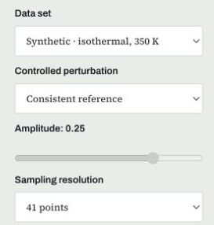
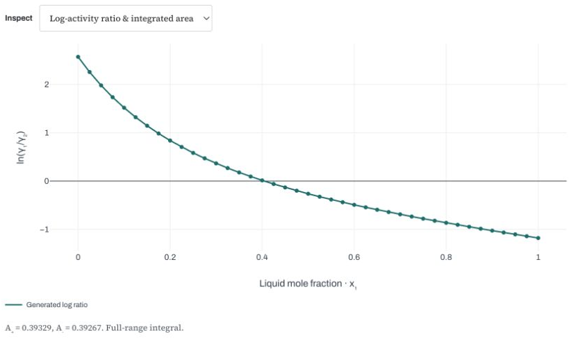
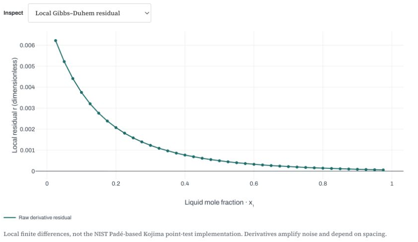
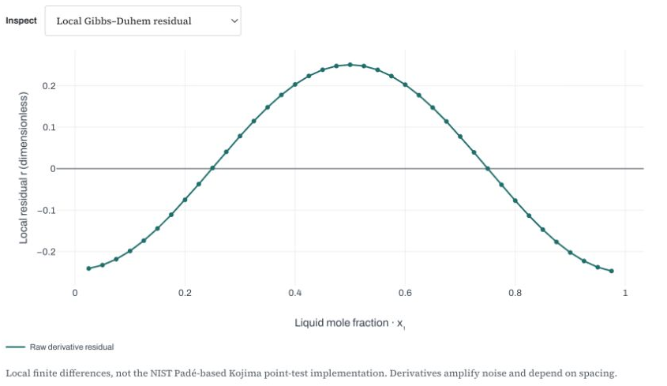
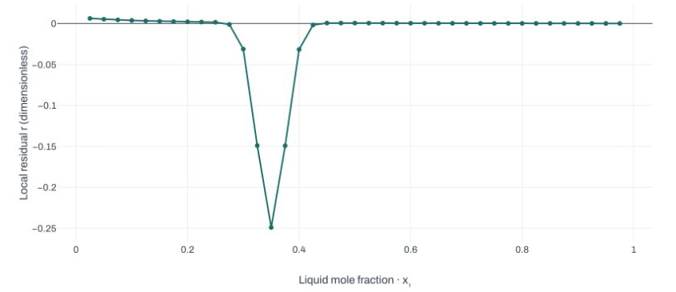
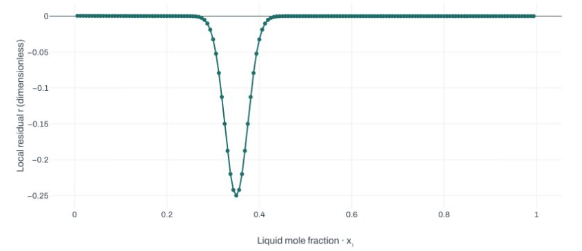
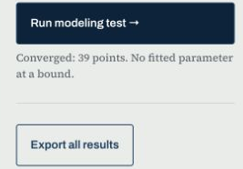
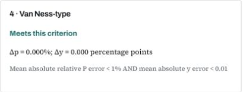

## Your independent lesson {#your-independent-lesson}

::: {.your-action}
**Your action:** Open the worksheet and Lab guide. Keep them beside these slides. Complete the sections in order, checking solutions only after your attempt.
:::

This lesson combines **explanation, a real Lab 03 demonstration, your own calculations, and two Lab investigations**.

- [Practice worksheet, 6 pages](files/week03-practice.pdf): Sections A–I.
- [Lab guide, 4 pages](files/week03-lab-guide.pdf): exact controls and interpretation.
- [Worked solutions](files/week03-solutions.pdf): retain your first answer, then correct it.

Allow **180 minutes including the recording, independent work and a 10-minute break**. Pause at the main work stops. Slide time ranges describe elapsed **study time**, not recording timestamps.

[Study route](week03-study.html) · [Printable slides](files/postmidterm-03-slides.pdf) · [Optional background](files/preclass-week-03.pdf)

## The 180-minute route {#the-180-minute-route}

::: {.your-action}
**Your action:** Start your study timer. Preparation and all required work are included below. Have a calculator and paper ready.
:::

| Study time | What you do | Worksheet |
|---|---|---|
| 0–15 | Review composition, activity and fitting | p. 1, A |
| 15–40 | Connect excess energy, Gibbs–Duhem and the data path | p. 1, B |
| 40–65 | Calculate an area and a local residual | p. 2, C |
| 65–95 | Watch, predict and investigate Lab 03 | p. 3, D–E |
| 95–105 | Take a break | |
| 105–155 | Distinguish stability and calculate LLE | pp. 4–5, F–G |
| 155–170 | Solve an unseen case before checking | p. 6, H |
| 170–180 | Submit the exit ticket and feedback; save work | p. 6, I |

## Review attempt · 0–15 min {#review-attempt .work-stop}

::: {.your-action}
**Your action:** Pause here. Complete worksheet p. 1, **A1–A3**, with a calculator. Attempt all three before advancing.
:::

**A1.** Define liquid composition $x_1$, vapor composition $y_1$, overall composition $z_1$, and activity coefficient $\gamma_1$.

**A2.** Calculate the activity coefficient from this synthetic Lab 08 observation:

$$\gamma_1=\frac{y_1P}{x_1P_1^{sat}}
=\frac{0.704857144627(158.707198211)}{0.5(150)}$$

Pressures are in kPa. Assume ideal vapor and negligible Poynting correction.

**A3.** Does a small model fitting error prove thermodynamic consistency? Explain briefly.

## Review check · 0–15 min {#review-check}

::: {.your-action}
**Your action:** Check A1–A3. Keep your original answers and add corrections. Continue with worksheet B on the same page.
:::

$x_1$ and $y_1$ describe compositions **within a phase**. $z_1$ describes the overall mixture. On the pure-liquid standard state, $a_1=x_1\gamma_1$.

$$\gamma_1=1.491545\qquad \ln\gamma_1\approx0.399813$$

Gamma is dimensionless. It tells us how liquid activity differs from the ideal-mixture value $a_1=x_1$.

**Fitting:** How well does this selected model reproduce these observations?

**Consistency:** Do inferred properties satisfy a thermodynamic constraint under the stated assumptions?

## Excess Gibbs energy · 15–40 min {#excess-gibbs-energy}

::: {.your-action}
**Your action:** Read this definition. Use it to begin B1; the next two slides supply the reasoning.
:::

Excess Gibbs energy measures the departure from ideal mixing **at the same $T$, $P$ and composition**.

$$\bar g_i^E=RT\ln\gamma_i,\qquad
\widetilde g^E\equiv\frac{g^E}{RT}
=x\ln\gamma_1+(1-x)\ln\gamma_2$$

Here $g^E$ is **molar**, $\bar g_i^E$ is partial molar, and $x=x_1$.

The two activity coefficients are partial-molar information from **one mixture Gibbs-energy function**. They are constrained together; they are not two arbitrary curves.

## Gibbs–Duhem · 15–40 min {#consistency-constraint}

::: {.your-action}
**Your action:** Read the fixed-condition equation. In B1, identify the weights and explain what cannot vary independently.
:::

For a binary liquid at **fixed temperature and pressure**:

$$x\,d\ln\gamma_1+(1-x)\,d\ln\gamma_2=0$$

If $\ln\gamma_1$ changes with composition, $\ln\gamma_2$ must change in a compatible way.

For an ideal mixture, both activity coefficients are 1 and both log values are zero. Nonideal mixtures may have large gamma values and still satisfy this relation.

**Nonideality is not inconsistency.** The issue is the relation between the composition dependences.

## From excess energy to a slope · 15–40 min {#from-excess-energy-to-a-slope}

::: {.your-action}
**Your action:** Finish worksheet p. 1, **B1**. Use the product rule, then identify the part that Gibbs–Duhem removes.
:::

Differentiate the definition at fixed $T,P$:

$$\frac{d\widetilde g^E}{dx}
=\ln\gamma_1-\ln\gamma_2
+\underbrace{x\frac{d\ln\gamma_1}{dx}
+(1-x)\frac{d\ln\gamma_2}{dx}}_{0\text{ by Gibbs–Duhem}}$$

Therefore,

$$\frac{d\widetilde g^E}{dx}=L(x),\qquad
L(x)\equiv\ln\!\left(\frac{\gamma_1}{\gamma_2}\right)$$

The local diagnostic will compare **a numerical slope of excess energy** with **the log-activity ratio** at the same composition.

## Follow the experimental path · 15–40 min {#experimental-path}

::: {.your-action}
**Your action:** Complete worksheet p. 1, **B2**. Identify what changes in the data set before choosing a test.
:::

With molar excess properties and varying $T,P$:

$$\sum_i x_i\,d\ln\gamma_i
=-\frac{h^E}{RT^2}\,dT+\frac{v^E}{RT}\,dP$$

| Path | Consequence for the local test |
|---|---|
| Fixed $T,P$ | Both correction terms vanish. |
| Isothermal VLE, varying $P$ | Lab 03 neglects the excess-volume pressure term. |
| Isobaric VLE, varying $T$ | The excess-enthalpy term is needed. |

Real isobaric data without independent $h^E$ cannot receive this lab's local consistency verdict. A synthetic generator can supply its own correction; that is **not independent calorimetry**.

## Match the method to the claim · 15–40 min {#method-applicability}

::: {.your-action}
**Your action:** Complete **B3** using this comparison and Lab guide p. 1. No Lab calculation yet.
:::

| Method | What it examines | Main qualification |
|---|---|---|
| Isothermal area | Full-range integral of $L$ | Endpoint coverage and pressure-term approximation; errors can cancel. |
| Local differential | A slope relation across composition | Path corrections and numerical differentiation. |
| Herington | Empirical area allowance for an **isobaric** boiling range | Does not supply measured $h^E$. |
| Van Ness-type | Reproduction of $P$ and $y$ by a selected model | Depends on model flexibility and property assumptions. |

**Not applicable**, **not assessed**, **not run**, and **outside this criterion** mean different things. Record the reason with the result.

::: {.notes}
Primary background: https://trc.nist.gov/TDE/Help/TDE103b_v4_0/VLE-DataSets-ConsistencyTests/Herington.htm ; https://trc.nist.gov/TDE/Help/TDE103b_v4_0/VLE-DataSets-ConsistencyTests/Point.htm ; https://trc.nist.gov/TDE/Help/TDE103b_v4_0/VLE-DataSets-ConsistencyTests/VanNess.htm . Lab03 uses teaching implementations, not blanket certification.
:::

## What a local residual measures · 15–40 min {#what-a-local-residual-measures .work-stop}

::: {.your-action}
**Your action:** Read the calculation sequence, then pause to complete **B1–B3**, worksheet p. 1, using Lab guide p. 1. Keep this sequence beside C4–C6 for the local exercise.
:::

For fixed $T,P$, or the stated isothermal approximation:

$$r(x)=\frac{d\widetilde g^E}{dx}-L(x)$$

1. Calculate $\widetilde g^E=x\ln\gamma_1+(1-x)\ln\gamma_2$ at each point.
2. Estimate its slope from neighboring compositions.
3. Subtract $L=\ln\gamma_1-\ln\gamma_2$ at the center point.

A residual is dimensionless. One residual is **not** an averaged score. Lab 03 reports $100\,\mathrm{mean}|r|$ over interior points, with a teaching threshold of 5.

The lab uses three-point finite differences, not the NIST/Kojima Padé-based point test.

## Why the area should vanish · 40–65 min {#why-the-area-should-vanish}

::: {.your-action}
**Your action:** Read the link from the local equation to a full-range integral. Then use the supplied values on the next slide.
:::

At pure-liquid endpoints, $\widetilde g^E(0)=\widetilde g^E(1)=0$ under the chosen standard states.

$$\int_0^1 L(x)\,dx
=\int_0^1\frac{d\widetilde g^E}{dx}\,dx
=\widetilde g^E(1)-\widetilde g^E(0)=0$$

This is a **global necessary check** under fixed $T,P$, or the stated isothermal approximation.

A zero integral does not force every local residual to vanish. Positive and negative departures may cancel.

## Area attempt · 40–65 min {#area-attempt .work-stop}

::: {.your-action}
**Your action:** Pause and complete worksheet p. 2, **C1–C3**. Calculate before advancing to the check.
:::

Synthetic values with endpoint limits supplied analytically:

| $x$ | 0 | 0.25 | 0.50 | 0.75 | 1.00 |
|---|---:|---:|---:|---:|---:|
| $L=\ln(\gamma_1/\gamma_2)$ | 2 | 1 | 0 | −1 | −2 |

$$S\approx\sum_j\frac{L_j+L_{j+1}}{2}(x_{j+1}-x_j)$$

Find all four signed areas and their sum. Repeat after **adding 0.2 to every $L$ value**. Explain why a zero sum alone cannot certify measurements.

## Area check · 40–65 min {#area-check}

::: {.your-action}
**Your action:** Correct C1–C3. Distinguish a signed integral from the Lab's normalized area score.
:::

Baseline interval areas: $0.375,\ 0.125,\ -0.125,\ -0.375$, so $S=0$.

After the shift: $0.425,\ 0.175,\ -0.075,\ -0.325$, so $S=0.2$.

Lab 03 calls the signed integral **$I$**, and also reports:

$$D=100\frac{|A_+-A_-|}{A_++A_-}$$

$A_-$ is the **positive magnitude** below zero. The isothermal teaching criterion is $D<5\%$. The normalization is undefined when both areas vanish.

Real interior measurements do not provide the missing endpoint limits. Extrapolation remains an assumption.

## Worked local table · 40–65 min {#worked-local-table}

::: {.your-action}
**Your action:** Follow this worked example in **C4** and Lab guide p. 1. Calculate excess energy before estimating its slope.
:::

These are synthetic values at **fixed $T,P$**, not experimental VLE data.

| $x$ | $\ln\gamma_1$ | $\ln\gamma_2$ | $\widetilde g^E$ |
|---:|---:|---:|---:|
| 0.40 | 0.72 | 0.32 | 0.480 |
| 0.50 | 0.50 | 0.50 | 0.500 |
| 0.60 | 0.32 | 0.72 | 0.480 |

For equally spaced points, the center slope is:

$$\left.\frac{d\widetilde g^E}{dx}\right|_{0.50}
\approx\frac{0.480-0.480}{0.60-0.40}=0,
\qquad r(0.50)=0-(0.50-0.50)=0$$

## Change one value · 40–65 min {#worked-local-defect}

::: {.your-action}
**Your action:** Finish **C4**. Change only $\ln\gamma_1$ at $x=0.60$ from 0.32 to **0.36**. Recalculate the affected excess energy.
:::

$$\widetilde g^E(0.60)=0.60(0.36)+0.40(0.72)=0.504$$

The center log ratio is unchanged: $L(0.50)=0$.

$$r(0.50)\approx\frac{0.504-0.480}{0.60-0.40}-0
=\boxed{0.120}$$

The changed neighboring value alters the **estimated slope**. A local check detects a departure even though it does not directly differentiate at the changed endpoint.

With real measurements, a departure could reflect error, numerical sensitivity or an omitted path correction. It does not identify the cause by itself.

## Local attempt · 40–65 min {#local-attempt .work-stop}

::: {.your-action}
**Your action:** Pause and complete **C5–C6**, worksheet p. 2. Use the same three-step procedure; do not open the check yet.
:::

Independent synthetic fixed-$T,P$ table:

| $x$ | $\ln\gamma_1$ | $\ln\gamma_2$ |
|---:|---:|---:|
| 0.30 | 0.735 | 0.135 |
| 0.40 | 0.540 | 0.240 |
| 0.50 | 0.375 | 0.375 |

Calculate all three $\widetilde g^E$ values and $r(0.40)$.

Then change **only** the final $\ln\gamma_2$ from 0.375 to **0.425** and repeat. State one reason a measured nonzero residual needs further investigation.

## Local check · 40–65 min {#local-check}

::: {.your-action}
**Your action:** Correct C5–C6 and retain the working. Next, open Lab guide pp. 2–3 for the Lab 03 demonstration.
:::

Clean $\widetilde g^E$ values are $0.315,\ 0.360,\ 0.375$.

$$r(0.40)\approx\frac{0.375-0.315}{0.50-0.30}-(0.540-0.240)=0$$

After the change, $\widetilde g^E(0.50)=0.400$:

$$r(0.40)\approx\frac{0.400-0.315}{0.50-0.30}-0.300
=\boxed{0.125}$$

Finite differences depend on spacing, rounding and noise. The central formula above assumes equal spacing; Lab 03 uses a three-point formula that also handles unequal spacing.

One center-point result is **not** the Lab's average over a full data set.

## Lab 03: watch the complete route · 65–95 min {#lab03-demo-route}

::: {.your-action}
**Your action:** Open [Lab 03](labs/consistency.html#consistency-experiment), worksheet p. 3 and Lab guide pp. 2–3. Watch the demonstration first; then reproduce the investigation at the main work stop.
:::

1. Set a clean isothermal baseline and inspect **area and local evidence**.
2. Predict, then apply canceling and localized perturbations.
3. Compare the localized case at **41 and 161 points**.
4. Return to the clean baseline, run one modeling test, and save evidence.

These are generated $P$–$T$–$x$–$y$ data at **350 K** with known endpoint activities. They are distinct from the Lab 08 example and the article data.

Follow the controls on screen, not only the result badges.

## Demonstration: baseline controls · 65–95 min {#lab03-baseline-controls .demo-slide}

::: {.your-action}
**Your action:** Locate these controls in the demonstration. Record **D1** settings; reproduce them during the work stop.
:::

:::: {.columns}
::: {.column width="30%"}
{width="90%"}
:::
::: {.column width="65%"}
| Control | Exact setting |
|---|---|
| Data set | **Synthetic · isothermal, 350 K** |
| Controlled perturbation | **Consistent reference** |
| Sampling resolution | **41 points** |
| Inspect | **Log-activity ratio & integrated area** |

Controls update automatically. The clean reference disables Amplitude. A new Lab may start at 81 points: explicitly choose **41**.
:::
::::

## Demonstration: two baseline views · 65–95 min {#lab03-baseline-evidence .demo-slide}

::: {.your-action}
**Your action:** Watch the switch to **Local Gibbs–Duhem residual**. Note where D1's area and local evidence appear.
:::

:::: {.columns}
::: {.column width="49%"}
**Area view**

{width="100%"}
:::
::: {.column width="49%"}
**Local view**

{width="100%"}
:::
::::

$I\approx0.00061849$; $D\approx0.07869\%$; local mean score $\approx0.11776$. Both criteria are met.

A consistent generator does not make a finite-grid residual exactly zero. Read the **axis scale**, not only the curve's apparent height.

## Predict the defects before seeing them · 65–95 min {#predict-the-defects}

::: {.your-action}
**Your action:** Write the predictions in **D2–D3** before the demonstration reveals the changed plots. Pause briefly if needed.
:::

For **Canceling errors · zero net area**, predict whether these must agree:

- A small full-range area score.
- A small local residual everywhere.

For **Localized defect near x₁ = 0.35**, predict whether a narrow peak could be hidden by an average.

Use the distinction between an integral, an average and a plotted local value. Do not write a verdict before inspecting the evidence.

## Why the area misses the canceling error · 65–95 min {#canceling-errors-explained .demo-slide}

::: {.your-action}
**Your action:** Watch **Canceling errors · zero net area**, amplitude **0.25**, 41 points. Compare both plots with your D2 prediction.
:::

:::: {.columns}
::: {.column width="56%"}
{width="100%"}
:::
::: {.column width="41%"}
The generator adds $(1-x)f$ to $\ln\gamma_1$ and $-xf$ to $\ln\gamma_2$.

$$f(x)=0.25\cos(2\pi x)$$

$\widetilde g^E$ is unchanged, while $L$ increases by $f$.

$$\int_0^1 f(x)\,dx=0$$
:::
::::

$D\approx0.07355\%$ meets its criterion; the local mean score $\approx15.59870$ is outside its criterion. The added area cancels, while local departures remain.

## A localized defect and sampling · 65–95 min {#localized-defect-and-sampling .demo-slide}

::: {.your-action}
**Your action:** Watch the localized defect, amplitude **0.25**, at **41 and 161 points** for D3–D4. The sampling comparison is required.
:::

:::: {.columns}
::: {.column width="49%"}
**41 points**

{width="100%"}
:::
::: {.column width="49%"}
**161 points**

{width="100%"}
:::
::::

| Points | Area $D$ | Local mean score | Largest $|r|$ |
|---|---:|---:|---:|
| 41 | 2.01346% | 1.67184 | 0.24903 |
| 161 | 1.94172% | 1.56561 | 0.24994 |

Both averages meet their thresholds. More sampling resolves the peak; it **does not remove the imposed defect**.

## Modeling and saved evidence · 65–95 min {#model-fit-and-saved-evidence .demo-slide}

::: {.your-action}
**Your action:** Watch **Consistent reference, 41 points → Run modeling test** once. Record D5, then watch export and restore.
:::

:::: {.columns}
::: {.column width="28%"}
{width="100%"}
:::
::: {.column width="68%"}
{width="85%"}

The fit uses two constant NRTL parameters at 350 K, with $\alpha=0.47$. Criteria: $\Delta p<1\%$, $\Delta y<1$ percentage point. Herington is **Not applicable** for this isothermal path.
:::
::::

**Export all results:** inspect the JSON settings, scores, fit and reflection. A near-zero fit reproduces its own generator; it does not validate real measurements.

**Reopen:** expand **Study workspace · reopen and compare cases** → load the JSON → **Restore** the case → **Run modeling test**. Restoring inputs is not a fresh fit.

## Your Lab 03 investigation · 65–95 min {#lab03-investigation .work-stop}

::: {.your-action}
**Your action:** Pause the recording. Complete worksheet p. 3, **D1–D5 and E1–E2**, using Lab guide pp. 2–3. Keep the predictions you wrote before the demonstration.
:::

- Reproduce clean, canceling and localized cases at **41 points**; amplitude 0.25 for the two defects.
- Repeat the localized case at **161 points**. Record settings, scores and the visible peak.
- Return to clean **41 points**, run the modeling test once, and record its units and applicability.
- Save exports or screenshots. Annotate one residual plot (**E1**).

For **E2**, write one claim, numerical evidence, and one limitation. Explain why a badge alone cannot establish all forms of consistency.

Advance only after you have your own saved record.

## Lab 03 check: retain the distinction · 65–95 min {#lab03-check}

::: {.your-action}
**Your action:** Compare D–E with the worked solutions. Add corrections without replacing your first predictions or results.
:::

| Case | What the evidence supports |
|---|---|
| Clean baseline | Both checks approach their expected behavior within numerical error. |
| Canceling error | A near-zero area can coexist with a large local departure. |
| Localized defect | An average can hide a narrow peak even at 161 points. |
| Clean model fit | The selected model reproduces its own generated data. |

An acceptable conclusion names the **data path, settings, score, plotted evidence and limitation**.

For real isobaric data, Herington's empirical allowance does not replace missing independent $h^E$ in the local test. Do not turn “not assessed” into “failed.”

## Break · 95–105 min {#break .work-stop}

::: {.your-action}
**Your action:** Take a 10-minute break. Leave your files open. Return to worksheet p. 4, Section F, at study minute 105.
:::

Next question: a model can satisfy Gibbs–Duhem and still predict liquid separation.

We will ask which admissible state has the **lowest total Gibbs energy**, then calculate how much of each liquid is present.

## Consistency does not imply one stable liquid · 105–155 min {#phase-equilibrium-includes-stability}

::: {.your-action}
**Your action:** Read the new question and begin worksheet p. 4, **F1**. Keep consistency and stability as separate claims.
:::

At fixed $T,P$, stable equilibrium minimizes total Gibbs energy subject to the material balance.

$$\widetilde g(x)=\frac{\Delta g_{mix}}{RT}
=x\ln x+(1-x)\ln(1-x)+\widetilde g^E(x)$$

A homogeneous liquid and a split into two liquids are competing admissible states.

A consistent excess-Gibbs model may give a **nonconvex mixing-energy curve**. It can therefore predict two liquids without violating Gibbs–Duhem.

## What local curvature tells us · 105–155 min {#local-curvature}

::: {.your-action}
**Your action:** Use these definitions for F1 and your later G1 predictions. The labels describe a hypothetical homogeneous feed.
:::

| Homogeneous feed | Local behavior | Global question |
|---|---|---|
| Stable | Locally resistant to small fluctuations | It lies on the lower convex envelope. |
| Metastable | Positive curvature resists small fluctuations | A finite split still has lower Gibbs energy. |
| Unstable | Negative curvature permits small fluctuations to lower energy | The homogeneous liquid is not the minimum. |

For one-parameter Margules,

$$\widetilde g^E=A x(1-x),\qquad
\widetilde g''(x)=\frac{1}{x(1-x)}-2A$$

**Positive curvature alone cannot prove global stability.** This bulk model does not calculate nucleation barriers or separation rates.

## A common tangent must support the curve · 105–155 min {#supporting-common-tangent}

::: {.your-action}
**Your action:** Complete **F3** after reading this condition. Separate a stationary solution from a globally supported split.
:::

For two distinct candidate liquid compositions:

$$\widetilde g'(x^\alpha)=\widetilde g'(x^\beta)
=\frac{\widetilde g(x^\beta)-\widetilde g(x^\alpha)}{x^\beta-x^\alpha}$$

The common tangent must lie **at or below the Gibbs curve throughout the admitted composition interval**.

Equality of chemical potentials provides a candidate. Global support checks whether any other admissible composition offers lower energy.

A root with $x^\alpha=x^\beta$ does not establish two distinct liquids. Amounts must also satisfy the feed balance.

## Lever-rule attempt · 105–155 min {#lever-rule-attempt .work-stop}

::: {.your-action}
**Your action:** Pause. Complete **F2**, worksheet p. 4, using the supplied illustrative endpoints and a calculator. Attempt both feeds before advancing.
:::

Suppose a globally supported tie line has $x_1^\alpha=0.20$ and $x_1^\beta=0.80$.

$$f_\beta=\frac{z_1-x_1^\alpha}{x_1^\beta-x_1^\alpha},\qquad f_\alpha=1-f_\beta$$

Find both liquid fractions at $z_1=0.50$, then $z_1=0.35$. Check:

$$z_1=f_\alpha x_1^\alpha+f_\beta x_1^\beta$$

Here $\beta$ means the component-1-rich **liquid**. These are hand-example endpoints, not the expected Lab 04 values.

## Lever-rule check · 105–155 min {#lever-rule-check}

::: {.your-action}
**Your action:** Correct F2. Keep the hand example separate from the model investigation that follows.
:::

| Overall composition $z_1$ | $f_\alpha$ | $f_\beta$ |
|---|---:|---:|
| 0.50 | 0.50 | 0.50 |
| 0.35 | 0.75 | 0.25 |

$$0.75(0.20)+0.25(0.80)=0.35$$

Inside the same tie line at unchanged conditions, changing the feed changes the **phase amounts**. The coexisting **phase compositions** remain fixed.

Do not extrapolate this lever rule to a feed outside the tie-line interval; a negative fraction is not a physical split.

## Predict three feeds before running · 105–155 min {#lab04-predict}

::: {.your-action}
**Your action:** Write **G1** predictions on worksheet p. 4 before opening a named preset in Lab 04. Keep model parameter $A=3$ for all feeds.
:::

Compare $z_1=0.02,\ 0.12,\ 0.50$.

For each feed, predict:

1. The homogeneous-feed label: stable, metastable or unstable.
2. The equilibrium: one liquid or two liquids.
3. Whether positive curvature alone is enough evidence.

Use $\widetilde g''(z)=1/[z(1-z)]-6$ for a local clue. You still need global evidence to distinguish stable from metastable.

The named presets contain the answers in their labels, so make your predictions first.

## Lab 04 controls and evidence · 105–155 min {#lab04-controls}

::: {.your-action}
**Your action:** Open [Lab 04](labs/stability.html#lle-experiment) and Lab guide p. 4. Use worksheet p. 5, G2–G4, for your results.
:::

Set **Liquid model: Margules · 1 parameter**, **Interaction parameter A: 3**.

Type **Feed mole fraction z₁**, then click **Find equilibrium**. Use 0.02, 0.12 and 0.50 in turn. Sliders update automatically, but typed values require the button.

In **Gibbs energy & common tangent** and **Verify the equilibrium**, inspect the feed classification, equilibrium phases, curvature, energy decrease and balance checks.

This hypothetical fixed-$T,P$ model assigns no physical temperature. Keep its parameters unchanged across the comparison.

## Your Lab 04 investigation · 105–155 min {#lab04-investigation .work-stop}

::: {.your-action}
**Your action:** Pause. Complete **G2–G4**, worksheet p. 5, with Lab guide p. 4. Save each case with **Export study JSON** or a labeled screenshot.
:::

**G2:** Record all three feeds. Keep the homogeneous-feed label separate from the final equilibrium phase count.

**G3:** For each two-liquid case, use the lab's endpoints to calculate $f_\beta$ independently, then reconstruct $z_1$.

**G4:** Calculate the homogeneous and split Gibbs energies at $z_1=0.12$. Compare their difference with the Lab. Inspect curvature, global tangent support and chemical-potential equality.

For $z_1=0.02$, report the single liquid at the feed composition. Do not force a two-liquid lever rule or invent a second phase.

## Three-feed check · 105–155 min {#three-feed-check}

::: {.your-action}
**Your action:** Compare G1–G2 with this model result. Explain any change from your predictions before reading the balance check.
:::

At $A=3$, the coexistence endpoints are approximately **0.07072018 and 0.92927982**.

| Feed $z_1$ | $\widetilde g''(z_1)$ | Homogeneous feed | Stable equilibrium |
|---|---:|---|---|
| 0.02 | +45.0204 | Stable | One liquid at $x_1=0.02$ |
| 0.12 | +3.4697 | Metastable | Two liquids at the coexistence endpoints |
| 0.50 | −2.0000 | Unstable | Two liquids at the same endpoints |

The metastable case has **positive curvature and a lower-energy split**. That is why a local criterion cannot replace the global test.

## Check amounts and the energy benefit · 105–155 min {#balance-and-energy-check}

::: {.your-action}
**Your action:** Check **G3–G4** against your calculation and Lab results. Save your corrected comparison before the unseen review.
:::

For $z_1=0.12$:

$$f_\beta=\frac{0.12-0.07072018}{0.92927982-0.07072018}
\approx0.05739825,\qquad f_\alpha\approx0.94260175$$

| Feed | $f_\beta$ | $(g_{hom}-g_{eq})/(RT)$ |
|---|---:|---:|
| 0.02 | Not a two-phase fraction | 0 |
| 0.12 | 0.05739825 | 0.00821636 |
| 0.50 | 0.50000000 | 0.11519417 |

At $z_1=0.12$: $\widetilde g_{hom}=-0.05012499$, $\widetilde g_{split}=-0.05834135$. Subtraction gives the positive decrease above. A balance checks amounts; global support checks stability. Neither predicts the separation rate.

## Unseen review: consistency · 155–170 min {#unseen-review-1}

::: {.your-action}
**Your action:** Read **H1–H2** on worksheet p. 6, then read H3–H4 on the next slide. Attempt all four together at the main review stop before any check.
:::

**H1.** For an independent fixed-$T,P$ table:

| $x$ | 0.20 | 0.30 | 0.40 |
|---|---:|---:|---:|
| $\widetilde g^E$ | 0.32 | 0.42 | 0.48 |

Given $L(0.30)=0.75$, calculate the center slope and local residual. Is that one residual the Lab's full-data mean score?

**H2.** Real **isobaric** VLE data have no independent $h^E$. A raw local score is 8.4. Can this be called a failed local consistency test? Explain.

## Unseen review: equilibrium and evidence · 155–170 min {#unseen-review-2 .work-stop}

::: {.your-action}
**Your action:** Pause and finish **H1–H4** without the solutions. Use a calculator and the definitions you have learned, then advance to the checks.
:::

**H3.** A candidate pair has $x^\alpha=0.15$, $x^\beta=0.75$, and feed $z_1=0.39$. Calculate both liquid fractions and check the balance. What further evidence is needed for stability?

**H4.** A hypothetical full-range isothermal data set gives:

| Area $D$ | Local mean score | Model $\Delta p$ | Model $\Delta y$ |
|---:|---:|---:|---:|
| 1.2% | 8.4 | 0.3% | 0.2 percentage point |

Use the stated teaching thresholds. Which criteria are met? Write a defensible conclusion that preserves their different meanings.

## Unseen check: consistency · 155–170 min {#unseen-check-consistency}

::: {.your-action}
**Your action:** Correct **H1, H2 and H4** in a different color or add a correction note. Keep your first answers.
:::

**H1:** Center slope $=(0.48-0.32)/0.20=0.80$; hence $r=0.80-0.75=\boxed{0.05}$. It is one residual, not a full-data average.

**H2:** **Not assessed** for this local verdict. The missing excess-enthalpy correction prevents treating the raw isobaric score as a valid fixed-condition test.

**H4:** Area and model-reproduction criteria are met; the local criterion is outside its threshold. A small area and a good selected-model fit do not remove the local departure.

Investigate the path assumptions, numerical sensitivity and property/data inputs before attributing a cause.

## Unseen check: equilibrium · 155–170 min {#unseen-check-equilibrium}

::: {.your-action}
**Your action:** Correct **H3**, then turn to worksheet p. 6, Section I. Use the separate worked solutions for any unfinished explanation.
:::

$$f_\beta=\frac{0.39-0.15}{0.75-0.15}=0.40,
\qquad f_\alpha=0.60$$

$$0.60(0.15)+0.40(0.75)=0.39$$

The fractions satisfy the material balance, but a balance alone does not establish equilibrium.

For a stable split, the distinct phases must have equal component chemical potentials and a **globally supporting common tangent**. Check the candidate against the full admitted Gibbs curve.

## Exit ticket · 170–180 min {#exit-ticket .work-stop}

::: {.your-action}
**Your action:** Pause and complete worksheet p. 6, **I**, in the existing Session 3 form: reflection, then feedback. Include your **actual study minutes and pace**. Submit once and wait for **“Response received.”**
:::

:::: {.columns}
::: {.column width="62%"}

In the **concept answer**, explain when a calculated liquid split is stable. Distinguish a metastable homogeneous feed from its equilibrium state.

In the **evidence answer**, include the Lab 03 area/local comparison, settings and numerical results. Mention the required **41 versus 161** comparison and one limitation.

The form is anonymous and does not identify individual attendance.

[Open Session 3 exit ticket and feedback](https://thermo-2105603-exit-ticket.soorathep-k.chatgpt.site/?session=3)

:::
::: {.column width="32%"}

[{width="100%"}](https://thermo-2105603-exit-ticket.soorathep-k.chatgpt.site/?session=3)

:::
::::

## Feedback and saved work · 170–180 min {#feedback-and-saved-work}

::: {.your-action}
**Your action:** Verify **“Response received”** and check your saved files. If you have not submitted yet, finish the same form once. Do not resubmit after receiving confirmation.
:::

Before submission, include your actual study minutes and whether the pace worked. Report whether the worked calculation and Lab demonstration helped, and identify one remaining difficulty. If already submitted, keep the existing response.

Keep:

- The completed worksheet, original predictions and corrections.
- Lab 03 exports or screenshots, including the required sampling comparison and annotated residual plot.
- All three Lab 04 cases, with independent balances for the two-liquid cases.

All required work fits within this lesson. [LLE fitting and VLLE](postmidterm-03-appendix.html) are optional extensions.

[Week 3 study route](week03-study.html) · [Course learning path](labs/learning-path.html#session-3)
