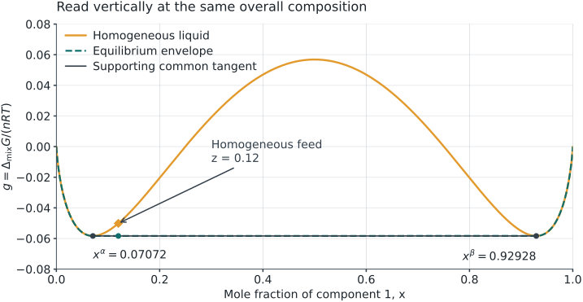

## Start with the chemical potential {#chemical-potential}

Follow the same reaction throughout the derivation.

$$\mathrm{A_2(g)\rightleftharpoons 2A(g)}$$

The chemical potential of each species depends on its activity.

$$\mu_i=\mu_i^\circ+RT\ln a_i$$

$\mu_i^\circ$ refers to the chosen standard state. The activity $a_i$ is dimensionless. For a gas, use $a_i=f_i/p^\circ$.

::: {.notes}
เริ่มที่ chemical potential ของสารแต่ละชนิด แยกส่วนมาตรฐานกับส่วนที่ขึ้นกับ activity ให้เห็นก่อน activity ของแก๊สใช้ fugacity หารด้วยความดันมาตรฐาน จึงไม่มีหน่วย
:::

## Combine the potentials along the reaction {#reaction-gibbs-energy}

At fixed temperature and pressure, a small forward reaction consumes one unit of A₂ and forms two units of A.

$$\mathrm dn_{\mathrm A}=2\,\mathrm d\xi,\qquad \mathrm dn_{\mathrm{A_2}}=-\mathrm d\xi$$

Substitute these amounts into $\mathrm dG=\sum_i\mu_i\,\mathrm dn_i$.

$$\mathrm dG=(2\mu_{\mathrm A}-\mu_{\mathrm{A_2}})\,\mathrm d\xi$$

The reaction Gibbs energy is the slope along the reaction extent $\xi$.

$$\Delta_rG=\left(\frac{\partial G}{\partial\xi}\right)_{T,P}=2\mu_{\mathrm A}-\mu_{\mathrm{A_2}}$$

::: {.notes}
เลขสองและเครื่องหมายลบมาจากสมการปฏิกิริยา อธิบายว่า delta-r-G เป็นความชันของ G ต่อความก้าวหน้าปฏิกิริยา ณ องค์ประกอบขณะนั้น
:::

## The activity ratio is Q {#reaction-quotient}

Insert $\mu_i=\mu_i^\circ+RT\ln a_i$ into the reaction Gibbs energy.

$$\Delta_rG=(2\mu_{\mathrm A}^\circ-\mu_{\mathrm{A_2}}^\circ)+RT(2\ln a_{\mathrm A}-\ln a_{\mathrm{A_2}})$$

Define $\Delta_rG^\circ=2\mu_{\mathrm A}^\circ-\mu_{\mathrm{A_2}}^\circ$ and combine the logarithms.

$$\Delta_rG=\Delta_rG^\circ+RT\ln\left(\frac{a_{\mathrm A}^2}{a_{\mathrm{A_2}}}\right)$$

The ratio calculated from the mixture's **current activities** is the reaction quotient.

$$Q=\frac{a_{\mathrm A}^2}{a_{\mathrm{A_2}}},\qquad \Delta_rG=\Delta_rG^\circ+RT\ln Q$$

::: {.notes}
ชี้การรวม logarithm ให้เห็นว่า activity ของผลิตภัณฑ์อยู่ข้างบน ของสารตั้งต้นอยู่ข้างล่าง และยกกำลังตามสัมประสิทธิ์ Q ใช้สภาวะขณะนี้ จะอยู่ที่สมดุลหรือยังดำเนินปฏิกิริยาก็ได้
:::

## At equilibrium, Q equals K {#equilibrium-constant}

At reaction equilibrium, $\Delta_rG=0$. Call the equilibrium value of the activity ratio $K$.

$$0=\Delta_rG^\circ+RT\ln K,\qquad K=\exp\left(-\frac{\Delta_rG^\circ}{RT}\right)$$

For the written reaction and chosen standard states, the temperature determines $K$. Combine this relation with the expression for the current mixture.

$$\boxed{\Delta_rG=RT\ln\left(\frac{Q}{K}\right)}$$

Compare $Q$ with $K$ to predict the reaction direction. Which sign does $\Delta_rG$ have when $Q<K$?

::: {.notes}
ตอนนี้จึงใช้เงื่อนไขสมดุล delta-r-G เท่ากับศูนย์ เรียกค่าอัตราส่วนที่สมดุลว่า K จากนั้นแทนกลับเพื่อได้ RT ln Q/K ให้นิสิตบอกว่า Q น้อยกว่า K ทำให้ logarithm ติดลบ จึงเดินหน้า
:::

## Q and K for the same reaction {#q-and-k}

For $\mathrm{A_2(g)\rightleftharpoons 2A(g)}$, use the dimensionless activity ratio $a_{\mathrm A}^2/a_{\mathrm{A_2}}$.

**Reaction quotient, $Q$.** Calculate the ratio using the activities in the mixture *now*.

**Equilibrium constant, $K$.** At equilibrium the ratio equals $K$. Its value is fixed at a given temperature for the written reaction and chosen standard states.

| If $Q<K$ | If $Q=K$ | If $Q>K$ |
|---|---|---|
| The forward reaction forms A. | The reaction is at equilibrium. | The reverse reaction forms A₂. |

::: {.notes}
ชี้ที่อัตราส่วนเดียวกัน ถ้าใส่ activity ตอนนี้จะได้ Q ถ้าใส่ค่าที่สมดุลจะได้ K จากนั้นให้ลองบอกทิศปฏิกิริยาเมื่อ Q ต่ำกว่า K ก่อนเริ่มโจทย์อัดแก๊ส
:::

## Does doubling the pressure always double Q? {#week5-questions}

**A question from Week 5.** How does the pressure argument change for a real gas?

Start with the ideal-gas reaction $\mathrm{A_2(g)\rightleftharpoons 2A(g)}$. At 350 K, $K=3.953$ for $p^\circ=100$ kPa. Compress the mixture from 100 to 200 kPa at fixed temperature. Consider the instant before the composition responds.

| Starting value | Predict $Q$ immediately after compression | Which way will the reaction move? |
|---|---|---|
| $Q=K=3.953$ | Calculate on paper | Toward A or A₂? |
| $Q=1.000$ | Calculate on paper | Toward A or A₂? |

Take one minute. Compare your two answers with a neighbor.

## Compare the new quotient with K {#pressure-check}

At fixed mole fractions, the ideal-gas quotient for this reaction is proportional to pressure.

$$Q=\frac{y_{\mathrm A}^2}{y_{\mathrm{A_2}}}\frac{P}{p^\circ}$$

| Before compression | Immediately after | Response at 350 K |
|---|---|---|
| $Q=3.953$ | $Q=7.906>K$ | More A₂ forms. |
| $Q=1.000$ | $Q=2.000<K$ | More A forms. |

As the reaction proceeds, the mole fractions change. At the new equilibrium, $Q=K=3.953$ in both cases.

::: {.notes}
Thai spoken recap: ความดันเพิ่มทำให้ Q ของปฏิกิริยานี้เพิ่มทันทีเมื่อองค์ประกอบยังคงเดิม ทิศทางขึ้นกับว่า Q ใหม่สูงหรือต่ำกว่า K.
:::

## Does gas non-ideality change K? {#nonideality-and-k}

At the same temperature, for the same written reaction and standard states, **the thermodynamic $K$ stays the same**.

$$K=\exp\left(-\frac{\Delta_rG^\circ}{RT}\right)$$

Fugacity coefficients enter the current mixture's activity ratio. For $\mathrm{A_2(g)\rightleftharpoons 2A(g)}$,

$$Q=\frac{\phi_{\mathrm A}^2}{\phi_{\mathrm{A_2}}}\frac{y_{\mathrm A}^2}{y_{\mathrm{A_2}}}\frac{P}{p^\circ}$$

At equilibrium, this **full ratio** equals $K$. Non-ideality changes the equilibrium composition needed to satisfy that condition. We will now calculate the fugacities that enter it.

::: {.notes}
ตอบประเด็น K ก่อน ที่ T สมการปฏิกิริยาและสถานะมาตรฐานเดิม ค่า K เท่าเดิม เพราะนิยามจาก delta-r-G มาตรฐาน fugacity coefficient อยู่ในอัตราส่วน activity จึงเปลี่ยนองค์ประกอบที่ทำให้ Q เท่ากับ K ถ้าใช้ความดันย่อยอย่างเดียวจะได้เพียงอัตราส่วนที่ยังไม่รวมผลของ phi
:::

## Fugacity expresses the chemical potential {#what-is-fugacity}

For an ideal gas mixture, the partial pressure $y_iP$ enters the chemical potential.

$$\mu_i^{\rm ideal}=\mu_i^\circ+RT\ln\left(\frac{y_iP}{p^\circ}\right)$$

For a real gas, define the **component fugacity**, $f_i$, through the same logarithmic form and standard state.

$$\mu_i=\mu_i^\circ+RT\ln\left(\frac{f_i}{p^\circ}\right)$$

Fugacity has pressure units. The activity $a_i=f_i/p^\circ$ is dimensionless. In the ideal-gas limit, $f_i=y_iP$.

[Definition reference · IUPAC](https://publications.iupac.org/pac/1994/pdf/6603x0533.pdf)

::: {.notes}
fugacity เป็นปริมาณที่มีหน่วยความดันและใช้แทน chemical potential ของแก๊สจริงในรูป logarithm เดียวกับแก๊สอุดมคติ ชี้ว่า activity คือ f หารความดันมาตรฐานจึงไม่มีหน่วย
:::

## Compare fugacity with partial pressure {#fugacity-coefficient}

The **fugacity coefficient**, $\phi_i$, is the ratio of component fugacity to its partial pressure.

$$\phi_i=\frac{f_i}{y_iP},\qquad f_i=\phi_i y_iP$$

Subtract the ideal-mixture chemical potential at the **same $T,P,\mathbf y$**.

$$\mu_i-\mu_i^{\rm ideal}=RT\ln\phi_i$$

At $\phi_i=1$, $f_i=y_iP$ and the chemical potential matches the ideal-mixture value. A value below one gives a negative departure in chemical potential; a value above one gives a positive departure.

Each component has its own $\phi_i(T,P,\mathbf y)$.

::: {.notes}
สัมประสิทธิ์ phi ไม่มีหน่วย เป็นอัตราส่วน f ต่อความดันย่อยและบอกการเบี่ยงเบนของ chemical potential จากแก๊สผสมอุดมคติที่ T P และองค์ประกอบเดียวกัน ค่า phi ของแต่ละชนิดเปลี่ยนตามสภาวะได้
:::

## Calculate phi from an equation of state {#phi-from-eos}

An EOS supplies the partial-molar properties used to calculate $RT\ln\phi_i$. Choose the EOS and its parameters for the stated $T,P,\mathbf y$.

For the **low-density, pressure-form second-virial EOS**, used in Lab 09,

$$Z=\frac{PV}{nRT}=1+\frac{B_{\rm mix}P}{RT},\qquad B_{\rm mix}=\sum_i\sum_j y_i y_j B_{ij}$$

The component fugacity coefficients follow from this mixture EOS.

$$\ln\phi_i=\left(2\sum_j y_jB_{ij}-B_{\rm mix}\right)\frac{P}{RT}$$

The coefficients $B_{ij}(T)$ come from gas-property data or a correlation. The cross coefficient describes unlike pairs. Use consistent units and check the EOS validity range.

::: {.notes}
เริ่มจากเลือก EOS และข้อมูลพารามิเตอร์ที่อุณหภูมินั้น สำหรับ virial ต้องมีทั้ง B ของคู่ชนิดเดียวกันและคู่ต่างชนิด สมการของสารผสมให้ phi ของแต่ละชนิดผ่านสมบัติ partial molar ถ้ามีคำถามที่มาเชิงคณิตศาสตร์ ใช้ d mu_i ต่อ d P ที่ T และองค์ประกอบคงที่เท่ากับ partial molar volume แล้ว integrate ผลต่างจากแก๊สอุดมคติจากความดันศูนย์ถึง P อย่าใช้ Z ของสารผสมแทน phi_i
:::

## Work out both coefficients from the EOS {#virial-phi-check}

Use synthetic inputs at 350 K and 200 kPa. Let component 1 be A and component 2 be A₂, with $y_1=0.80$, $y_2=0.20$.

Take $B_{11}=-1.00$, $B_{12}=B_{21}=-0.600$, $B_{22}=-0.200$ L mol$^{-1}$ and $R=8.31446$ L kPa mol$^{-1}$ K$^{-1}$.

$$B_{\rm mix}=0.80^2(-1.00)+2(0.80)(0.20)(-0.600)+0.20^2(-0.200)=-0.840\ {\rm L\,mol^{-1}}$$

| Component | $\sum_j y_jB_{ij}$ (L mol$^{-1}$) | $\ln\phi_i$ | $\phi_i=\exp(\ln\phi_i)$ |
|---|---:|---:|---:|
| A | $-0.920$ | $(-1.000)(200)/(8.31446\times350)=-0.068727$ | 0.93358 |
| A₂ | $-0.520$ | $(-0.200)(200)/(8.31446\times350)=-0.013745$ | 0.98635 |

Carry these coefficients into the activity calculation. Keep unrounded values until the final result.

::: {.notes}
คำนวณ Bmix ก่อน แล้วให้เห็นผลรวม y_j B_ij ของแต่ละแถว A ให้ -0.920 และ A2 ให้ -0.520 เมื่อนำมาคูณสองแล้วลบ Bmix จะได้ -1.000 และ -0.200 ตามลำดับ จากนั้นคูณ P ต่อ RT เพื่อได้ ln phi และกด exp จึงได้ phi ค่าทั้งหมดเป็นข้อมูลสังเคราะห์สำหรับฝึก
:::

## A real gas uses fugacity in each activity {#real-gas}

At a specified $T,P,\mathbf y$, a mixture equation of state gives each component's fugacity coefficient $\phi_i$. With an ideal-gas standard state,

$$a_i=\frac{f_i}{p^\circ}=\frac{\phi_i y_iP}{p^\circ},\qquad Q=\frac{a_{\mathrm A}^2}{a_{\mathrm{A_2}}}.$$

For this dissociation, the multiplier on the ideal-gas estimate is $\phi_{\mathrm A}^2/\phi_{\mathrm{A_2}}$. The coefficients can change during compression and as the reaction proceeds. The same $T$, written reaction and standard states give the same $K$.

**Try it.** Continue with the same EOS calculation at 350 K and 200 kPa, with $y_{\mathrm A}=0.80$, $y_{\mathrm{A_2}}=0.20$. Use the calculated coefficients $\phi_{\mathrm A}=0.93358$ and $\phi_{\mathrm{A_2}}=0.98635$, with $p^\circ=100$ kPa. Calculate both fugacities, both activities and the reaction direction.

## Work the real-gas example on paper {#real-gas-check}

The pressure ratio is $200/100=2$. At the specified composition,

| Quantity | Calculation | Value |
|---|---|---:|
| $f_{\mathrm A}$ | $\phi_{\mathrm A}(0.80)(200)$ | 149.373 kPa |
| $f_{\mathrm{A_2}}$ | $\phi_{\mathrm{A_2}}(0.20)(200)$ | 39.454 kPa |
| $a_{\mathrm A}$ | $f_{\mathrm A}/(100\ {\rm kPa})$ | 1.49373 |
| $a_{\mathrm{A_2}}$ | $f_{\mathrm{A_2}}/(100\ {\rm kPa})$ | 0.394539 |
| $Q$ | $a_{\mathrm A}^2/a_{\mathrm{A_2}}$ | 5.6553 |

The ideal-gas estimate at this same state is $6.40$. Both exceed $K=3.953$, so A₂ forms. To find the final extent for the real gas, update the composition and both fugacity coefficients until $Q=K$. Lab 12 solves the ideal-gas case.

::: {.notes}
Thai spoken recap: ใช้ค่า phi ที่คำนวณจาก EOS หาค่า fugacity แล้วหารความดันมาตรฐานเพื่อได้ activity จากนั้นคำนวณ Q และเทียบกับ K ที่อุณหภูมิเดียวกัน ตัวอย่างนี้ให้ Q ประมาณ 5.66 จึงเกิด A₂ เพิ่มขึ้น.
:::

## The 180-minute class {#the-180-minute-class}

| Class time | Activity |
|---|---|
| 0–20 min | Derive Q and K, then calculate fugacity and check the pressure question |
| 20–40 min | Revisit Weeks 2–5 in pairs with paper and a calculator |
| 40–65 min | Balance a cell reaction and calculate its potential by hand |
| 65–75 min | Demonstrate the concentration cell in Lab 13 |
| 75–85 min | Break |
| 85–155 min | Pair investigation and independent check |
| 155–180 min | Discuss results (15), exit ticket (5), feedback (3), closing (2) |

## Week 2 · What did the VLE measurement tell us? {#review-week-2}

A VLE measurement gives $P=100$ kPa, $x_1=0.40$, $y_1=0.60$. Assume an ideal vapor, negligible Poynting correction and a pure-liquid reference state.

$$y_1P=x_1\gamma_1 P_1^{\rm sat},\qquad a_1=x_1\gamma_1.$$

1. Use $P_1^{\rm sat}=120$ kPa. Find $\gamma_1$ and $a_1$.
2. A second source gives 150 kPa at the same temperature. Predict which way your inferred $\gamma_1$ moves.
3. Before fitting the data, which Antoine conventions would you check?

::: {.notes}
Allow three minutes for pairs. Check 1.25 and 0.50, then 1.00 and 0.40. Ask about the log base, temperature unit, pressure unit and correlation range. Thai spoken recap: ข้อมูลทดลองชุดเดิมให้ค่า activity coefficient ต่างกันได้ ถ้าใช้ความดันไออิ่มตัวต่างกัน ต้องตรวจหน่วยและช่วงอุณหภูมิของสมการ Antoine.
:::

## Week 3 · Would this feed split into two liquids? {#review-week-3}

:::: {.columns}
::: {.column width="53%"}
{width="100%" fig-alt="At feed z=0.12 the supporting common tangent lies below the homogeneous liquid Gibbs curve."}
:::
::: {.column width="45%"}
At $z_1=0.12$, compare the curve and the supporting line at the **same overall composition**. Which state has lower Gibbs energy?

The homogeneous curve has positive local curvature here. What does the tangent tell you that curvature alone cannot?

A Gibbs–Duhem area test examines the VLE data. How could errors of opposite sign affect its signed integral?
:::
::::

::: {.notes}
The split lies below the homogeneous point, despite the positive local curvature. At the same T and P the split meets the same material balance. Local residuals of opposite sign can cancel in an area integral. Thai spoken recap: การตรวจความสอดคล้องของข้อมูลกับการตรวจว่าเฟสเสถียรตอบคนละคำถาม ที่องค์ประกอบรวมเดียวกันให้เลือกสถานะที่พลังงานกิบส์ต่ำกว่า.
:::

## Week 4 · Can the vessel supply that much gas? {#review-week-4}

At 300 K, a 1.00 L vessel contains 0.00200 mol of volatile A. Its equilibrium sublimation pressure is 10.0 kPa. Use $R=8.314$ kPa L mol$^{-1}$ K$^{-1}$ and assume an ideal gas.

1. Calculate the gas inventory required for $P_A=10.0$ kPa. Will any bulk solid remain?
2. Calculate the actual $P_A$. What happens to $P_A$ if you add an inert gas at fixed $T,V$?
3. In a separate adsorption vessel, an adsorbent of mass $m_s$ holds $q(P_A,T)$ mol per kg. Which term must you add to the gas inventory to close the balance?

::: {.notes}
Hold the free gas volume fixed and assume the inert does not adsorb. Thai spoken recap: ต้องมีสารมากพอจึงจะเหลือของแข็งและได้ความดันระเหิด ถ้ามีตัวดูดซับให้รวมจำนวนโมลบนผิวในสมดุลมวลด้วย.
:::

## Week 5 · Change pressure, then change temperature {#review-week-5}

Lab 12 used 1 mol of A₂ initially, zero A, no inert, and $p^\circ=100$ kPa. Use the same ideal-gas reaction in all three cases.

| Case | $T$ (K) | $P$ (kPa) | $K$ | Equilibrium extent (mol) |
|---|---:|---:|---:|---:|
| 12A | 350 | 100 | 3.953 | 0.7050 |
| 12B | 350 | 400 | 3.953 | 0.4451 |
| 12C | 400 | 100 | 33.861 | 0.9457 |

Which pair isolates pressure? Which isolates temperature? For 12C assume a constant positive reaction enthalpy of 50 kJ mol$^{-1}$. Explain the change in $K$.

With a partner, use the extent in 12B to check $2n_{\mathrm{A_2}}+n_{\mathrm A}$ against the feed.

## Check your four predictions {#recap-check}

| Week | Compare with your calculation or prediction |
|---|---|
| 2 · VLE | With $P_1^{\rm sat}=120$ kPa, $\gamma_1=1.25$ and $a_1=0.50$. With $P_1^{\rm sat}=150$ kPa they become 1.00 and 0.40. Check Antoine units, log base and temperature range. |
| 3 · Stability | At $z_1=0.12$ the two-liquid line lies lower. Positive local curvature describes small fluctuations. Opposite errors can cancel in the signed area test. |
| 4 · Inventory | Saturation requires 0.00401 mol. All 0.00200 mol enters the gas, giving $P_A=4.99$ kPa. Adding ideal inert at fixed $T,V$ raises total pressure while $P_A$ stays at 4.99 kPa. For adsorption add $m_s q$ mol. |
| 5 · Reaction | 12A–12B isolate pressure. 12A–12C isolate temperature. Heating raises $K$ for this endothermic reaction. In 12B, $2(0.5549)+0.8902=2.0000$ mol of A atoms. |

::: {.notes}
Ask one pair per row and collect one remaining question before moving on. Thai spoken recap: ในทุกกรณี เริ่มจากกำหนดสถานะอ้างอิงและเงื่อนไขที่ตรึงไว้ แล้วตรวจสมการสมดุลควบคู่กับสมดุลมวล.
:::

## The question for today {#the-question-for-today}

What determines the sign of a concentration-cell potential?

Week 5 gave us $\Delta_rG=RT\ln(Q/K)$. A reversible cell turns that reaction driving force into a potential difference, $E=-\Delta_rG/(nF)$.

**Predict on paper.** For the reaction as written, what sign should $E$ have when $Q<K$? What voltage would you measure at complete cell equilibrium, $Q=K$?

[Pre-class reading and preparation questions](files/preclass-week-06.pdf)

## Two reduction half-reactions

Enter both half-reactions as reductions. Reverse the left reaction and add the right after matching electron counts.

$$E_{cell}^\circ=E_{right}^\circ-E_{left}^\circ$$

Both potentials need the same reference electrode and temperature. Multiplying a half-reaction does not multiply its potential.

## Nernst equation from reaction thermodynamics

Combine ΔrG=ΔrG°+RTlnQ with ΔrG=−nFE:
$$E=E^\circ-\frac{RT}{nF}\ln Q$$

At 298.15 K,
$$E=E^\circ-\frac{0.05915935\ \mathrm V}{n}\log_{10}Q$$

Changing T requires valid E° data at the new T.

## A concentration-cell calculation

Use the same $\mathrm{M^{2+}/M}$ couple on both sides at 298.15 K. For oxidation on the left and reduction on the right, $Q=a_{\mathrm L}/a_{\mathrm R}$. Take $a_{\mathrm L}=0.01$, $a_{\mathrm R}=1$, $n=2$, and neglect the junction potential.
$$Q=0.01,\qquad E=+0.05915935\ \mathrm V$$

E°=0, K=1, but E is nonzero. Reversing the concentrations changes the sign of E. Equal activities give E=0.

ΔrG≈−11.416 kJ per mol of the written reaction.

## An independent check

Use dimensionless activities. Concentration is an approximation with a stated standard concentration and activity coefficient.

Use Eright−Eleft and deltaG=−nFE with the balanced electron count. Equal activities must give zero potential for the same reduction couple.

## One demonstration · 10 minutes {#one-demonstration-20-minutes}

[Open the core lab](labs/electrochemistry.html#ec-experiment)

Open the concentration-cell preset on the projector. On paper, make three rows for the original, exchanged and equal activities. If your device is offline, use the projected inputs and complete the same hand check. Predict the sign, exchange left and right activities, then set them equal. Keep T and reference conventions fixed.

Keep one saved baseline for the pair investigation.

## Pair investigation · 70 minutes

- 10 min: predict and record the baseline.
- 25 min: change one input and calculate.
- 20 min: exchange roles and check the result by hand.
- 15 min: prepare one plot or table and a short explanation.

In Lab 13, compare a concentration cell with the activities exchanged. Predict and explain the sign of E, then independently check deltaG=−nFE.

## Discussion · 15 minutes {#discussion-20-minutes}

What determines the sign of a concentration-cell potential?

Compare results and discuss unexpected behavior. Use one numerical check to support your explanation.

## After class · 30–40 minutes

In Lab 13, compare a concentration cell with the activities exchanged. Predict and explain the sign of E, then independently check deltaG=−nFE.

[Assessment 6 and independent checkpoint](labs/assessments.html#session-6)

Retain one study JSON, one comparison and a short explanation.

Optional: [Session appendix](postmidterm-06-appendix.html).

[Learning path](labs/learning-path.html#session-6) · [Offline package](https://github.com/soorathep/Test/releases/download/course-downloads-20261107/thermodynamics-offline.zip)

## Exit ticket + feedback · 8 minutes

:::: {.columns}
::: {.column width="60%"}

**5 min · Explain and check**

Answer the session question in the form. Give one result or independent check from today's lab, with units.

**3 min · Help improve the next class**

Rate the pace, report lab access, and suggest one improvement.

Thai or English. No name, ID or email requested.

Wait for **“Response received.”** We will use the final 2 minutes to close the class.

:::
::: {.column width="36%"}

[{width="100%"}](https://thermo-2105603-exit-ticket.soorathep-k.chatgpt.site/?session=6)

[Open Session 6 form](https://thermo-2105603-exit-ticket.soorathep-k.chatgpt.site/?session=6)

:::
::::
