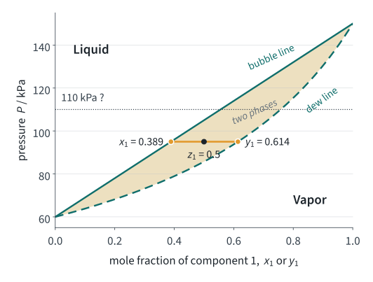

## The 180-minute route {#route}

::: {.route}
::: {.seg .concept style="flex:30"}
[0–30]{.t} **Essential concepts** [Pxy diagram, bubble and dew, flash]{.d}
:::
::: {.seg .act style="flex:10"}
[30–40]{.t} **Activity 1** [predict]{.d}
:::
::: {.seg .demo style="flex:20"}
[40–60]{.t} **Demo** [Lab 01]{.d}
:::
::: {.seg .break style="flex:10"}
[60–70]{.t} **Break**
:::
::: {.seg .act style="flex:70"}
[70–140]{.t} **Activity 2 · pair investigation** [Lab 01: one change, one hand check]{.d}
:::
::: {.seg .wrap style="flex:40"}
[140–180]{.t} **Discussion and exit ticket** [answer the session question]{.d}
:::
:::

::: {.route-question}
[Session question]{.label} How does pressure change the phase split at fixed temperature?
:::

::: {.beforeafter}
::: {}
[Before class · 15–20 min]{.label}
Read the 3-page note and answer its three preparation questions.
:::
::: {}
[After class · 30–40 min]{.label}
Finish the Lab 01 comparison and submit the downloaded study file with your name and ID.
:::
:::

::: {.selfstudy}
**Studying on your own?** Follow the same order. Turn on narration or captions at the top right, and pause at each activity slide.
:::

## One diagram answers three questions {#concept}

:::: {.columns}
::: {.column width="58%"}
{.fig-pxy fig-alt="Pressure-composition diagram of an ideal binary at 350 K with the tie line at 95 kPa"}
:::
::: {.column width="42%" .concept-notes}
[Which phases?]{.q} Compare P with the two lines.

$$P_{\text{bubble}}=\sum_i x_iP_i^{\text{sat}} \qquad \frac{1}{P_{\text{dew}}}=\sum_i\frac{y_i}{P_i^{\text{sat}}}$$

[What compositions?]{.q} Read the ends of the tie line: $y_i=K_ix_i$.

[How much of each?]{.q} The feed position on the tie line:

$$\beta=\frac{z_1-x_1}{y_1-x_1}=0.494$$

[Lab 01 synthetic binary · 350 K · P₁ˢᵃᵗ = 150 kPa, P₂ˢᵃᵗ = 60 kPa · z₁ = 0.5]{.source}
:::
::::

## Predict before you calculate {#activity-1 .activity}

[Activity 1 · 10 minutes · alone, then with a partner]{.act-label}

::: {.prompt}
Same temperature, same feed. The pressure rises from 95 to **110 kPa**.
:::

::: {.choices}
[Liquid]{} [Two phases]{} [Vapor]{}
:::

Write your choice and **one reason taken from the diagram**. Then compare with your partner. Do not calculate yet.

::: {.selfstudy}
**On your own:** pause here, write your answer, then go to the next slide.
:::

## Demonstration · Lab 01 {#demo-lab}

:::: {.columns}
::: {.column width="44%"}
1. Load the **synthetic** case.
2. Set P = 95 kPa and z₁ = 0.5, then press **Calculate**.
3. Check the tie line against the diagram.
4. Save it as your baseline, change **only P**, and test your prediction.

[Open Lab 01 →](../preview-2027/vle.html){.lab-button target="_blank"}
:::
::: {.column width="54%"}
{.lab-shot fig-alt="Lab 01 phase diagram at 95 kPa with the tie line from x1 0.389 to y1 0.614"}

::: {.expect}
[Lab 01 should report]{.label}
x₁ = 0.3889 · y₁ = 0.6140 · β = 0.4935 · bubble P = 105.0 kPa · dew P = 85.71 kPa
:::
:::
::::
