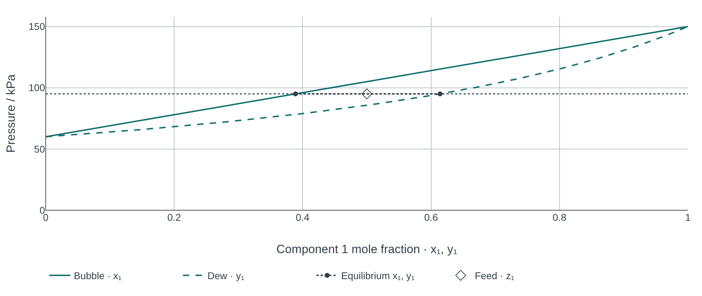

## Where this session sits {#course-map}

::: {.coursemap}
::: {.half .done}
[Before the midterm]{.label}
[Equations of state]{.cm} [Fugacity and chemical potential]{.cm} [Solution thermodynamics]{.cm}
:::
::: {.half}
[After the midterm · 7 sessions]{.label}
[1 · VLE and flash]{.cm .now} [2 · Experimental VLE and consistency]{.cm} [3 · Liquid stability and LLE]{.cm} [4 · Solids and adsorption]{.cm} [5 · Chemical equilibrium]{.cm} [6 · Electrochemical equilibrium]{.cm} [7 · Choosing a model from evidence]{.cm}
:::
:::

::: {.bridge}
The first half gave you the **condition** for phase equilibrium. From today we **use** it: given T, P and a feed, which phases form, with what compositions and in what amounts?
:::

## Why this matters: a flash drum {#why}

:::: {.columns}
::: {.column width="56%"}
```{=html}
<svg class="flash-sketch" viewBox="0 0 640 370" role="img" aria-label="A hot liquid feed passes a valve into a flash drum; vapor leaves at the top and liquid at the bottom">
  <defs><marker id="ah" viewBox="0 0 10 10" refX="9" refY="5" markerWidth="7" markerHeight="7" orient="auto"><path d="M0,0 L10,5 L0,10 z" fill="#333F4A"/></marker></defs>
  <line x1="20" y1="190" x2="232" y2="190" stroke="#333F4A" stroke-width="3" marker-end="url(#ah)"/>
  <path d="M110,176 L110,204 L140,190 Z M170,176 L170,204 L140,190 Z" fill="#fff" stroke="#333F4A" stroke-width="2.5"/>
  <rect x="236" y="70" width="110" height="240" rx="50" fill="#fff" stroke="#333F4A" stroke-width="3"/>
  <path d="M239,215 L343,215 L343,262 Q291,316 239,262 Z" fill="#0F6E6B" opacity=".22"/>
  <line x1="291" y1="70" x2="291" y2="40" stroke="#333F4A" stroke-width="3"/>
  <line x1="290" y1="40" x2="430" y2="40" stroke="#333F4A" stroke-width="3" marker-end="url(#ah)"/>
  <line x1="291" y1="310" x2="291" y2="335" stroke="#333F4A" stroke-width="3"/>
  <line x1="290" y1="335" x2="430" y2="335" stroke="#333F4A" stroke-width="3" marker-end="url(#ah)"/>
  <text x="20" y="146" class="s">Feed · 350 K</text><text x="20" y="172" class="s">z = 0.40 benzene</text>
  <text x="140" y="232" class="s c">valve</text>
  <text x="291" y="148" class="s c">50 kPa</text>
  <text x="440" y="34" class="s">Vapor</text><text x="440" y="58" class="a">how much? y = ?</text>
  <text x="440" y="329" class="s">Liquid</text><text x="440" y="353" class="a">x = ?</text>
</svg>
```
:::
::: {.column width="42%" .why-notes}
A hot benzene + toluene liquid is let down to 50 kPa. Part of it boils.

To size the drum and the equipment after it, you need **how much vapor** forms and **what each stream contains**.

By the end of today you can answer this by hand and check it in Lab 01.

[Answer in Lab 01, real-data case (NIST Antoine, ideal liquid): β = 0.593, y = 0.491, x = 0.268.]{.source}
:::
::::

## What you already know {#recap}

::: {.chain}
::: {.link}
[From the first half]{.label}
At equilibrium each component has the same fugacity in every phase.

$$\hat f_i^{\,V}=\hat f_i^{\,L}$$
:::
::: {.link}
[At low pressure]{.label}
Ideal vapor and the pure-liquid standard state give

$$y_iP=x_i\gamma_iP_i^{\text{sat}}$$
:::
::: {.link .today}
[Today: ideal liquid]{.label}
Set γ<sub>i</sub> = 1. This is Raoult's law, the simplest case to learn the method on.

$$y_iP=x_iP_i^{\text{sat}}$$
:::
:::

Sessions 2 and 3 bring back γ ≠ 1 from measured data.

## By the end of today you can {#outcomes}

[Where you show it]{.where-head}

1. **Read** a Pxy diagram and say whether a feed is liquid, vapor or two phases. [Activity 1]{.where}
2. **Calculate** bubble and dew pressures of an ideal mixture. [Concepts, Lab 01 demo]{.where}
3. **Solve** a TP flash for x, y and the vapor fraction β, and check it with a component balance. [Activity 2]{.where}
4. **Explain** how raising P at fixed T changes the split, using numbers. [Exit ticket]{.where}

## The 180-minute route {#route}

::: {.route}
::: {.seg .concept style="flex:30"}
[0–30]{.t} **Essential concepts** [Pxy diagram, bubble and dew, flash]{.d}
:::
::: {.seg .act style="flex:10"}
[30–40]{.t} **Activity 1** [predict]{.d}
:::
::: {.seg .demo style="flex:20"}
[40–60]{.t} **Demo** [Lab 01]{.d}
:::
::: {.seg .break style="flex:10"}
[60–70]{.t} **Break**
:::
::: {.seg .act style="flex:70"}
[70–140]{.t} **Activity 2 · pair investigation** [Lab 01: one change, one hand check]{.d}
:::
::: {.seg .wrap style="flex:40"}
[140–180]{.t} **Discussion and exit ticket** [answer the session question]{.d}
:::
:::

::: {.route-question}
[Session question]{.label} How does pressure change the phase split at fixed temperature?
:::

::: {.beforeafter}
::: {}
[Before class · 15–20 min]{.label}
Read the 3-page note and answer its three preparation questions.
:::
::: {}
[After class · 30–40 min]{.label}
Finish the Lab 01 comparison and submit the downloaded study file with your name and ID.
:::
:::

::: {.selfstudy}
**Studying on your own?** Follow the same order. Turn on narration or captions at the top right, and pause at each activity slide.
:::

## One diagram answers three questions {#concept}

:::: {.columns}
::: {.column width="58%"}
{.fig-pxy fig-alt="Pressure-composition diagram of an ideal binary at 350 K with the tie line at 95 kPa"}
:::
::: {.column width="42%" .concept-notes}
[Which phases?]{.q} Compare P with the two lines.

$$P_{\text{bubble}}=\sum_i x_iP_i^{\text{sat}} \qquad \frac{1}{P_{\text{dew}}}=\sum_i\frac{y_i}{P_i^{\text{sat}}}$$

[What compositions?]{.q} Read the ends of the tie line: $y_i=K_ix_i$.

[How much of each?]{.q} The feed position on the tie line:

$$\beta=\frac{z_1-x_1}{y_1-x_1}=0.494$$

[Lab 01 synthetic binary · 350 K · P₁ˢᵃᵗ = 150 kPa, P₂ˢᵃᵗ = 60 kPa · z₁ = 0.5]{.source}
:::
::::

## Predict before you calculate {#activity-1 .activity}

[Activity 1 · 10 minutes · alone, then with a partner]{.act-label}

::: {.prompt}
Same temperature, same feed. The pressure rises from 95 to **110 kPa**.
:::

::: {.choices}
[Liquid]{} [Two phases]{} [Vapor]{}
:::

Write your choice and **one reason taken from the diagram**. Then compare with your partner. Do not calculate yet.

::: {.selfstudy}
**On your own:** pause here, write your answer, then go to the next slide.
:::

## Demonstration · Lab 01 {#demo-lab}

:::: {.columns}
::: {.column width="44%"}
1. Load the **synthetic** case.
2. Set P = 95 kPa and z₁ = 0.5, then press **Calculate**.
3. Check the tie line against the diagram.
4. Save it as your baseline, change **only P**, and test your prediction.

[Open Lab 01 →](../preview-2027/vle.html){.lab-button target="_blank"}
:::
::: {.column width="54%"}
{.lab-shot fig-alt="Lab 01 phase diagram at 95 kPa with the tie line from x1 0.389 to y1 0.614"}

::: {.expect}
[Lab 01 should report]{.label}
x₁ = 0.3889 · y₁ = 0.6140 · β = 0.4935 · bubble P = 105.0 kPa · dew P = 85.71 kPa
:::
:::
::::
