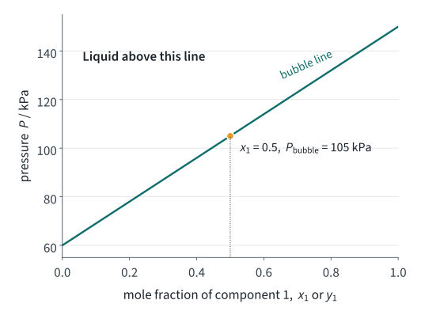
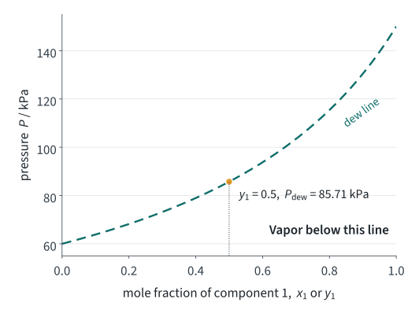
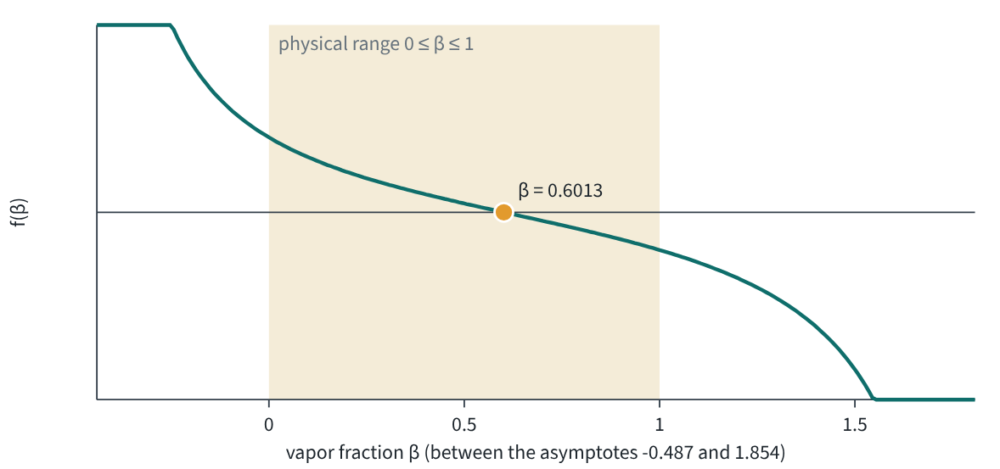
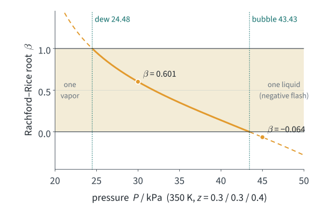

## Where this session sits {#course-map}

::: {.coursemap}
::: {.half .done}
[Before the midterm]{.label}
[Equations of state]{.cm} [Fugacity and chemical potential]{.cm} [Solution thermodynamics]{.cm}
:::
::: {.half}
[After the midterm · 7 sessions]{.label}
[1 · VLE and flash]{.cm .now} [2 · Experimental VLE and consistency]{.cm} [3 · Liquid stability and LLE]{.cm} [4 · Solids and adsorption]{.cm} [5 · Chemical equilibrium]{.cm} [6 · Electrochemical equilibrium]{.cm} [7 · Choosing a model from evidence]{.cm}
:::
:::

::: {.bridge}
The first half gave you the **condition** for phase equilibrium. From today we **use** it: given T, P and a feed, which phases form, with what compositions and in what amounts?
:::

## Why this matters: a flash drum {#why}

:::: {.columns}
::: {.column width="56%"}
```{=html}
<svg class="flash-sketch" viewBox="0 0 640 370" role="img" aria-label="A hot liquid feed passes a valve into a flash drum; vapor leaves at the top and liquid at the bottom">
  <defs><marker id="ah" viewBox="0 0 10 10" refX="9" refY="5" markerWidth="7" markerHeight="7" orient="auto"><path d="M0,0 L10,5 L0,10 z" fill="#333F4A"/></marker></defs>
  <line x1="20" y1="190" x2="232" y2="190" stroke="#333F4A" stroke-width="3" marker-end="url(#ah)"/>
  <path d="M110,176 L110,204 L140,190 Z M170,176 L170,204 L140,190 Z" fill="#fff" stroke="#333F4A" stroke-width="2.5"/>
  <rect x="236" y="70" width="110" height="240" rx="50" fill="#fff" stroke="#333F4A" stroke-width="3"/>
  <path d="M239,215 L343,215 L343,262 Q291,316 239,262 Z" fill="#0F6E6B" opacity=".22"/>
  <line x1="291" y1="70" x2="291" y2="40" stroke="#333F4A" stroke-width="3"/>
  <line x1="290" y1="40" x2="430" y2="40" stroke="#333F4A" stroke-width="3" marker-end="url(#ah)"/>
  <line x1="291" y1="310" x2="291" y2="335" stroke="#333F4A" stroke-width="3"/>
  <line x1="290" y1="335" x2="430" y2="335" stroke="#333F4A" stroke-width="3" marker-end="url(#ah)"/>
  <text x="20" y="146" class="s">Feed · 350 K</text><text x="20" y="172" class="s">z = 0.40 benzene</text>
  <text x="140" y="232" class="s c">valve</text>
  <text x="291" y="148" class="s c">50 kPa</text>
  <text x="440" y="34" class="s">Vapor</text><text x="440" y="58" class="a">how much? y = ?</text>
  <text x="440" y="329" class="s">Liquid</text><text x="440" y="353" class="a">x = ?</text>
</svg>
```
:::
::: {.column width="42%" .why-notes}
A hot benzene + toluene liquid is let down to 50 kPa. Part of it boils.

To size the drum and the equipment after it, you need **how much vapor** forms and **what each stream contains**.

By the end of today you can answer this by hand and check it in Lab 01.

[Answer in Lab 01, real-data case (NIST Antoine, ideal liquid): β = 0.593, y = 0.491, x = 0.268.]{.source}
:::
::::

## From equal fugacity to working equations {#recap}

::: {.chain}
::: {.link}
[First half of the course]{.label}
At equilibrium every component has the same fugacity in every phase.

$$\hat f_i^{\,V}=\hat f_i^{\,L}$$
:::
::: {.link}
[γ–φ route]{.label}
Liquid from an activity model, vapor from an EOS.

$$y_i\hat\phi_i^{V}P=x_i\gamma_i\phi_i^{\text{sat}}P_i^{\text{sat}}\,\mathcal{P}_i$$
:::
::: {.link .today}
[φ–φ route]{.label}
Both phases from one equation of state.

$$y_i\hat\phi_i^{V}=x_i\hat\phi_i^{L}$$
:::
:::

𝒫<sub>i</sub> is the Poynting factor. Today: the general structure, then the ideal limit as the worked case. Sessions 2 and 3 bring in real γ.

## Every route gives a K-value {#routes-to-k}

:::: {.columns}
::: {.column width="52%"}
$$K_i\equiv\frac{y_i}{x_i}$$

$$K_i^{\gamma\phi}=\frac{\gamma_i\,\phi_i^{\text{sat}}P_i^{\text{sat}}\,\mathcal{P}_i}{\hat\phi_i^{V}P}\qquad K_i^{\phi\phi}=\frac{\hat\phi_i^{L}}{\hat\phi_i^{V}}$$

Ideal liquid and ideal vapor at low pressure: $K_i=P_i^{\text{sat}}/P$.
:::
::: {.column width="46%"}
::: {.lever-box}
[Which route?]{.label}

| System | Route |
|---|---|
| Polar or associating liquids, low P | γ–φ |
| Hydrocarbons, gases, high P | φ–φ |
| Near a critical point | φ–φ only |

In both, K depends on T, P **and the phase compositions**. Only the ideal limit gives K independent of x and y.
:::
:::
::::

## By the end of today you can {#outcomes}

[Where you show it]{.where-head}

1. **Choose** the γ–φ or φ–φ route for a system and write its K-values. [Concepts]{.where}
2. **Decide** the phase state from Σ z<sub>i</sub>K<sub>i</sub> and Σ z<sub>i</sub>/K<sub>i</sub>, and find a bubble T by iteration. [Activity 1, worked example]{.where}
3. **Solve** a multicomponent TP flash with Rachford–Rice and interpret a negative flash. [Activity 2, Lab 01 step D]{.where}
4. **Explain** with numbers how a nonideal liquid changes K and the phase split. [Lab 01 demo, exit ticket]{.where}

## The 180-minute route {#route}

::: {.route}
::: {.seg .concept style="flex:30"}
[0–30]{.t} **Essential concepts** [K-values, bubble T, Rachford–Rice]{.d}
:::
::: {.seg .act style="flex:10"}
[30–40]{.t} **Activity 1** [phase test]{.d}
:::
::: {.seg .demo style="flex:20"}
[40–60]{.t} **Demo** [Lab 01]{.d}
:::
::: {.seg .break style="flex:10"}
[60–70]{.t} **Break**
:::
::: {.seg .act style="flex:70"}
[70–140]{.t} **Activity 2 · pair investigation** [three-component flash, nonideal K]{.d}
:::
::: {.seg .wrap style="flex:40"}
[140–180]{.t} **Discussion and exit ticket** [answer the session question]{.d}
:::
:::

::: {.route-question}
[Session question]{.label} Given T, P and a feed, how do we find which phases form, and how much of each, when K is not constant?
:::

::: {.beforeafter}
::: {}
[Before class · 15–20 min]{.label}
Review fugacity, φ and γ from the first half. Bring one question.
:::
::: {}
[After class · 30–40 min]{.label}
Finish Lab 01 step D and the nonideal comparison. Submit the study file with your name and ID.
:::
:::

::: {.selfstudy}
**Studying on your own?** Follow the same order. Turn on narration or captions at the bottom left, and pause at each activity slide.
:::

## What is fixed in a flash? {#phase-rule}

:::: {.columns}
::: {.column width="48%"}
$$F=C-\pi+2$$

::: {.rule-table}
| | binary | C components |
|---|---:|---:|
| phases, π | 2 | 2 |
| degrees of freedom, F | **2** | **C** |
:::
:::
::: {.column width="50%" .rule-notes}
**Intensive:** for a binary, fixing T and P fixes x and y. With C components, T and P leave C − 2 compositions free.

**Duhem's theorem:** T, P and the feed z fix the whole state, amounts included. That is the TP flash.

For a binary the feed only changes β. With more components the feed also moves x and y.
:::
::::

## The bubble line: where the first bubble appears {#bubble}

:::: {.columns}
::: {.column width="56%"}
{.fig-pxy fig-alt="Bubble line of the ideal binary with the bubble pressure 105 kPa marked at x1 = 0.5"}
:::
::: {.column width="42%" .concept-notes}
Start from a liquid of composition x and lower P until the first bubble forms. Summing $y_iP=x_iP_i^{\text{sat}}$ over i, with $\sum y_i=1$:

$$P_{\text{bubble}}=\sum_i x_iP_i^{\text{sat}}$$

At $x_1=0.5$: $0.5(150)+0.5(60)=$ **105 kPa**.

For an ideal liquid the bubble line is straight.
:::
::::

## The dew line: where the first drop appears {#dew}

:::: {.columns}
::: {.column width="56%"}
{.fig-pxy fig-alt="Dew line of the ideal binary with the dew pressure 85.71 kPa marked at y1 = 0.5"}
:::
::: {.column width="42%" .concept-notes}
Start from a vapor of composition y and raise P until the first drop forms. Now $x_i=y_iP/P_i^{\text{sat}}$ and $\sum x_i=1$:

$$\frac{1}{P_{\text{dew}}}=\sum_i\frac{y_i}{P_i^{\text{sat}}}$$

At $y_1=0.5$: $1/(0.5/150+0.5/60)=$ **85.71 kPa**.

The dew line is curved, and always lies below the bubble line.
:::
::::

## Bubble T needs an iteration {#bubble-t}

:::: {.columns}
::: {.column width="50%"}
Bubble P is explicit: $P=\sum_i z_iP_i^{\text{sat}}$. Bubble T is not, because every $K_i$ depends on T:

$$g(T)=\sum_i z_iK_i(T,P)-1=0$$

Newton on g(T), starting at 350 K, for z = 0.3 / 0.3 / 0.4 benzene, toluene, p-xylene at 30 kPa:
:::
::: {.column width="48%"}
::: {.lever-box}
[Newton iterations]{.label}

| k | T / K | Σ z<sub>i</sub>K<sub>i</sub> |
|---:|---:|---:|
| 0 | 350.000 | 1.4478 |
| 1 | 340.731 | 1.0524 |
| 2 | 339.328 | 1.0011 |
| 3 | 339.298 | 1.0000 |

Bubble T = **339.30 K**; first vapor y = 0.646 / 0.235 / 0.119.
:::
:::
::::

[Antoine constants, log₁₀(P/bar) = A − B/(T/K + C), NIST WebBook, Willingham et al. (1945): benzene 4.01814, 1203.835, −53.226; toluene 4.07827, 1343.943, −53.773; p-xylene 4.11138, 1450.688, −58.160. All course constants: Session 2 note, section 6.]{.source}

## One diagram answers three questions {#concept}

:::: {.columns}
::: {.column width="58%"}
{.fig-pxy fig-alt="Pressure-composition diagram of an ideal binary at 350 K with the tie line at 95 kPa"}
:::
::: {.column width="42%" .concept-notes}
[Which phases?]{.q} Compare P with the two lines.

$$P_{\text{bubble}}=\sum_i x_iP_i^{\text{sat}} \qquad \frac{1}{P_{\text{dew}}}=\sum_i\frac{y_i}{P_i^{\text{sat}}}$$

[What compositions?]{.q} Read the ends of the tie line: $y_i=K_ix_i$.

[How much of each?]{.q} The feed position on the tie line:

$$\beta=\frac{z_1-x_1}{y_1-x_1}=0.494$$

[Lab 01 synthetic binary · 350 K · P₁ˢᵃᵗ = 150 kPa, P₂ˢᵃᵗ = 60 kPa · z₁ = 0.5]{.source}
:::
::::

## How much of each phase: the lever rule {#lever}

:::: {.columns}
::: {.column width="52%"}
Total and component balances on 1 mol of feed, with β = V/F:

$$z_1=(1-\beta)\,x_1+\beta\,y_1$$

$$\beta=\frac{z_1-x_1}{y_1-x_1}$$

The feed point divides the tie line. The closer z is to y, the more vapor forms.
:::
::: {.column width="46%"}
::: {.lever-box}
[At 95 kPa]{.label}

β = (0.5 − 0.3889) / (0.6140 − 0.3889) = **0.4935**

[Check component 2]{.label}

(1 − β)(0.6111) + β(0.3860) = 0.3095 + 0.1905 = **0.5000** ✓
:::
:::
::::

## Rachford–Rice: one equation in β {#rachford-rice}

:::: {.columns}
::: {.column width="46%"}
With $x_i=z_i/[1+\beta(K_i-1)]$ and $y_i=K_ix_i$, require $\sum(y_i-x_i)=0$:

$$f(\beta)=\sum_i\frac{z_i(K_i-1)}{1+\beta(K_i-1)}=0$$

$f'(\beta)<0$ between the asymptotes $\beta=1/(1-K_{\max})$ and $1/(1-K_{\min})$, so there is **exactly one root** there. Bracket it there, then use Newton.
:::
::: {.column width="52%"}
{.lab-shot fig-alt="Rachford-Rice function for the three-component feed at 30 kPa with the root at beta 0.6013"}

::: {.expect}
[Benzene / toluene / p-xylene · 350 K · 30 kPa]{.label}
K = 3.052 / 1.160 / 0.461 · root β = **0.6013** (Newton from 0.5: 0.5992, 0.6013)
:::
:::
::::

## Phase test before you flash {#phase-check}

:::: {.columns}
::: {.column width="50%"}
$$f(0)=\sum_i z_iK_i-1\qquad f(1)=1-\sum_i\frac{z_i}{K_i}$$

| Test | State |
|---|---|
| Σ z<sub>i</sub>K<sub>i</sub> ≤ 1 | liquid (at or below bubble point) |
| Σ z<sub>i</sub>/K<sub>i</sub> ≤ 1 | vapor (at or above dew point) |
| both &gt; 1 | two phases, 0 &lt; β &lt; 1 |
:::
::: {.column width="48%" .rule-notes}
If the test says one phase, Rachford–Rice still has a root, outside 0–1. This **negative flash** is the extrapolated tie line, not a physical amount.

With constant K the test is exact. When K depends on composition it is not: a one-phase answer must be confirmed by a **stability test** (tangent-plane distance, Session 3).
:::
::::

## When K depends on composition {#nonideal-k}

:::: {.columns}
::: {.column width="50%"}
::: {.steps-v}
1. Guess K (ideal or Wilson).
2. Solve Rachford–Rice for β, then x and y.
3. Update K from γ(x) and φ̂(y) or from the EOS.
4. Repeat until K stops changing.
:::

Successive substitution converges slowly near the critical point; then switch to Newton on all variables.
:::
::: {.column width="48%"}
::: {.lever-box}
[Lab 01 · 350 K · 95 kPa · z₁ = 0.5]{.label}

| Liquid model | Two-phase range | At 95 kPa |
|---|---|---|
| Ideal | 85.71–105.0 kPa | β = 0.494 |
| Margules A = 1 | 102.4–134.8 kPa | all vapor |

Positive deviation raises both K-values and moves the whole envelope to higher P. The ideal answer is not even the right phase.
:::
:::
::::

## Phase test without solving {#activity-1 .activity}

[Activity 1 · 10 minutes · alone, then with a partner]{.act-label}

::: {.prompt}
At 350 K and 45 kPa, the feed z = 0.3 / 0.3 / 0.4 (benzene, toluene, p-xylene) has K = 2.035 / 0.773 / 0.307.
:::

::: {.choices}
[Liquid]{} [Two phases]{} [Vapor]{}
:::

Decide with Σ z<sub>i</sub>K<sub>i</sub> and Σ z<sub>i</sub>/K<sub>i</sub> only. Then predict the sign of the Rachford–Rice root and compare with your partner.

::: {.selfstudy}
**On your own:** pause here, write your answer, then go to the next slide.
:::

## Activity 1: check your answer {#activity-1-debrief}

:::: {.columns}
::: {.column width="52%"}
Σ z<sub>i</sub>K<sub>i</sub> = 0.3(2.035) + 0.3(0.773) + 0.4(0.307) = **0.965** ≤ 1

The feed is a **subcooled liquid**: 45 kPa is above its bubble pressure, 43.43 kPa.

[Rachford–Rice root]{.label}

::: {.range}
β = −0.064 (negative flash)
:::
:::
::: {.column width="46%" .rule-notes}
Σ z<sub>i</sub>/K<sub>i</sub> = 1.838 &gt; 1, so it is not vapor either. Only the first test decides.

The negative root still means something: it is where the feed lies on the extension of the tie line. Some algorithms use it to locate the phase boundary.
:::
::::

## Demonstration · Lab 01 {#demo-lab}

:::: {.columns}
::: {.column width="44%"}
1. Synthetic case, **350 K, 95 kPa, z₁ = 0.5**, ideal liquid: β = 0.494.
2. Switch the liquid model to **Margules, A = 1**. Recalculate: all vapor.
3. Find the new bubble and dew pressures. Explain the shift.
4. Graduate view, **step D**: solve the 30 kPa three-component preset, then 45 kPa.

[Open Lab 01 →](../preview-2027/vle.html){.lab-button target="_blank"}
:::
::: {.column width="54%"}
{.lab-shot fig-alt="Lab 01 phase diagram at 95 kPa with the tie line from x1 0.389 to y1 0.614"}

::: {.expect}
[Lab 01 should report]{.label}
Ideal: x₁ = 0.3889 · y₁ = 0.6140 · β = 0.4935 · Margules A = 1: vapor only, bubble 134.8 kPa
:::
:::
::::

## Four common mistakes {#mistakes}

::: {.mistakes}
::: {}
**Treating a negative flash as an amount.** β &lt; 0 or β &gt; 1 means one phase. The value is an extrapolation.
:::
::: {}
**Newton outside the asymptotes.** Rachford–Rice has poles at 1/(1 − K<sub>max</sub>) and 1/(1 − K<sub>min</sub>). Start inside, or bracket first.
:::
::: {}
**Keeping K constant for a nonideal mixture.** K depends on x and y. One Rachford–Rice solve is one step of an iteration.
:::
::: {}
**Trusting the phase test with variable K.** A one-phase answer needs a stability test before it is accepted.
:::
:::

## Break · 10 minutes {#break .breakslide}

::: {.break-next}
[Next]{.label}
Activity 2: a pair investigation in Lab 01, 70 minutes.

Before you leave your seat, check that Lab 01 opens on your device and that your baseline at 95 kPa is saved.
:::

## Activity 2 · flash beyond the ideal binary {#activity-2 .activity}

[Activity 2 · 70 minutes · in pairs: one drives Lab 01, one checks by hand, then swap]{.act-label}

::: {.a2grid}
::: {}
[20 min · by hand]{.label}
Three components at 350 K, 30 kPa. Do two Newton steps on Rachford–Rice from β = 0.5. Get x, y and close the balance.
:::
::: {}
[15 min · step D]{.label}
Check in Lab 01 step D. Then find the dew and bubble pressures of this feed and run 45 kPa.
:::
::: {}
[20 min · nonideal]{.label}
Binary at 350 K, z₁ = 0.5: compare ideal with Margules A = 0.5 and 1 at 95 kPa. Record β and both phase boundaries.
:::
::: {}
[15 min · explain]{.label}
Two sentences with numbers answering the session question. Download the study file with your names and IDs.
:::
:::

::: {.selfstudy}
**On your own:** do both roles yourself. Pause the slides, work in Lab 01, then continue.
:::

## Activity 2 · what to hand in {#activity-2-check}

:::: {.columns}
::: {.column width="48%"}
1. Lab 01 study file with step D solved at 30 and 45 kPa and the model comparison, your name and student ID.
2. Your two Newton steps by hand.
3. Two sentences answering the session question with numbers.

[Graduate extension]{.label}
Replace K = P<sup>sat</sup>/P with a composition-dependent K and describe the outer loop you would add. Where would it fail to converge?
:::
::: {.column width="50%"}
::: {.lever-box}
[Check your results · 350 K, z = 0.3 / 0.3 / 0.4]{.label}

| | benzene | toluene | p-xylene |
|---|---:|---:|---:|
| x at 30 kPa | 0.1343 | 0.2737 | 0.5920 |
| y at 30 kPa | 0.4099 | 0.3174 | 0.2727 |

β = 0.6013 at 30 kPa · two phases from 24.48 to 43.43 kPa · β = −0.064 at 45 kPa
:::
:::
::::

## Discussion: what did the flashes show? {#discussion}

:::: {.columns}
::: {.column width="58%"}
{.fig-pxy fig-alt="Rachford-Rice root against pressure for the three-component feed, physical between the dew and bubble pressures and negative above the bubble pressure"}
:::
::: {.column width="40%" .concept-notes}
[Discuss in pairs, then with the class]{.q}

1. Why does the root leave 0–1 exactly at the dew and bubble pressures?
2. Margules A = 1 turned two phases into one at 95 kPa. Which assumption in the ideal flash failed?
3. With composition-dependent K, why is the phase test not enough on its own?
:::
::::

## Summary {#summary}

::: {.summary3}
::: {}
[Formulation]{.label}
Equal fugacity, written as γ–φ or φ–φ. Both give K<sub>i</sub>, which depends on T, P, x and y.
:::
::: {}
[Phase test]{.label}
Σ z<sub>i</sub>K<sub>i</sub> and Σ z<sub>i</sub>/K<sub>i</sub>; exact for constant K, a hint otherwise.
:::
::: {}
[Flash]{.label}
Rachford–Rice: one monotone equation in β inside its asymptotes, wrapped in a K-update loop.
:::
:::

**Session question:** test the phase state, solve Rachford–Rice, update K and repeat. For the three-component feed, β falls from 1 to 0 between 24.48 and 43.43 kPa; with Margules A = 1 the binary at 95 kPa is all vapor instead of β = 0.494.

[Next session]{.label} Where γ comes from: activity coefficients from measured VLE data (Lab 02).

## Exit ticket · 5 minutes {#exit-ticket .activity}

[Exit ticket and feedback · alone · 5 minutes · anonymous]{.act-label}

:::: {.columns}
::: {.column width="64%"}
::: {.prompt}
A Rachford–Rice solve returns β = −0.064. What does this mean, and what must you check before accepting it for a nonideal mixture?
:::

Scan the code or open the link. The same form asks three short questions about today: pace, confidence and whether the lab worked.

No name or student ID is recorded. Wait for **"Response received."**
:::
::: {.column width="32%" .qr-col}
{.qr fig-alt="QR code for the Session 1 exit ticket and feedback form"}

[Open the Session 1 form](exit.html?s=1){target="_blank"}
:::
::::

## After class {#after-class}

::: {.summary3}
::: {}
[Hand in · this week]{.label}
Your Lab 01 study file with step D and the model comparison, name and student ID.
:::
::: {}
[Prepare · Session 2]{.label}
Read the [note on activity coefficients from measured data](note-s02.html){target="_blank"}. About 20 minutes.
:::
::: {}
[Optional · graduate]{.label}
Sketch the full nonideal flash algorithm with a convergence test, and add it to the study file.
:::
:::

[Open Lab 01 →](../preview-2027/vle.html){.lab-button target="_blank"}
