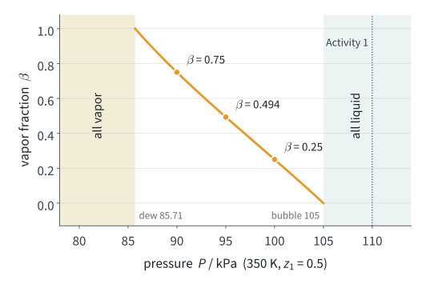

## Where this session sits {#course-map}

::: {.coursemap}
::: {.half .done}
[Before the midterm]{.label}
[Equations of state]{.cm} [Fugacity and chemical potential]{.cm} [Solution thermodynamics]{.cm}
:::
::: {.half}
[After the midterm · 7 sessions]{.label}
[1 · VLE and flash]{.cm .now} [2 · Experimental VLE and consistency]{.cm} [3 · Liquid stability and LLE]{.cm} [4 · Solids and adsorption]{.cm} [5 · Chemical equilibrium]{.cm} [6 · Electrochemical equilibrium]{.cm} [7 · Choosing a model from evidence]{.cm}
:::
:::

::: {.bridge}
The first half gave you the **condition** for phase equilibrium. From today we **use** it: given T, P and a feed, which phases form, with what compositions and in what amounts?
:::

## Why this matters: a flash drum {#why}

:::: {.columns}
::: {.column width="56%"}
```{=html}
<svg class="flash-sketch" viewBox="0 0 640 370" role="img" aria-label="A hot liquid feed passes a valve into a flash drum; vapor leaves at the top and liquid at the bottom">
  <defs><marker id="ah" viewBox="0 0 10 10" refX="9" refY="5" markerWidth="7" markerHeight="7" orient="auto"><path d="M0,0 L10,5 L0,10 z" fill="#333F4A"/></marker></defs>
  <line x1="20" y1="190" x2="232" y2="190" stroke="#333F4A" stroke-width="3" marker-end="url(#ah)"/>
  <path d="M110,176 L110,204 L140,190 Z M170,176 L170,204 L140,190 Z" fill="#fff" stroke="#333F4A" stroke-width="2.5"/>
  <rect x="236" y="70" width="110" height="240" rx="50" fill="#fff" stroke="#333F4A" stroke-width="3"/>
  <path d="M239,215 L343,215 L343,262 Q291,316 239,262 Z" fill="#0F6E6B" opacity=".22"/>
  <line x1="291" y1="70" x2="291" y2="40" stroke="#333F4A" stroke-width="3"/>
  <line x1="290" y1="40" x2="430" y2="40" stroke="#333F4A" stroke-width="3" marker-end="url(#ah)"/>
  <line x1="291" y1="310" x2="291" y2="335" stroke="#333F4A" stroke-width="3"/>
  <line x1="290" y1="335" x2="430" y2="335" stroke="#333F4A" stroke-width="3" marker-end="url(#ah)"/>
  <text x="20" y="146" class="s">Feed · 350 K</text><text x="20" y="172" class="s">z = 0.40 benzene</text>
  <text x="140" y="232" class="s c">valve</text>
  <text x="291" y="148" class="s c">50 kPa</text>
  <text x="440" y="34" class="s">Vapor</text><text x="440" y="58" class="a">how much? y = ?</text>
  <text x="440" y="329" class="s">Liquid</text><text x="440" y="353" class="a">x = ?</text>
</svg>
```
:::
::: {.column width="42%" .why-notes}
A hot benzene + toluene liquid is let down to 50 kPa. Part of it boils.

To size the drum and the equipment after it, you need **how much vapor** forms and **what each stream contains**.

By the end of today you can answer this by hand and check it in Lab 01.

[Answer in Lab 01, real-data case (NIST Antoine, ideal liquid): β = 0.593, y = 0.491, x = 0.268.]{.source}
:::
::::

## What you already know {#recap}

::: {.chain}
::: {.link}
[From the first half]{.label}
At equilibrium each component has the same fugacity in every phase.

$$\hat f_i^{\,V}=\hat f_i^{\,L}$$
:::
::: {.link}
[At low pressure]{.label}
Ideal vapor and the pure-liquid standard state give

$$y_iP=x_i\gamma_iP_i^{\text{sat}}$$
:::
::: {.link .today}
[Today: ideal liquid]{.label}
Set γ<sub>i</sub> = 1. This is Raoult's law, the simplest case to learn the method on.

$$y_iP=x_iP_i^{\text{sat}}$$
:::
:::

Sessions 2 and 3 bring back γ ≠ 1 from measured data.

## By the end of today you can {#outcomes}

[Where you show it]{.where-head}

1. **Read** a Pxy diagram and say whether a feed is liquid, vapor or two phases. [Activity 1]{.where}
2. **Calculate** bubble and dew pressures of an ideal mixture. [Concepts, Lab 01 demo]{.where}
3. **Solve** a TP flash for x, y and the vapor fraction β, and check it with a component balance. [Activity 2]{.where}
4. **Explain** how raising P at fixed T changes the split, using numbers. [Exit ticket]{.where}

## The 180-minute route {#route}

::: {.route}
::: {.seg .concept style="flex:30"}
[0–30]{.t} **Essential concepts** [Pxy diagram, bubble and dew, flash]{.d}
:::
::: {.seg .act style="flex:10"}
[30–40]{.t} **Activity 1** [predict]{.d}
:::
::: {.seg .demo style="flex:20"}
[40–60]{.t} **Demo** [Lab 01]{.d}
:::
::: {.seg .break style="flex:10"}
[60–70]{.t} **Break**
:::
::: {.seg .act style="flex:70"}
[70–140]{.t} **Activity 2 · pair investigation** [Lab 01: one change, one hand check]{.d}
:::
::: {.seg .wrap style="flex:40"}
[140–180]{.t} **Discussion and exit ticket** [answer the session question]{.d}
:::
:::

::: {.route-question}
[Session question]{.label} How does pressure change the phase split at fixed temperature?
:::

::: {.beforeafter}
::: {}
[Before class · 15–20 min]{.label}
Read the 3-page note and answer its three preparation questions.
:::
::: {}
[After class · 30–40 min]{.label}
Finish the Lab 01 comparison and submit the downloaded study file with your name and ID.
:::
:::

::: {.selfstudy}
**Studying on your own?** Follow the same order. Turn on narration or captions at the bottom left, and pause at each activity slide.
:::

## Two phases, two components: what is fixed? {#phase-rule}

:::: {.columns}
::: {.column width="48%"}
$$F=C-\pi+2$$

::: {.rule-table}
| | |
|---|---|
| components, C | 2 |
| phases, π | 2 |
| degrees of freedom, F | **2** |
:::
:::
::: {.column width="50%" .rule-notes}
Fix **T and P** and both phase compositions, x and y, are fixed.

The feed z does **not** change x or y. It only changes **how much** of each phase forms.

This is why a tie line at one T and P serves every feed between its ends.
:::
::::

## The bubble line: where the first bubble appears {#bubble}

:::: {.columns}
::: {.column width="56%"}
{.fig-pxy fig-alt="Bubble line of the ideal binary with the bubble pressure 105 kPa marked at x1 = 0.5"}
:::
::: {.column width="42%" .concept-notes}
Start from a liquid of composition x and lower P until the first bubble forms. Summing $y_iP=x_iP_i^{\text{sat}}$ over i, with $\sum y_i=1$:

$$P_{\text{bubble}}=\sum_i x_iP_i^{\text{sat}}$$

At $x_1=0.5$: $0.5(150)+0.5(60)=$ **105 kPa**.

For an ideal liquid the bubble line is straight.
:::
::::

## The dew line: where the first drop appears {#dew}

:::: {.columns}
::: {.column width="56%"}
{.fig-pxy fig-alt="Dew line of the ideal binary with the dew pressure 85.71 kPa marked at y1 = 0.5"}
:::
::: {.column width="42%" .concept-notes}
Start from a vapor of composition y and raise P until the first drop forms. Now $x_i=y_iP/P_i^{\text{sat}}$ and $\sum x_i=1$:

$$\frac{1}{P_{\text{dew}}}=\sum_i\frac{y_i}{P_i^{\text{sat}}}$$

At $y_1=0.5$: $1/(0.5/150+0.5/60)=$ **85.71 kPa**.

The dew line is curved, and always lies below the bubble line.
:::
::::

## One diagram answers three questions {#concept}

:::: {.columns}
::: {.column width="58%"}
{.fig-pxy fig-alt="Pressure-composition diagram of an ideal binary at 350 K with the tie line at 95 kPa"}
:::
::: {.column width="42%" .concept-notes}
[Which phases?]{.q} Compare P with the two lines.

$$P_{\text{bubble}}=\sum_i x_iP_i^{\text{sat}} \qquad \frac{1}{P_{\text{dew}}}=\sum_i\frac{y_i}{P_i^{\text{sat}}}$$

[What compositions?]{.q} Read the ends of the tie line: $y_i=K_ix_i$.

[How much of each?]{.q} The feed position on the tie line:

$$\beta=\frac{z_1-x_1}{y_1-x_1}=0.494$$

[Lab 01 synthetic binary · 350 K · P₁ˢᵃᵗ = 150 kPa, P₂ˢᵃᵗ = 60 kPa · z₁ = 0.5]{.source}
:::
::::

## How much of each phase: the lever rule {#lever}

:::: {.columns}
::: {.column width="52%"}
Total and component balances on 1 mol of feed, with β = V/F:

$$z_1=(1-\beta)\,x_1+\beta\,y_1$$

$$\beta=\frac{z_1-x_1}{y_1-x_1}$$

The feed point divides the tie line. The closer z is to y, the more vapor forms.
:::
::: {.column width="46%"}
::: {.lever-box}
[At 95 kPa]{.label}

β = (0.5 − 0.3889) / (0.6140 − 0.3889) = **0.4935**

[Check component 2]{.label}

(1 − β)(0.6111) + β(0.3860) = 0.3095 + 0.1905 = **0.5000** ✓
:::
:::
::::

## Worked example: the flash at 95 kPa by hand {#worked}

::: {.steps4}
::: {}
[1 · Phase check]{.label}
P<sub>dew</sub>(z) = 85.71 &lt; **95** &lt; 105 = P<sub>bubble</sub>(z), so two phases form.
:::
::: {}
[2 · K-values]{.label}
K<sub>1</sub> = 150/95 = 1.5789<br>
K<sub>2</sub> = 60/95 = 0.6316
:::
::: {}
[3 · Compositions]{.label}
x<sub>1</sub> = (1 − K<sub>2</sub>)/(K<sub>1</sub> − K<sub>2</sub>) = **0.3889**<br>
y<sub>1</sub> = K<sub>1</sub>x<sub>1</sub> = **0.6140**
:::
::: {}
[4 · Amounts and check]{.label}
β = **0.4935**, and component 2 closes at 0.5000.
:::
:::

Step 3 comes from $\sum x_i=1$ and $\sum K_ix_i=1$. Step 1 matters: outside the two-phase range the same formulas give β &lt; 0 or β &gt; 1, which means one phase.

## More than two components: Rachford–Rice {#rachford-rice}

:::: {.columns}
::: {.column width="56%"}
With $K_i=P_i^{\text{sat}}/P$ and $x_i=\dfrac{z_i}{1+\beta(K_i-1)}$, the condition $\sum(y_i-x_i)=0$ gives one equation in β:

$$\sum_i\frac{z_i(K_i-1)}{1+\beta(K_i-1)}=0$$

It decreases with β, so it has one root between 0 and 1 whenever two phases exist. Solve it by bisection or Newton's method.
:::
::: {.column width="42%"}
::: {.lever-box}
[Check at 95 kPa, β = 0.4935]{.label}

0.5(0.5789)/1.2857 = +0.2251<br>
0.5(−0.3684)/0.8182 = −0.2251

Sum = **0**. For a binary the root is the lever-rule value.
:::
:::
::::

## Predict before you calculate {#activity-1 .activity}

[Activity 1 · 10 minutes · alone, then with a partner]{.act-label}

::: {.prompt}
Same temperature, same feed. The pressure rises from 95 to **110 kPa**.
:::

::: {.choices}
[Liquid]{} [Two phases]{} [Vapor]{}
:::

Write your choice and **one reason taken from the diagram**. Then compare with your partner. Do not calculate yet.

::: {.selfstudy}
**On your own:** pause here, write your answer, then go to the next slide.
:::

## Activity 1: check your prediction {#activity-1-debrief}

:::: {.columns}
::: {.column width="52%"}
At 110 kPa the feed (z₁ = 0.5) lies **above the bubble line**: P &gt; P<sub>bubble</sub>(z) = 105 kPa.

The mixture is **all liquid**. No vapor forms.

[Two phases exist for z₁ = 0.5 only between]{.label}

::: {.range}
85.71 kPa &lt; P &lt; 105 kPa
:::
:::
::: {.column width="46%" .rule-notes}
A good reason names the line: "110 kPa is above the bubble pressure of the feed."

A weak reason: "pressure went up, so less vapor". The direction is right, but it does not say whether any vapor remains.
:::
::::

## Demonstration · Lab 01 {#demo-lab}

:::: {.columns}
::: {.column width="44%"}
1. Load the **synthetic** case.
2. Set P = 95 kPa and z₁ = 0.5, then press **Calculate**.
3. Check the tie line against the diagram.
4. Save it as your baseline, change **only P**, and test your prediction.

[Open Lab 01 →](../preview-2027/vle.html){.lab-button target="_blank"}
:::
::: {.column width="54%"}
{.lab-shot fig-alt="Lab 01 phase diagram at 95 kPa with the tie line from x1 0.389 to y1 0.614"}

::: {.expect}
[Lab 01 should report]{.label}
x₁ = 0.3889 · y₁ = 0.6140 · β = 0.4935 · bubble P = 105.0 kPa · dew P = 85.71 kPa
:::
:::
::::

## Four common mistakes {#mistakes}

::: {.mistakes}
::: {}
**Using z in the bubble or dew equation of a flash.** P<sub>bubble</sub>(z) and P<sub>dew</sub>(z) only tell you whether two phases form. The compositions come from the tie line.
:::
::: {}
**Skipping the phase check.** Outside the two-phase range the flash formulas still return numbers, with β &lt; 0 or β &gt; 1.
:::
::: {}
**Mixing pressure units.** P and P<sup>sat</sup> must be in the same unit before forming K<sub>i</sub>.
:::
::: {}
**Expecting z to move x and y.** At fixed T and P, z changes only β.
:::
:::

## Break · 10 minutes {#break .breakslide}

::: {.break-next}
[Next]{.label}
Activity 2: a pair investigation in Lab 01, 70 minutes.

Before you leave your seat, check that Lab 01 opens on your device and that your baseline at 95 kPa is saved.
:::

## Activity 2 · how does P move the split? {#activity-2 .activity}

[Activity 2 · 70 minutes · in pairs: one drives Lab 01, one checks by hand, then swap]{.act-label}

::: {.a2grid}
::: {}
[10 min · predict]{.label}
At 350 K and z₁ = 0.5, predict β at **90, 95 and 100 kPa**. Sketch β against P.
:::
::: {}
[25 min · calculate]{.label}
Run the three pressures in Lab 01. Change only P. Save each as a case with a clear name.
:::
::: {}
[20 min · hand check]{.label}
The checker repeats one pressure by hand: K-values, x₁, y₁, β and a component balance.
:::
::: {}
[15 min · explain]{.label}
Write two sentences, with numbers, answering the session question. Download the study file with your names and IDs.
:::
:::

::: {.selfstudy}
**On your own:** do both roles yourself. Pause the slides, work in Lab 01, then continue.
:::

## Activity 2 · what to hand in {#activity-2-check}

:::: {.columns}
::: {.column width="52%"}
1. Lab 01 study file with three saved cases (90, 95, 100 kPa), your name and student ID.
2. One hand calculation, photographed or typed into the additional note.
3. Two sentences that answer the session question with numbers.

[Graduate extension]{.label}
Load the real benzene + toluene case. Find the pressure range where z = 0.40 gives two phases at 350 K, and compare β at 50 kPa with the drum on slide 3.
:::
::: {.column width="46%"}
::: {.lever-box}
[Check your Lab 01 results]{.label}

| P / kPa | x₁ | y₁ | β |
|---:|---:|---:|---:|
| 90 | 0.3333 | 0.5556 | 0.750 |
| 95 | 0.3889 | 0.6140 | 0.494 |
| 100 | 0.4444 | 0.6667 | 0.250 |
:::
:::
::::

## Discussion: what did pressure do? {#discussion}

:::: {.columns}
::: {.column width="58%"}
{.fig-pxy fig-alt="Vapor fraction falls from 1 at the dew pressure to 0 at the bubble pressure for z1 = 0.5"}
:::
::: {.column width="40%" .concept-notes}
[Discuss in pairs, then with the class]{.q}

1. Why does β fall from 1 to 0 between 85.71 and 105 kPa?
2. x₁ and y₁ both **rise** with P. Why can β still fall?
3. What would change if T were raised to 360 K?
:::
::::

## Summary {#summary}

::: {.summary3}
::: {}
[Which phases]{.label}
Compare P with P<sub>dew</sub>(z) and P<sub>bubble</sub>(z).
:::
::: {}
[What compositions]{.label}
T and P fix x and y on the tie line: $K_i=P_i^{\text{sat}}/P$.
:::
::: {}
[How much]{.label}
The lever rule, or Rachford–Rice for many components, gives β.
:::
:::

**Session question:** at fixed T, raising P moves the tie line up and the feed toward the liquid end, so β falls, from 1 at the dew pressure to 0 at the bubble pressure.

[Next session]{.label} Real mixtures: γ ≠ 1, inferred from measured VLE data (Lab 02).

## Exit ticket · 5 minutes {#exit-ticket .activity}

[Exit ticket and feedback · alone · 5 minutes · anonymous]{.act-label}

:::: {.columns}
::: {.column width="64%"}
::: {.prompt}
At 350 K and z₁ = 0.5, how does raising P from 90 to 100 kPa change β, and why? Use one number.
:::

Scan the code or open the link. The same form asks three short questions about today: pace, confidence and whether the lab worked.

No name or student ID is recorded. Wait for **"Response received."**
:::
::: {.column width="32%" .qr-col}
{.qr fig-alt="QR code for the Session 1 exit ticket and feedback form"}

[Open the Session 1 form](exit.html?s=1){target="_blank"}
:::
::::

## After class {#after-class}

::: {.summary3}
::: {}
[Hand in · this week]{.label}
Your Lab 01 study file from Activity 2, with name and student ID.
:::
::: {}
[Prepare · Session 2]{.label}
Read the note on activity coefficients from measured data. About 20 minutes.
:::
::: {}
[Optional · graduate]{.label}
Finish the real benzene + toluene extension and add it to the same study file.
:::
:::

[Open Lab 01 →](../preview-2027/vle.html){.lab-button target="_blank"}

