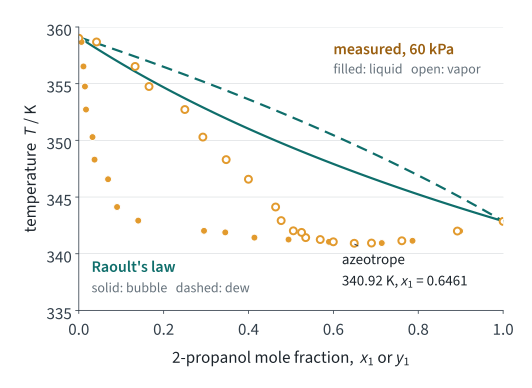
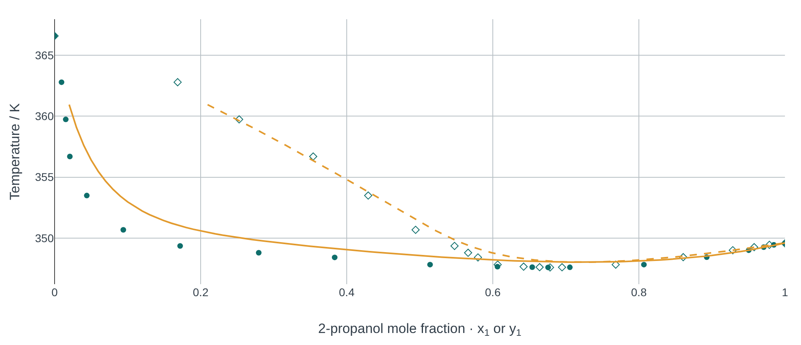
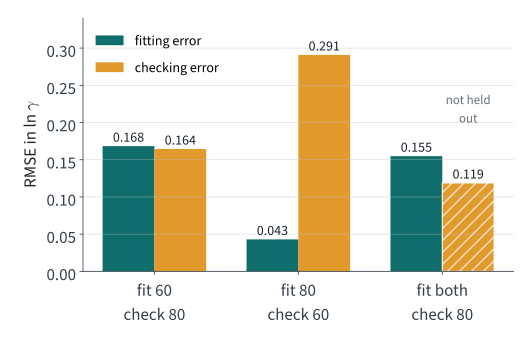

## Where this session sits {#course-map}

::: {.coursemap}
::: {.half .done}
[Before the midterm]{.label}
[Equations of state]{.cm} [Fugacity and chemical potential]{.cm} [Solution thermodynamics]{.cm}
:::
::: {.half}
[After the midterm · 7 sessions]{.label}
[1 · VLE and flash]{.cm .past} [2 · Experimental VLE and consistency]{.cm .now} [3 · Liquid stability and LLE]{.cm} [4 · Solids and adsorption]{.cm} [5 · Chemical equilibrium]{.cm} [6 · Electrochemical equilibrium]{.cm} [7 · Choosing a model from evidence]{.cm}
:::
:::

::: {.bridge}
Session 1 used an ideal liquid. Today we take **measured** data for a real mixture, infer how far it is from ideal, fit a model, and test whether that model can be trusted.
:::

## Why this matters: Raoult's law misses the azeotrope {#why}

:::: {.columns}
::: {.column width="58%"}
{.fig-pxy fig-alt="Measured T-x-y data for 2-propanol and water at 60 kPa fall far below the Raoult's law prediction and show a minimum-boiling azeotrope"}
:::
::: {.column width="40%" .why-notes}
2-Propanol + water at 60 kPa, measured by Barbieri et al. (2024).

The mixture boils up to **13 K lower** than Raoult's law predicts, and it has a minimum-boiling **azeotrope** near x₁ = 0.65.

A column designed with Raoult's law would promise a pure product that simple distillation cannot make.

[Data: Barbieri, De Guido and Moioli, J. Chem. Thermodyn. 198 (2024) 107342, Table 4. Lab 02 uses the same data.]{.source}
:::
::::

## What you already know {#recap}

::: {.chain}
::: {.link}
[Session 1]{.label}
Ideal liquid, Raoult's law.

$$y_iP=x_iP_i^{\text{sat}}$$
:::
::: {.link .today}
[Today]{.label}
Keep the ideal vapor, let the liquid be real.

$$y_iP=x_i\gamma_iP_i^{\text{sat}}$$
:::
::: {.link}
[From the first half]{.label}
γi measures the departure of component i from an ideal solution, relative to its pure liquid.
:::
:::

Every quantity except γ is measured or comes from a vapor-pressure correlation, so one measured state gives γ₁ and γ₂.

## By the end of today you can {#outcomes}

[Where you show it]{.where-head}

1. **Infer** γ₁ and γ₂ from one measured T, P, x, y state. [Worked example, Activity 2]{.where}
2. **Explain** what γ &gt; 1 and an azeotrope mean, with numbers. [Activity 1]{.where}
3. **Fit** a two-parameter NRTL model at one pressure and **check** it at another. [Lab 02 demo, Activity 2]{.where}
4. **State** what a small fitting error and a consistency test can and cannot establish. [Discussion, exit ticket]{.where}

## The 180-minute route {#route}

::: {.route}
::: {.seg .concept style="flex:30"}
[0–30]{.t} **Essential concepts** [γ from data, NRTL, fit and check]{.d}
:::
::: {.seg .act style="flex:10"}
[30–40]{.t} **Activity 1** [the azeotrope]{.d}
:::
::: {.seg .demo style="flex:20"}
[40–60]{.t} **Demo** [Lab 02]{.d}
:::
::: {.seg .break style="flex:10"}
[60–70]{.t} **Break**
:::
::: {.seg .act style="flex:70"}
[70–140]{.t} **Activity 2 · pair investigation** [Lab 02: γ by hand, three fits]{.d}
:::
::: {.seg .wrap style="flex:40"}
[140–180]{.t} **Discussion and exit ticket** [consistency, the session question]{.d}
:::
:::

::: {.route-question}
[Session question]{.label} When a model fits measured VLE data well, what does that prove, and what does it not?
:::

::: {.beforeafter}
::: {}
[Before class · 15–20 min]{.label}
Read the note on activity coefficients. Bring one question.
:::
::: {}
[After class · 30–40 min]{.label}
Finish the three Lab 02 fits and submit the study file with your name and ID.
:::
:::

::: {.selfstudy}
**Studying on your own?** Follow the same order. Turn on narration or captions at the bottom left, and pause at each activity slide.
:::

## From one measured state to γ {#gamma-def}

:::: {.columns}
::: {.column width="50%"}
Solve the modified Raoult's law for γ:

$$\gamma_1=\frac{y_1P}{x_1P_1^{\text{sat}}(T)}\qquad\gamma_2=\frac{y_2P}{x_2P_2^{\text{sat}}(T)}$$

Psat is evaluated at the **measured T** of that row, from the Antoine equation:

$$\log_{10}\frac{P^{\text{sat}}}{\text{bar}}=A-\frac{B}{T+C}$$
:::
::: {.column width="48%" .rule-notes}
Assumptions behind each γ:

- ideal vapor (low pressure)
- negligible pressure correction on the liquid
- pure-liquid standard state, so γi → 1 as xi → 1

At a pure endpoint the absent component gives 0/0, so those rows carry no γ.
:::
::::

## Worked example: row 7 at 60 kPa {#worked}

::: {.steps4}
::: {}
[1 · Read the row]{.label}
T = 341.25 K, P = 60 kPa 
x₁ = 0.4943, y₁ = 0.569
:::
::: {}
[2 · [Psat]{.nt} at 341.25 K]{.label}
2-propanol: 55.853 kPa 
water: 28.703 kPa
:::
::: {}
[3 · [γ₁]{.nt}]{.label}
(0.569 × 60) / (0.4943 × 55.853) 
= **1.237**
:::
::: {}
[4 · [γ₂]{.nt}]{.label}
(0.431 × 60) / (0.5057 × 28.703) 
= **1.782**
:::
:::

Both exceed 1: each component escapes to the vapor more readily than in an ideal solution. For fitting we use ln γ₁ = 0.212 and ln γ₂ = 0.578.

[Antoine constants: NIST WebBook; 2-propanol A = 4.8610, B = 1357.427, C = −75.814; water A = 5.0768, B = 1659.793, C = −45.854; common range 334–362.41 K.]{.source}

## What γ &gt; 1 tells you {#gamma-meaning}

:::: {.columns}
::: {.column width="58%"}
{.fig-pxy fig-alt="ln gamma of 2-propanol and water from 18 measured pairs at 60 kPa, both positive, with the NRTL fit"}
:::
::: {.column width="40%" .concept-notes}
[Positive deviation]{.q} ln γ &gt; 0 for both components at every composition. Unlike pairs (2-propanol with water) attract less than like pairs.

[Largest when dilute]{.q} ln γ₁ reaches about 2 as x₁ → 0, so γ₁ ≈ 8: a little 2-propanol in water is very volatile.

[Azeotrope]{.q} Where yi = xi:

$$\frac{\gamma_1}{\gamma_2}=\frac{P_2^{\text{sat}}}{P_1^{\text{sat}}}$$
:::
::::

## From points to a model: NRTL {#nrtl}

:::: {.columns}
::: {.column width="56%"}
$$\ln\gamma_1=x_2^2\left[\tau_{21}\Big(\frac{G_{21}}{x_1+x_2G_{21}}\Big)^2+\frac{\tau_{12}G_{12}}{(x_2+x_1G_{12})^2}\right]$$

$$G_{ij}=\exp(-\alpha\,\tau_{ij})$$

ln γ₂ follows by swapping 1 and 2. With α fixed at 0.47 (from the article), two parameters τ₁₂ and τ₂₁ are fitted.
:::
::: {.column width="42%"}
::: {.lever-box}
[What "fit" means here]{.label}

Choose τ₁₂, τ₂₁ to minimize the root-mean-square difference between model and measured ln γ:

$$\text{RMSE}=\sqrt{\frac{\sum_j (r_{1,j}^2+r_{2,j}^2)}{2N}}$$

r = model ln γ − measured ln γ; N usable pairs.
:::
:::
::::

## Fit at one pressure, check at another {#fit-check}

:::: {.columns}
::: {.column width="50%"}
The data come at **two pressures**: 60 kPa (18 usable pairs) and 80 kPa (17 usable pairs).

1. **Fit** τ₁₂, τ₂₁ to one pressure only.
2. **Keep** those parameters fixed.
3. **Check** the model against the other pressure, which it has never seen.

The checking error tells you how far you can trust the model away from its own data.
:::
::: {.column width="48%" .rule-notes}
A fitting error alone can always be made small by adding parameters.

A checking error on held-out data is the honest test of a model.

This is the same idea as training and test data in machine learning.
:::
::::

## Predict before you look {#activity-1 .activity}

[Activity 1 · 10 minutes · alone, then with a partner]{.act-label}

::: {.prompt}
Row 5 at 60 kPa is the azeotrope: T = 340.92 K, x₁ = 0.6461, y₁ = 0.6492. Is γ₁/γ₂ greater or less than 1, and roughly how large?
:::

At 340.92 K: P₁sat = 55.04 kPa and P₂sat = 28.29 kPa.

Use the azeotrope condition, not a full calculation. Then compare with your partner.

::: {.selfstudy}
**On your own:** pause here, write your answer, then go to the next slide.
:::

## Activity 1: check your prediction {#activity-1-debrief}

:::: {.columns}
::: {.column width="52%"}
At the azeotrope yi = xi, so γ₁P₁sat = γ₂P₂sat:

$$\frac{\gamma_1}{\gamma_2}=\frac{28.29}{55.04}=0.514$$

From the measured row: γ₁ = 1.095 and γ₂ = 2.102, so γ₁/γ₂ = **0.521**.
:::
::: {.column width="46%" .rule-notes}
**Less than 1.** Water is the less volatile component, so it needs the larger γ to reach the same partial pressure.

The two ratios differ by about 1%: y₁ and x₁ are close but not equal at the measured point.

Simple distillation cannot cross this composition.
:::
::::

## Demonstration · Lab 02 {#demo-lab}

:::: {.columns}
::: {.column width="44%"}
1. Read **row 7** at 60 kPa and open the worked calculation. Check γ₁ = 1.237, γ₂ = 1.782.
2. Fit **60 kPa only**, α = 0.47. Read the fitting error.
3. Change the checking pressure to **80 kPa**. Do not refit.
4. Look at the T–x–y plot: where does the model miss?

[Open Lab 02 →](../preview-2027/case-study.html){.lab-button target="_blank"}
:::
::: {.column width="54%"}
{.lab-shot fig-alt="Lab 02 T-x-y plot at 80 kPa with the model fitted at 60 kPa"}

::: {.expect}
[Lab 02 should report]{.label}
τ₁₂ = 0.3618 · τ₂₁ = 1.7524 · fitting RMSE 0.168 (18 pairs) · checking RMSE 0.164 (17 pairs)
:::
:::
::::

## Four common mistakes {#mistakes}

::: {.mistakes}
::: {}
**Psat at the wrong temperature.** Each row has its own measured T. Evaluate both Psat there, not at one fixed T.
:::
::: {}
**Using the pure-component rows.** At x₁ = 0 or 1 the absent component gives 0/0. Those rows cannot enter the fit.
:::
::: {}
**Refitting before checking.** If you refit at the checking pressure, there is nothing left to check.
:::
::: {}
**Reading a small fitting error as proof.** It shows the model can follow these points, not that the data or the model are right elsewhere.
:::
:::

## Break · 10 minutes {#break .breakslide}

::: {.break-next}
[Next]{.label}
Activity 2: a pair investigation in Lab 02, 70 minutes.

Before you leave your seat, check that Lab 02 opens on your device.
:::

## Activity 2 · does the model transfer? {#activity-2 .activity}

[Activity 2 · 70 minutes · in pairs: one drives Lab 02, one checks by hand, then swap]{.act-label}

::: {.a2grid}
::: {}
[15 min · [γ]{.nt} by hand]{.label}
Pick any interior row other than row 7. Calculate Psat, γ₁ and γ₂ by hand. Check with the lab.
:::
::: {}
[20 min · three fits]{.label}
Fit 60 → check 80. Fit 80 → check 60. Fit both. Save each as a case.
:::
::: {}
[20 min · compare]{.label}
Record the fitting and checking errors. Which fit transfers best? Which data set scatters more?
:::
::: {}
[15 min · explain]{.label}
Write two sentences, with numbers, answering the session question. Download the study file with your names and IDs.
:::
:::

::: {.selfstudy}
**On your own:** do both roles yourself. Pause the slides, work in Lab 02, then continue.
:::

## Activity 2 · what to hand in {#activity-2-check}

:::: {.columns}
::: {.column width="50%"}
1. Lab 02 study file with three saved cases, your name and student ID.
2. One hand calculation of γ₁ and γ₂ for your chosen row.
3. Two sentences that answer the session question with numbers.

[Graduate extension]{.label}
Open Lab 03, load case D (measured 60 kPa data) and run the diagnostics. Explain why the tests report "not applicable" or "not assessed" rather than pass or fail.
:::
::: {.column width="48%"}
::: {.lever-box}
[Check your Lab 02 results · RMSE in ln [γ]{.nt}]{.label}

| Fit | τ₁₂ | τ₂₁ | fit | check |
|---|---:|---:|---:|---:|
| 60 → 80 | 0.362 | 1.752 | 0.168 | 0.164 |
| 80 → 60 | 0.354 | 2.417 | 0.043 | 0.291 |
| both | 0.364 | 1.937 | 0.155 | — |
:::
:::
::::

## Discussion: what did the checks show? {#discussion}

:::: {.columns}
::: {.column width="56%"}
{.fig-pxy fig-alt="Bar chart of fitting and checking errors for the three fits"}
:::
::: {.column width="42%" .concept-notes}
[Discuss in pairs, then with the class]{.q}

1. Fitting 80 kPa gives the smallest fitting error, 0.043, but the largest checking error, 0.291. Why?
2. Fitting 60 kPa gives similar errors at both pressures. What does that suggest about the 60 kPa data?
3. Why does the joint fit leave no honest check?
:::
::::

## Can a test tell us the data are good? {#consistency}

:::: {.columns}
::: {.column width="50%"}
Gibbs–Duhem links the two activity coefficients at constant T and P:

$$x_1\,d\ln\gamma_1+x_2\,d\ln\gamma_2=0$$

For isothermal data this gives the **area test**:

$$\int_0^1\ln\frac{\gamma_1}{\gamma_2}\,dx_1=0$$

Isobaric data need an extra term with the excess enthalpy HE.
:::
::: {.column width="48%"}
::: {.lever-box}
[Lab 03 on the measured 60 kPa data]{.label}

Area test: **not applicable**, the path is isobaric. 
Herington: **not assessed**, no endpoint estimates. 
Local test: **not assessed**, HE is not available.

"Not assessed" is not "inconsistent". It means the data do not carry what the test needs.
:::
:::
::::

## Summary {#summary}

::: {.summary3}
::: {}
[[γ]{.nt} from data]{.label}
γi = yiP / (xiPisat), with Psat at each measured T.
:::
::: {}
[Model]{.label}
NRTL with α fixed: two τ values fitted to ln γ by RMSE.
:::
::: {}
[Trust]{.label}
Judge a model by its checking error on data it has not seen.
:::
:::

**Session question:** a good fit shows that the model can follow the points it was given. It does not show that the model transfers to other conditions, or that the data are thermodynamically consistent. Fitting 80 kPa gave 0.043 on its own data and 0.291 at 60 kPa.

[Next session]{.label} When one liquid splits into two: phase stability and LLE (Labs 04 and 05).

## Exit ticket · 5 minutes {#exit-ticket .activity}

[Exit ticket and feedback · alone · 5 minutes · anonymous]{.act-label}

:::: {.columns}
::: {.column width="64%"}
::: {.prompt}
A model fitted to 80 kPa data has a fitting error of 0.043 but a checking error of 0.291 at 60 kPa. What does this tell you, and what would you do next?
:::

Scan the code or open the link. The same form asks three short questions about today: pace, confidence and whether the lab worked.

No name or student ID is recorded. Wait for **"Response received."**
:::
::: {.column width="32%" .qr-col}
{.qr fig-alt="QR code for the Session 2 exit ticket and feedback form"}

[Open the Session 2 form](exit.html?s=2){target="_blank"}
:::
::::

## After class {#after-class}

::: {.summary3}
::: {}
[Hand in · this week]{.label}
Your Lab 02 study file with the three fits, name and student ID.
:::
::: {}
[Prepare · Session 3]{.label}
Read the note on Gibbs energy of mixing and phase stability. About 20 minutes.
:::
::: {}
[Optional · graduate]{.label}
Run Lab 03 on the measured data and add your explanation to the study file.
:::
:::

[Open Lab 02 →](../preview-2027/case-study.html){.lab-button target="_blank"}
