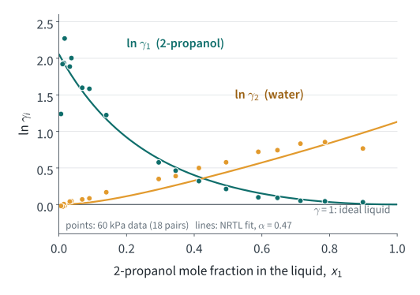
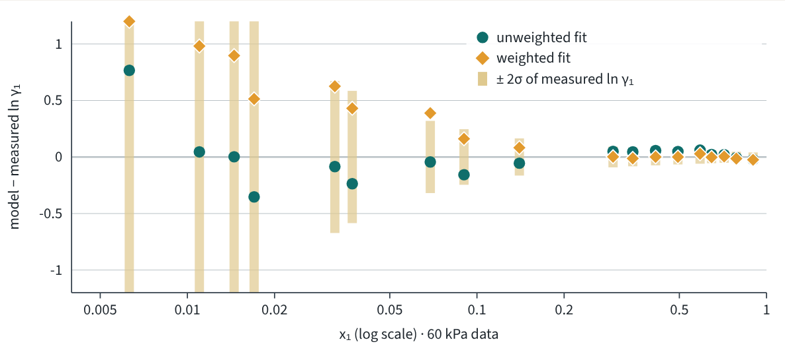
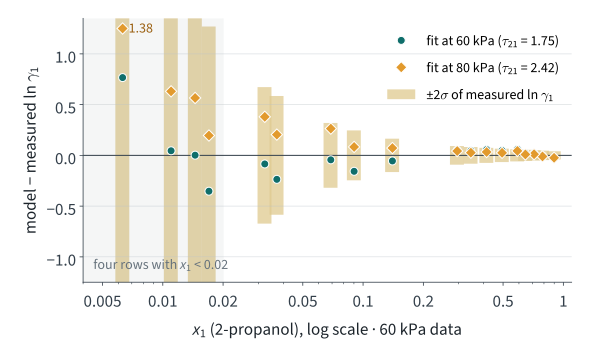

## Where this session sits {#course-map}

::: {.coursemap}
::: {.half .done}
[Before the midterm]{.label}
[Equations of state]{.cm} [Fugacity and chemical potential]{.cm} [Solution thermodynamics]{.cm}
:::
::: {.half}
[After the midterm · 7 sessions]{.label}
[1 · VLE and flash]{.cm .past} [2 · Experimental VLE and consistency]{.cm .now} [3 · Liquid stability and LLE]{.cm} [4 · Solids and adsorption]{.cm} [5 · Chemical equilibrium]{.cm} [6 · Electrochemical equilibrium]{.cm} [7 · Choosing a model from evidence]{.cm}
:::
:::

::: {.bridge}
Session 1 used an ideal liquid. Today we take **measured** data for a real mixture, infer how far it is from ideal, fit a model, and test whether that model can be trusted.
:::

## Why this matters: Raoult's law misses the azeotrope {#why}

:::: {.columns}
::: {.column width="58%"}
{.fig-pxy fig-alt="Measured T-x-y data for 2-propanol and water at 60 kPa fall far below the Raoult's law prediction and show a minimum-boiling azeotrope"}
:::
::: {.column width="40%" .why-notes}
2-Propanol + water at 60 kPa, measured by Barbieri et al. (2024).

The mixture boils up to **13 K lower** than Raoult's law predicts, and it has a minimum-boiling **azeotrope** near x₁ = 0.65.

A column designed with Raoult's law would promise a pure product that simple distillation cannot make.

[Data: Barbieri, De Guido and Moioli, J. Chem. Thermodyn. 198 (2024) 107342, Table 4. Lab 02 uses the same data.]{.source}
:::
::::

## From Session 1 to measured data {#recap}

::: {.chain}
::: {.link}
[Session 1]{.label}
The γ–φ route, solved for the phases.

$$y_i\Phi_iP=x_i\gamma_iP_i^{\text{sat}}$$
:::
::: {.link .today}
[Today]{.label}
The same equation, solved for γ from a measurement.

$$\gamma_i=\frac{y_i\Phi_iP}{x_iP_i^{\text{sat}}(T)}$$
:::
::: {.link}
[First half]{.label}
γi is a partial molar property of GE, so γ₁ and γ₂ are linked by Gibbs–Duhem.
:::
:::

Φi collects the vapor nonideality and the Poynting factor. Every input on the right has an uncertainty, and it passes into γ.

## By the end of today you can {#outcomes}

[Where you show it]{.where-head}

1. **Reduce** a measured T, P, x, y state to γ₁, γ₂ and GE/RT, and state the assumptions with their size. [Worked example, Activity 2]{.where}
2. **Propagate** measurement uncertainty into ln γ and say which rows constrain a model. [Activity 1, Lab 02 G3]{.where}
3. **Fit** NRTL with and without weights, and **compare** parameters, their correlation and the checking error. [Lab 02 demo, Activity 2]{.where}
4. **Judge** what a fit, a check and a consistency test can and cannot establish. [Discussion, exit ticket]{.where}

## The 180-minute route {#route}

::: {.route}
::: {.seg .concept style="flex:30"}
[0–30]{.t} **Essential concepts** [data reduction, GE, uncertainty, weights]{.d}
:::
::: {.seg .act style="flex:10"}
[30–40]{.t} **Activity 1** [which rows count?]{.d}
:::
::: {.seg .demo style="flex:20"}
[40–60]{.t} **Demo** [Lab 02]{.d}
:::
::: {.seg .break style="flex:10"}
[60–70]{.t} **Break**
:::
::: {.seg .act style="flex:70"}
[70–140]{.t} **Activity 2 · pair investigation** [Lab 02: three fits, then weighted fits]{.d}
:::
::: {.seg .wrap style="flex:40"}
[140–180]{.t} **Discussion and exit ticket** [why the checks disagree]{.d}
:::
:::

::: {.route-question}
[Session question]{.label} When a model fits measured VLE data well, what does that prove, and what does it not? And which data decide the fit?
:::

::: {.beforeafter}
::: {}
[Before class · 15–20 min]{.label}
Read the [note on activity coefficients](note-s02.html){target="_blank"}. Bring one question.
:::
::: {}
[After class · 30–40 min]{.label}
Finish the Lab 02 fits including G3, and submit the study file with your name and ID.
:::
:::

::: {.selfstudy}
**Studying on your own?** Follow the same order. Turn on narration or captions at the bottom left, and pause at each activity slide.
:::

## From one measured state to γ {#gamma-def}

:::: {.columns}
::: {.column width="50%"}
$$\gamma_i=\frac{y_i\,\Phi_i\,P}{x_i\,P_i^{\text{sat}}(T)}$$

Psat at the **measured T** of each row, from the course Antoine sets:

$$\log_{10}\frac{P^{\text{sat}}}{\text{bar}}=A-\frac{B}{T+C}$$

At a pure endpoint the absent component gives 0/0, so those rows carry no γ.
:::
::: {.column width="48%"}
::: {.lever-box}
[Assumptions, with their size here]{.label}

| Assumption | Effect on ln γ |
|---|---|
| Φi = 1, for B = −1000 cm³ mol⁻¹ | −0.011 (water), −0.0015 (2-propanol) |
| Antoine set 3 % low | +0.030, same sign in every row |
| Pure-liquid standard state | γi → 1 as xi → 1 |

Small next to scatter, but **systematic**: it does not average out.
:::
:::
::::

## Worked example: row 7 at 60 kPa {#worked}

::: {.steps4}
::: {}
[1 · Read the row]{.label}
T = 341.25 K, P = 60 kPa 
x₁ = 0.4943, y₁ = 0.569
:::
::: {}
[2 · [Psat]{.nt} at 341.25 K]{.label}
2-propanol: 55.853 kPa 
water: 28.703 kPa
:::
::: {}
[3 · [γ₁]{.nt}]{.label}
(0.569 × 60) / (0.4943 × 55.853) 
= **1.237**
:::
::: {}
[4 · [γ₂]{.nt}]{.label}
(0.431 × 60) / (0.5057 × 28.703) 
= **1.782**
:::
:::

Both exceed 1: each component escapes to the vapor more readily than in an ideal solution. For fitting we use ln γ₁ = 0.212 and ln γ₂ = 0.578.

[Antoine constants, log₁₀(P/bar) = A − B/(T/K + C), NIST WebBook: 2-propanol 4.8610, 1357.427, −75.814 (Biddiscombe et al. 1963); water 5.0768, 1659.793, −45.854 (Bridgeman and Aldrich 1964); common range 334–362.41 K. All course constants: Session 2 note, section 6.]{.source}

## What γ &gt; 1 tells you {#gamma-meaning}

:::: {.columns}
::: {.column width="58%"}
{.fig-pxy fig-alt="ln gamma of 2-propanol and water from 18 measured pairs at 60 kPa, both positive, with the NRTL fit"}
:::
::: {.column width="40%" .concept-notes}
[Positive deviation]{.q} ln γ &gt; 0 for both components at every composition. Unlike pairs (2-propanol with water) attract less than like pairs.

[Largest when dilute]{.q} ln γ₁ reaches about 2 as x₁ → 0, so γ₁ ≈ 8: a little 2-propanol in water is very volatile.

[Azeotrope]{.q} Where yi = xi:

$$\frac{\gamma_1}{\gamma_2}=\frac{P_2^{\text{sat}}}{P_1^{\text{sat}}}$$
:::
::::

## γ₁ and γ₂ are not independent {#ge-gd}

:::: {.columns}
::: {.column width="50%"}
$$g\equiv\frac{G^E}{RT}=\sum_i x_i\ln\gamma_i\qquad \ln\gamma_i=\left(\frac{\partial (ng)}{\partial n_i}\right)_{T,P,n_j}$$

At constant T and P, **Gibbs–Duhem**:

$$x_1\,\mathrm{d}\ln\gamma_1+x_2\,\mathrm{d}\ln\gamma_2=0$$

Row 7: g = 0.4943(0.212) + 0.5057(0.578) = **0.397**.
:::
::: {.column width="48%" .rule-notes}
So fit a model for g, not two separate curves for ln γ₁ and ln γ₂. Any g(x) gives a consistent pair by construction.

Measured T, P, x **and** y over-determine the problem. That redundancy is what a consistency test uses, and it is also why a bad y can be detected.
:::
::::

## From points to a model: NRTL {#nrtl}

:::: {.columns}
::: {.column width="56%"}
$$\ln\gamma_1=x_2^2\left[\tau_{21}\Big(\frac{G_{21}}{x_1+x_2G_{21}}\Big)^2+\frac{\tau_{12}G_{12}}{(x_2+x_1G_{12})^2}\right]$$

$$G_{ij}=\exp(-\alpha\,\tau_{ij})$$

ln γ₂ follows by swapping 1 and 2. In general τij = aij + bij/T. With α = 0.47 (from the article) and constant τ, two parameters are fitted.
:::
::: {.column width="42%"}
::: {.lever-box}
[What "fit" means here]{.label}

Choose τ₁₂, τ₂₁ to minimize the root-mean-square difference between model and measured ln γ:

$$\text{RMSE}=\sqrt{\frac{\sum_j (r_{1,j}^2+r_{2,j}^2)}{2N}}$$

r = model ln γ − measured ln γ; N usable pairs.
:::
:::
::::

## Can a test tell us the data are good? {#consistency}

:::: {.columns}
::: {.column width="50%"}
Gibbs–Duhem links the two activity coefficients at constant T and P:

$$x_1\,d\ln\gamma_1+x_2\,d\ln\gamma_2=0$$

For isothermal data this gives the **area test**:

$$\int_0^1\ln\frac{\gamma_1}{\gamma_2}\,dx_1=0$$

Isobaric data add an HE term. The article reports this test passed (−4.83 and −0.65, limit 10) without it.
:::
::: {.column width="48%"}
::: {.lever-box}
[Lab 03 on the measured 60 kPa data]{.label}

Area test: **not applicable**, the path is isobaric. 
Herington: **not assessed**, no endpoint estimates. 
Local test: **not assessed**, HE is not available.

"Not assessed" is not "inconsistent". It means the data do not carry what the test needs.
:::
:::
::::

## How well is ln γ₁ known in each row? {#uncertainty}

:::: {.columns}
::: {.column width="50%"}
Propagate the standard uncertainties u = U/k (article averages, k = 2):

$$\sigma_{\ln\gamma_1}^2\approx\Big(\frac{u_x}{x_1}\Big)^2+\Big(\frac{u_y}{y_1}\Big)^2+\Big(\frac{u_P}{P}\Big)^2+\Big(\frac{\mathrm{d}\ln P_1^{\text{sat}}}{\mathrm{d}T}u_T\Big)^2$$

At 60 kPa: ux = 0.0107, uy = 0.0139, uP = 0.25 kPa, uT = 0.037 K.
:::
::: {.column width="48%"}
::: {.lever-box}
[[σ]{.nt} of measured ln [γ₁]{.nt} · 60 kPa]{.label}

| x₁ | y₁ | measured ln γ₁ | σ |
|---:|---:|---:|---:|
| 0.4943 | 0.569 | 0.212 | 0.033 |
| 0.1401 | 0.4769 | 1.223 | 0.082 |
| 0.0371 | 0.3473 | 2.004 | 0.29 |
| 0.0063 | 0.0418 | 1.238 | 1.74 |

The dilute rows hardly constrain ln γ₁, yet an unweighted RMSE counts them fully.
:::
:::
::::

## Fit at one pressure, check at another {#fit-check}

:::: {.columns}
::: {.column width="50%"}
The data come at **two pressures**: 60 kPa (18 usable pairs) and 80 kPa (17 usable pairs).

1. **Fit** τ₁₂, τ₂₁ to one pressure only.
2. **Keep** those parameters fixed.
3. **Check** the model against the other pressure, which it has never seen.

The checking error tells you how far you can trust the model away from its own data.
:::
::: {.column width="48%" .rule-notes}
A fitting error alone can always be made small by adding parameters.

A checking error on held-out data is the honest test of a model.

The 80 kPa set loses its most dilute row: at 362.78 K it is outside the 2-propanol Antoine range.
:::
::::

## The objective is part of the model {#objective}

:::: {.columns}
::: {.column width="46%"}
Unweighted: minimize $\sum r^2$. Weighted: minimize $\sum (r/\sigma)^2$.

RMS(r/σ) ≈ 1 means the misfit matches the stated uncertainty.

The ± values are from the linearized covariance at the minimum. The unweighted fit at 60 kPa has τ₁₂ and τ₂₁ correlated at −0.86: many pairs fit almost equally well.
:::
::: {.column width="52%"}
::: {.lever-box}
[Training set 60 kPa · [α]{.nt} = 0.47]{.label}

| | τ₁₂ | τ₂₁ | RMSE 60 / 80 | RMS(r/σ) 60 / 80 |
|---|---:|---:|---:|---:|
| unweighted | 0.362 ± 0.14 | 1.75 ± 0.15 | 0.168 / 0.164 | 1.94 / 0.77 |
| weighted | 0.337 ± 0.04 | 2.85 ± 0.15 | 0.407 / 0.097 | 1.16 / 0.93 |

Changing only the weights moves τ₂₁ by 1.1, about seven of its standard deviations. The weighted parameters also give negative liquid curvature near x₁ = 0.15: a liquid split that does not exist.
:::
:::
::::

## Can isobaric data give τ(T)? {#tdep}

:::: {.columns}
::: {.column width="50%"}
On an isobar, T is set by x: here 340.9–358.7 K at 60 kPa. Composition and temperature effects are **confounded**.

Fitting τij = aij + bij/T to both pressures (4 parameters):

- RMSE falls only from 0.155 to 0.146
- b₁₂ = −2250 K, b₂₁ = 5950 K: large, opposite, compensating
:::
::: {.column width="48%" .rule-notes}
The article's own T-dependent NRTL parameters (its Table 7) give 0.26 at 60 kPa and 0.054 at 80 kPa in this ln γ metric.

Different objectives and data give different parameters. To identify τ(T), use data that vary T at fixed x: isotherms at several T, or excess enthalpy HE, the temperature derivative of GE/T.
:::
::::

## Which rows decide the fit? {#activity-1 .activity}

[Activity 1 · 10 minutes · alone, then with a partner]{.act-label}

::: {.prompt}
At 60 kPa, ux = 0.0107 and uy = 0.0139. Estimate σ of ln γ₁ from the x and y terms for row 7 (x₁ = 0.4943, y₁ = 0.569) and for the most dilute row (x₁ = 0.0063, y₁ = 0.0418).
:::

Then predict: in an unweighted fit, which of the two rows has more influence on τ₂₁? Is that what you want? Compare with your partner.

::: {.selfstudy}
**On your own:** pause here, write your answer, then go to the next slide.
:::

## Activity 1: check your estimate {#activity-1-debrief}

:::: {.columns}
::: {.column width="52%"}
Row 7: $\sqrt{(0.0107/0.4943)^2+(0.0139/0.569)^2}$ = **0.033**

Dilute row: $\sqrt{(0.0107/0.0063)^2+(0.0139/0.0418)^2}$ = **1.73**

The dilute row is 50 times less certain. In an unweighted fit it still counts as much as row 7, and its residual (0.77 for the 60 kPa fit) dominates the sum.
:::
::: {.column width="46%" .rule-notes}
Four 60 kPa rows have x₁ &lt; 0.02. They supply 70 % of the unweighted sum of squares for the 60 kPa fit, and 88 % for the 80 kPa fit checked at 60 kPa.

A weighted fit lets each row count in proportion to what was measured.
:::
::::

## Demonstration · Lab 02 {#demo-lab}

:::: {.columns}
::: {.column width="44%"}
1. Read **row 7** at 60 kPa. Check γ₁ = 1.237, γ₂ = 1.782.
2. Fit **60 kPa**, check **80 kPa**: 0.168 and 0.164.
3. Graduate view, **G3**: fit 60 kPa unweighted and weighted. Compare τ₂₁ and RMS(r/σ).
4. Set the minimum x₁ to 0.05 and refit. What changes?

[Open Lab 02 →](../preview-2027/case-study.html){.lab-button target="_blank"}
:::
::: {.column width="54%"}
{.lab-shot fig-alt="Lab 02 G3 residual plot of ln gamma one against x one on a log scale for the unweighted and weighted fits with two-sigma bars"}

::: {.expect}
[Lab 02 G3 should report · training 60 kPa]{.label}
Unweighted τ₂₁ = 1.7524 ± 0.150 · weighted τ₂₁ = 2.8484 ± 0.152 · RMS(r/σ) at 60 kPa: 1.94 and 1.16 · min. liquid curvature 0.238 and −0.030
:::
:::
::::

## Four common mistakes {#mistakes}

::: {.mistakes}
::: {}
**Psat at the wrong temperature.** Each row has its own measured T. Evaluate both Psat there, and stay inside the Antoine range.
:::
::: {}
**Treating every residual as equally certain.** σ of ln γ₁ ranges from 0.03 to 1.7 in the same data set.
:::
::: {}
**Reporting τ without its uncertainty.** Two parameters correlated at −0.86 are not two independent findings.
:::
::: {}
**Reading the isothermal area test on isobaric data.** Without the HE term, a pass or a fail says little.
:::
:::

## Break · 10 minutes {#break .breakslide}

::: {.break-next}
[Next]{.label}
Activity 2: a pair investigation in Lab 02, 70 minutes.

Before you leave your seat, check that Lab 02 opens on your device.
:::

## Activity 2 · why do the checks disagree? {#activity-2 .activity}

[Activity 2 · 70 minutes · in pairs: one drives Lab 02, one checks by hand, then swap]{.act-label}

::: {.a2grid}
::: {}
[15 min · by hand]{.label}
Pick an interior row other than row 7. Calculate Psat, γ₁, γ₂, g and σ of ln γ₁. Check with the lab.
:::
::: {}
[20 min · three fits]{.label}
Fit 60 → check 80. Fit 80 → check 60. Fit both. Save each as a case.
:::
::: {}
[20 min · G3 weights]{.label}
Repeat 60 and 80 in G3, unweighted and weighted, then with minimum x₁ = 0.02. Record τ, sd, RMS(r/σ) and the liquid curvature.
:::
::: {}
[15 min · explain]{.label}
Two sentences with numbers: why does "fit 80" check worse at 60 kPa than "fit 60" checks at 80? Download the study file with names and IDs.
:::
:::

::: {.selfstudy}
**On your own:** do both roles yourself. Pause the slides, work in Lab 02, then continue.
:::

## Activity 2 · what to hand in {#activity-2-check}

:::: {.columns}
::: {.column width="44%"}
1. Lab 02 study file with three saved cases, G3 and G4, your name and student ID.
2. One hand calculation of γ₁, γ₂, g and σ.
3. Two sentences that answer the activity question with numbers.

[Graduate extension]{.label}
Fit with minimum x₁ = 0.05 at both pressures. Do the two parameter sets agree within their standard deviations? What would you measure next?
:::
::: {.column width="54%"}
::: {.lever-box}
[Check your results · RMSE in ln [γ]{.nt} · unweighted]{.label}

| Fit | τ₁₂ | τ₂₁ | fit | check | check, x₁ ≥ 0.02 |
|---|---:|---:|---:|---:|---:|
| 60 → 80 | 0.362 | 1.752 | 0.168 | 0.164 | 0.148 |
| 80 → 60 | 0.354 | 2.417 | 0.043 | 0.291 | 0.116 |
| both | 0.364 | 1.937 | 0.155 | — | — |

G3, weighted: 60 kPa τ₂₁ = 2.85, RMS(r/σ) 1.16 / 0.93, min. curvature −0.030 · 80 kPa τ₂₁ = 2.08, RMS(r/σ) 1.59 / 0.42, curvature 0.139 (RMS at 60 / 80 kPa)
:::
:::
::::

## Discussion: why the checks disagree {#discussion}

:::: {.columns}
::: {.column width="58%"}
{.fig-pxy fig-alt="Residuals in ln gamma one at 60 kPa against x one on a log scale for the fits trained at 60 and 80 kPa, with two-sigma bars that grow large below x one equal to 0.02"}
:::
::: {.column width="40%" .concept-notes}
[Discuss in pairs, then with the class]{.q}

1. Without the four rows below x₁ = 0.02, the 80 kPa fit checks at 0.116 on 60 kPa data. What was the 0.291 measuring?
2. The weighted 60 kPa fit is closer to the stated uncertainty, yet predicts that a fully miscible liquid splits. Is it the better model?
3. Which single new measurement would discriminate τ₂₁ = 1.75 from 2.42?
:::
::::

## Summary {#summary}

::: {.summary3}
::: {}
[Data reduction]{.label}
γi = yiΦiP / (xiPisat); assumptions are small but systematic.
:::
::: {}
[Model]{.label}
Fit GE (NRTL), not two curves. The objective and weights are part of the model.
:::
::: {}
[Trust]{.label}
Check on unseen data, normalized by what was measured; report τ with its uncertainty.
:::
:::

**Session question:** a small fit error shows that the model follows the points it was given. The 0.291 checking error came mostly from four dilute rows whose ln γ₁ is known only to ±0.6–1.7. Weighting moves τ₂₁ from 1.75 to 2.85 with the same data, and the weighted set predicts a liquid split that does not exist.

[Next session]{.label} When does one liquid split into two? Phase stability and LLE (Labs 04 and 05), starting from that weighted fit.

## Exit ticket · 5 minutes {#exit-ticket .activity}

[Exit ticket and feedback · alone · 5 minutes · anonymous]{.act-label}

:::: {.columns}
::: {.column width="64%"}
::: {.prompt}
Weighting the residuals moved τ₂₁ from 1.75 to 2.85 with the same data. What does this say about the parameters, and what would you report with them?
:::

Scan the code or open the link. The same form asks three short questions about today: pace, confidence and whether the lab worked.

No name or student ID is recorded. Wait for **"Response received."**
:::
::: {.column width="32%" .qr-col}
{.qr fig-alt="QR code for the Session 2 exit ticket and feedback form"}

[Open the Session 2 form](exit.html?s=2){target="_blank"}
:::
::::

## After class {#after-class}

::: {.summary3}
::: {}
[Hand in · this week]{.label}
Your Lab 02 study file with the three fits, G3 and G4, name and student ID.
:::
::: {}
[Prepare · Session 3]{.label}
Read the [note on Gibbs energy of mixing and phase stability](note-s03.html){target="_blank"}. About 20 minutes.
:::
::: {}
[Optional · graduate]{.label}
Run Lab 03 on the measured 60 kPa data and explain each "not assessed" result in the study file.
:::
:::

[Open Lab 02 →](../preview-2027/case-study.html){.lab-button target="_blank"}
