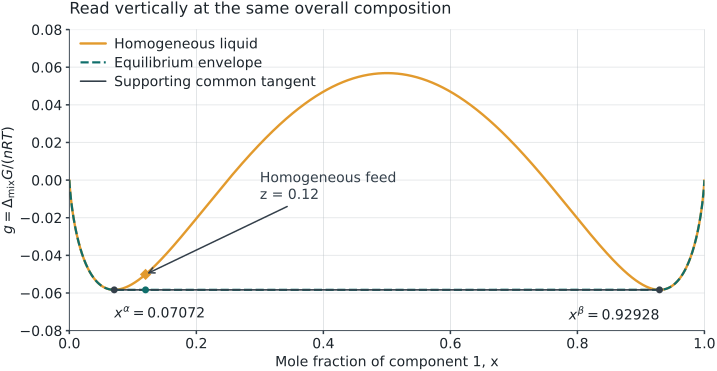
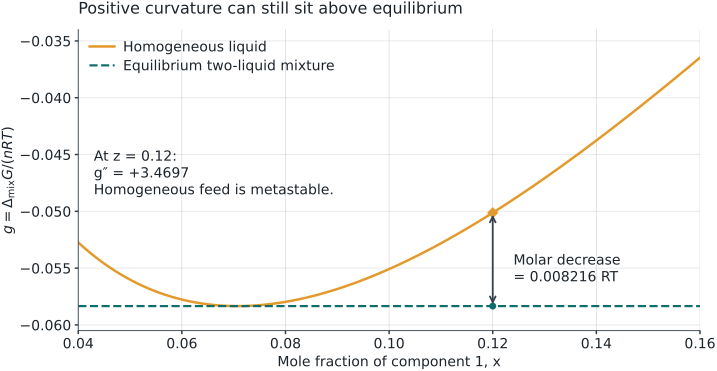
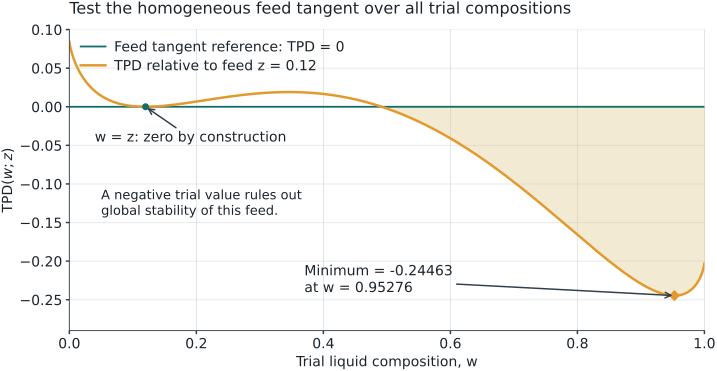
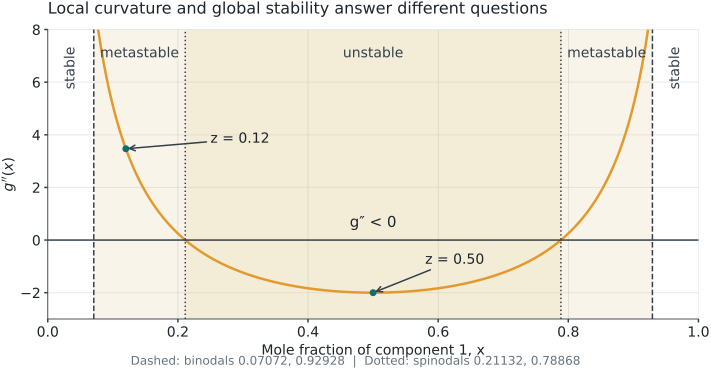

## Start with these two documents {#start}

**Open:** the [four-page calculation and Lab guide](files/week03-gibbs-review-guide.pdf) and [Lab 04: Liquid stability](labs/stability.html#lle-experiment) in another tab.

Use a calculator with **natural logarithms, ln**. No spreadsheet or code is needed.

| Follow this route | Write in the guide | Suggested time |
|---|---|---:|
| Read the graph and calculate one case | A–B, pages 1–2 | 20 min |
| Reproduce it in Lab 04; change the feed | C, page 3 | 15 min |
| Solve a new case and check your reasoning | D, page 4 | 10 min |

This optional review supports your original Week 3 worksheet. Use the parts you need; no additional attendance or exit-ticket submission is required.

## Keep two questions separate {#two-questions}

**Lab 03: Are the data compatible with a thermodynamic constraint?**

Applicable consistency tests assess relationships such as Gibbs–Duhem, with assumptions about the data and their path.

**Lab 04: Which allowed state has the lowest total Gibbs energy?**

A liquid model can satisfy Gibbs–Duhem and still predict separation into two liquids.

**Your action:** On guide page 1, A1, write which question a common tangent helps answer. This review concerns a binary liquid at fixed T and P; vapor and solid phases are excluded.

## Read the axes before the curve {#axes}

$$g(x)=\frac{\Delta g_{\mathrm{mix}}(x)}{RT},\qquad x=x_1,\quad x_2=1-x.$$

- **Horizontal:** composition of a possible homogeneous liquid, from pure component 2 to pure component 1.
- **Vertical:** molar Gibbs energy of mixing divided by RT, dimensionless. Lower means lower mixing energy at the same composition.
- **Feed:** $z=z_1$ is the overall composition. A single liquid has $x=z$; two liquids can have $x^\alpha\ne z\ne x^\beta$.

The pure-liquid reference is an affine function of composition. It cancels when states have the same total amounts of both components, so this graph can compare their total Gibbs energies.

**Your action:** Guide A2: mark $z=0.12$ and distinguish it from the two phase compositions.

## Compare states at the same overall composition {#read-curve}

{.review-figure}

The curve at $z$ represents **one homogeneous liquid**. The line segment between the two tangent contacts represents a **two-liquid mixture**, with amounts chosen to give that same $z$.

**Your action:** Guide A2: at $z=0.12$, which state is lower? A negative value of $g$ alone does not answer this comparison.

## One model for every calculation {#model}

For the synthetic, symmetric one-parameter Margules liquid, use **A = 3**:

$$g(x)=x\ln x+(1-x)\ln(1-x)+3x(1-x).$$

$$g'(x)=\ln\frac{x}{1-x}+3(1-2x),\qquad
g''(x)=\frac{1}{x}+\frac{1}{1-x}-6.$$

All quantities here, including A, are dimensionless. At pure endpoints, use the limit $x\ln x\to0$.

**Your action:** Guide B1, page 2: enter $z=0.12$. Use ln, not log₁₀. Keep A fixed when changing the feed later.

## Step 1: test local curvature {#local-curvature}

At the homogeneous feed composition $z=0.12$:

$$g''(0.12)=\frac{1}{0.12}+\frac{1}{0.88}-6$$
$$=8.333333+1.136364-6=\boxed{3.469697>0}.$$

This state resists sufficiently small composition fluctuations: it is **locally stable**. A distant pair of compositions may still lower the total Gibbs energy.

At $z=0.50$, $g''=2+2-6=-2$: the homogeneous liquid is **locally unstable**.

**Your action:** Record both curvatures in B1. Do not write “globally stable” from a positive curvature alone.

## Step 2: find the two tangent contacts {#endpoints}

A common tangent must satisfy

$$g'(x^\alpha)=g'(x^\beta)=
\frac{g(x^\beta)-g(x^\alpha)}{x^\beta-x^\alpha}.$$

Symmetry makes this particular tangent horizontal: $x^\beta=1-x^\alpha$ and $g'(x^\alpha)=0$.

$$\ln\frac{x^\alpha}{1-x^\alpha}+3(1-2x^\alpha)=0.$$

The low-composition root lies between **0.0707 and 0.0708**. Refinement gives

$$\boxed{x^\alpha=0.07072018,\qquad x^\beta=0.92927982}.$$

**Your action:** Guide B2: substitute $x^\alpha$ in $g'$. The root at 0.50 is a maximum here, not a second liquid phase. A horizontal tangent is specific to this symmetric case.

## Step 3: calculate the phase amounts {#lever-rule}

Use a basis of **1 mol of total feed**. Let $f^\alpha+f^\beta=1$.

$$z=f^\alpha x^\alpha+f^\beta x^\beta
\quad\Longrightarrow\quad
f^\beta=\frac{z-x^\alpha}{x^\beta-x^\alpha}.$$

At $z=0.12$:

$$f^\beta=\frac{0.12000000-0.07072018}{0.92927982-0.07072018}
=\boxed{0.057398}.$$

$$f^\alpha=1-f^\beta=\boxed{0.942602}.$$

**Your action:** Guide B3: write the amounts as 0.942602 mol α and 0.057398 mol β per mol of feed. These are liquid phase fractions; no vapor fraction is involved.

## Step 4: check the component balance {#balance}

$$0.942602+0.057398=1.000000$$

$$0.942602(0.07072018)+0.057398(0.92927982)
\approx\boxed{0.120000}.$$

For component 2, the same amounts give $1-z=0.88$.

The result satisfies the amount and composition constraints. **A closed balance alone does not prove that the state minimizes Gibbs energy.**

**Your action:** Guide B3: check this sum on your calculator. If a phase fraction is outside 0–1, that proposed split cannot represent this feed.

## Step 5: calculate the homogeneous energy {#feed-energy}

$$g(0.12)=0.12\ln(0.12)+0.88\ln(0.88)+3(0.12)(0.88)$$

| Term | Value |
|---|---:|
| $0.12\ln(0.12)$ | −0.25443162 |
| $0.88\ln(0.88)$ | −0.11249337 |
| $3(0.12)(0.88)$ | +0.31680000 |
| **Sum: homogeneous $g(z)$** | **−0.05012499** |

**Your action:** Guide B4: reproduce the sum. This is $\Delta G_{\mathrm{mix}}/(nRT)$ for the homogeneous feed, not an energy in joules.

## Step 6: compare with the split {#split-energy}

Both endpoints have $g(x^\alpha)=g(x^\beta)=-0.05834135$.

$$g_{\mathrm{split}}=f^\alpha g(x^\alpha)+f^\beta g(x^\beta)
=-0.05834135.$$

$$\text{Energy decrease}=g(z)-g_{\mathrm{split}}
=\boxed{0.00821636>0}.$$

The split is lower even though $g''(0.12)>0$. The original homogeneous feed is **metastable**; the equilibrium state is two liquids.

**Your action:** Guide B4: circle the lower energy. To obtain an actual total energy decrease, multiply 0.00821636 by $nRT$ using consistent units.

## See the same comparison on the graph {#energy-gap}

{.review-figure}

Read the **vertical** separation at the same $z$. It equals $g(z)-g_{\mathrm{split}}$, not a distance between the two phase compositions.

**Your action:** Return to B4: label the upper point “homogeneous” and the lower point “equilibrium split.”

## Step 7: check global support {#global-support}

For a candidate line $\ell(x)$, examine the whole allowed interval:

$$d(x)=g(x)-\ell(x)\ge0\quad\text{for all }0\le x\le1.$$

Here $\ell(x)=-0.05834135$. The two contacts are the global minima: checking the stationary points and endpoints verifies that no part of this curve lies below the line.

- Equal chemical potentials identify a **candidate** pair.
- The material balance checks whether its amounts are feasible.
- Global support establishes the lowest energy within this binary liquid model.

**Your action:** Guide B5: explain why testing only the two contacts is insufficient. A finite plotted grid can miss a narrow dip; the Lab also searches stationary points and uses a numerical tolerance.

## Verify support for this model {#support-values}

For A = 3, the stationary points are $x^\alpha$, 0.50 and $x^\beta$. Add both pure endpoints to cover the candidates for the lowest value of $d(x)=g(x)-\ell(x)$.

| Candidate composition | $d(x)$ |
|---|---:|
| 0 and 1 | $0-(-0.05834135)=0.05834135$ |
| $x^\alpha$ and $x^\beta$ | $0$ |
| 0.50 | $(0.75-\ln 2)-(-0.05834135)=0.11519417$ |

All candidate values are nonnegative, so the line supports this entire curve. The contacts give its lowest value.

**Your action:** Guide B5: reproduce the middle-composition value. This exhaustive stationary-point check applies to the stated A = 3 model; checking a few arbitrary plotted points would not be equivalent.

## A different tangent tests the homogeneous feed {#feed-tangent}

{.review-figure}

$$\mathrm{TPD}(w)=g(w)-[g(z)+g'(z)(w-z)].$$

A negative value rejects global stability of the **homogeneous feed**. This feed tangent differs from the **coexistence common tangent**. The trial minimizer $w$ is not automatically a binodal endpoint.

**Your action:** Guide C1, page 3: keep these two reference lines distinct when switching Lab views.

## Open Lab 04 and reproduce the calculation {#open-lab}

**Open:** [Lab 04: Liquid stability](labs/stability.html#lle-experiment). Keep guide **C1** beside it.

1. Under **Explore a state**, choose **Metastable · A = 3, z₁ = 0.12**.
2. Confirm **Liquid model = Margules · 1 parameter**, **A = 3**, and **Feed mole fraction z₁ = 0.12**.
3. Click **Find equilibrium →**. Select **View → Gibbs energy & common tangent**.
4. Open **Verify the equilibrium**. Compare the homogeneous and equilibrium energies and the component balance residual with your hand calculation.

**Your action:** Record the values before revealing the comparison on the next slide. If the Lab opens at a different state, use the preset above; opening the page alone does not set this case.

## Compare the outputs, then change the view {#lab-check}

| Quantity | Hand calculation / expected Lab value |
|---|---:|
| Coexisting compositions $x^\alpha$, $x^\beta$ | 0.070720, 0.929280 |
| Phase fractions $f^\alpha$, $f^\beta$ | 0.942602, 0.057398 |
| Local curvature of feed | +3.469697 |
| Homogeneous $g(z)$ / equilibrium $g(z)$ | −0.050125 / −0.058341 |
| Energy decrease | 0.008216 (dimensionless) |

**Your action:** Guide C1: switch to **Local curvature**, then **Tangent-plane distance · feed stability**. Positive local curvature and negative minimum feed TPD are compatible here.

Allow for display rounding. Small residuals check the numerical solution; assess global support separately.

## Predict before changing the feed {#predict-cases}

Keep the same model and **A = 3**. On guide **C2**, predict these two cases before running them:

| Feed | Questions to answer |
|---|---|
| $z=0.02$ | Does this feed lie between the binodal endpoints? Is the lever-rule split feasible? |
| $z=0.50$ | What is the sign of $g''$? What amounts does symmetry suggest? |

Then select the matching **Stable** and **Unstable** presets and click **Find equilibrium →** for each case.

**Pause for 5 minutes.** Record your prediction, Lab result and one reason for any correction. Continue only after both cases.

## Three feed states, two equilibrium outcomes {#compare-cases}

| Feed $z$ | $g''(z)$ | Homogeneous feed | Equilibrium |
|---|---:|---|---|
| 0.02 | +45.020408 | Stable | One liquid, $x=z$ |
| 0.12 | +3.469697 | Metastable | Two liquids; $f^\beta=0.057398$ |
| 0.50 | −2.000000 | Unstable | Two liquids; $f^\alpha=f^\beta=0.5$ |

For A = 3, the spinodals are **0.211325 and 0.788675**. They mark the change in local curvature, not the coexistence compositions.

At $z=0.02$, the proposed binodal split gives $f^\beta<0$. Do not use a line extended outside its contacts as a feasible two-phase mixture.

**Your action:** Guide C2: distinguish “classification of the initial homogeneous feed” from “stable equilibrium after allowing separation.”

## Locate the three regions on the same curve {#regions}

{.review-figure}

Between a binodal and its neighboring spinodal, a homogeneous feed is metastable. Inside the spinodals, it is locally unstable. Allowing separation gives two-liquid equilibrium throughout the binodal interval.

**Your action:** On guide C2, locate 0.02, 0.12 and 0.50. These labels classify the homogeneous feed; the lower common-tangent segment describes its equilibrium when separation is allowed.

## Your turn: solve a new feed {#practice}

**Guide D1, page 4. Keep A = 3 and set $z=0.35$.**

1. Calculate $g''(z)$ and classify the homogeneous feed locally.
2. Use the same endpoints to calculate $f^\alpha$ and $f^\beta$.
3. Check $f^\alpha x^\alpha+f^\beta x^\beta=z$.
4. Calculate $g(z)$ and $g(z)-g_{\mathrm{split}}$.
5. In Lab 04, enter **Feed mole fraction z₁ = 0.35** and click **Find equilibrium →**. Explain any difference from your calculation.

**Pause for 8 minutes before the next slide.** The endpoints depend on the model and fixed conditions, not on the feed's position inside this tie line.

## Check your new-feed calculation {#practice-answer}

$$g''(0.35)=\frac1{0.35}+\frac1{0.65}-6=-1.604396.$$

$$f^\beta=\frac{0.35-0.07072018}{0.85855964}=0.325289,
\qquad f^\alpha=0.674711.$$

$$0.674711(0.07072018)+0.325289(0.92927982)\approx0.350000.$$

$$g(0.35)=0.35\ln(0.35)+0.65\ln(0.65)+3(0.35)(0.65)
=0.03505336.$$

$$g(0.35)-g_{\mathrm{split}}=\boxed{0.09339471}.$$

**Your action:** Correct D1 in a different color. The feed is locally unstable and its stable liquid equilibrium is the same pair of compositions, with different amounts.

## Save a result you can explain {#save}

**Guide C3, page 3.** At the case you want to keep:

1. In **Your explanation**, state A, z, the feed classification and the equilibrium phase amounts. Include one balance or energy comparison.
2. Click **Export study JSON** and keep the downloaded file with your worksheet.
3. To reopen it, expand **Study workspace · reopen and compare cases** near the top. Use **Load studies or a comparison JSON**, then **Restore** beside your case.
4. Click **Find equilibrium →** to recompute from restored inputs.

**If something differs:** check model, A and z first; then the selected view, rounding and whether you recalculated. Keep a screenshot and the study JSON when asking for help. No manual JSON editing is needed.

## Check the reasoning without the Lab {#self-check}

**Guide D2, page 4. Answer before opening the next slide.**

1. Can $g''(z)>0$ alone establish global stability?
2. What is fixed, and what changes, when z moves inside this tie line at fixed T, P and A?
3. Why does equality of chemical potentials alone not finish the stability test?
4. The common tangent lies below $g(0.02)$ when extended left. Why is its binodal split not the equilibrium for this feed?

Use one short sentence for each. Keep these corrections with the original Week 3 worksheet; this review adds no form submission.

## Answers and reading {#answers}

1. **No.** Positive curvature establishes local stability. A feasible distant split can still lower total Gibbs energy.
2. **Fixed:** $x^\alpha$ and $x^\beta$. **Changing:** phase amounts according to the material balance.
3. It identifies a candidate. Check feasible amounts and a common tangent that supports the whole allowed Gibbs curve.
4. Since $0.02<x^\alpha$, reproducing this feed with those endpoints would require a negative phase amount.

**Read further:** [MIT OpenCourseWare, Lecture 21: phase coexistence and stability](https://ocw.mit.edu/courses/3-020-thermodynamics-of-materials-spring-2021/mit3_020s21_l21.pdf). Our numerical values come from the stated synthetic Margules model, not a real-fluid dataset.

**Next:** Return to the [Week 3 study route](week03-study.html). Use the [Lab 04 demonstration in the Week 3 video](week03-video.html#slide-35) if you need another screen walkthrough.
