## Integer and mixed-integer programming

2105623 · November 2, 2026

Choosing machines, opening production lines, and verifying decisions

::: {.notes}
Welcome to our independent study lesson on integer and mixed integer linear programming. In the previous lesson, decisions could vary continuously. Today we add decisions that must be whole numbers or yes or no. Keep paper and the Python notebook beside you. Pause whenever a question appears. The aim is to build a model, solve it, and explain why its decisions make sense.
:::

## Your three-hour study route

15 min review + 30 min integer geometry

35 min modeling + 10 min break

25 min search + 45 min lab + 20 min Exit Ticket

::: {.notes}
The videos are shorter than the scheduled class because your working time matters. Use fifteen minutes to recall L P, thirty for integer geometry, and thirty five for modeling. Take a ten minute break. Then spend twenty five minutes on branch and bound, forty five on the lab, and twenty on the exit ticket. Pause the video rather than trying to finish every activity at playback speed.
:::

## Recall the LP certificate

A feasible plan gives a candidate value.

A feasible dual solution bounds all primal values.

Matching values certify LP optimality.

::: {.notes}
Recall our maximization L P. A feasible production plan gives a value we can achieve. Feasible dual prices give an upper bound. When the two values agree, we have a certificate. Integer programming retains the idea of bounds, but an L P solution may no longer be an allowable plan. That distinction will drive the search procedure in this lesson.
:::

## Three kinds of decisions

Continuous: tonnes produced, q ≥ 0.

Integer: number of machines, n ∈ {0,1,2,…}.

Binary: open a line, y ∈ {0,1}.

::: {.notes}
Choose the variable domain from the meaning of the decision. Tonnes can usually be fractional, while an indivisible machine count cannot. A binary variable represents whether a line is available or selected. A mixed integer model may contain all three types. Making every variable integer is unnecessary and can change the engineering problem, especially when production is a continuous flow.
:::

## A small integer production problem

Maximize 3x + 2y.

x + y ≤ 4.5; 2x + y ≤ 6.5.

x and y count batches: nonnegative integers.

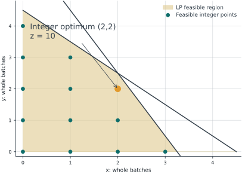{height=320}

::: {.notes}
We first use a small illustrative batch problem, with objective units chosen only for teaching. Each batch of x earns three and each batch of y earns two. Two shared resources give the displayed inequalities. The coefficients remain linear. What changes relative to L P is the requirement that both batch counts be whole numbers. Sketch the continuous feasible region before adding the integer points.
:::

## Solve the continuous relaxation

Intersection: x + y = 4.5 and 2x + y = 6.5.

Subtract: x = 2; then y = 2.5.

Add constraints: 3x + 2y ≤ 11. This point attains 11.

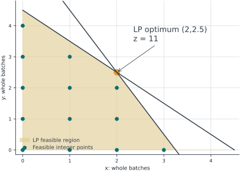{height=320}

::: {.notes}
Temporarily remove the integer restriction. Subtracting the first active equation from the second gives x equal to two, then y equal to two point five. To prove optimality, add the two resource inequalities. Their left sides sum to three x plus two y, and their limits sum to eleven. Thus every feasible point has objective at most eleven. Our point attains eleven, certifying the relaxed optimum. It still violates the whole batch requirement.
:::

## Rounding is not a solution method

Round upward to (2,3): resource use (5,7).

Both limits (4.5,6.5) are violated.

Rounding downward happens to work here; it needs proof.

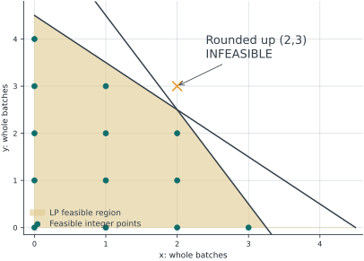{height=320}

::: {.notes}
Rounding y upward produces the plan two, three. Its resource use is five and seven, so it violates both limits. Rounding downward gives two, two and is feasible in this example. That success does not establish a general algorithm. Other problems can have infeasible rounded points or better integer points elsewhere. We need a method that verifies feasibility and provides a bound on quality.
:::

## The integer optimum

Enumerate feasible integer points.

Best point: (x,y) = (2,2), value 10.

LP upper bound 11; integer value 10.

{height=320}

::: {.notes}
For a problem this small, we can list all feasible integer points. The point two, two gives ten, and no other point in the finite list gives more. This independent enumeration will later check our solver. The difference between eleven and ten is the absolute relaxation gap for this example. It is not the solver stopping gap after the optimum has been certified.
:::

## Bounds depend on objective direction

Maximization: feasible integer value ≤ optimum ≤ LP bound.

Minimization: LP bound ≤ optimum ≤ feasible integer value.

A bound is useful even when its solution is fractional.

::: {.notes}
Removing restrictions enlarges the feasible set. Therefore a relaxed maximization can only improve or preserve the best value; it supplies an upper bound. A relaxed minimization supplies a lower bound. A feasible integer plan provides the opposite side. Before interpreting any solver bound, say whether your mathematical model is a maximization or a minimization, especially when you negated the objective in code.
:::

## Pause: check a proposed batch plan

For (x,y) = (3,1), calculate both resource uses.

Is the plan feasible? What is its objective?

Explain why a high objective is not enough.

::: {.notes}
Pause here and test the proposed integer plan three, one. Check both inequalities before comparing profit. The first resource use is four, which passes, but the second is seven, which exceeds six point five. Its objective is eleven, but that number is not attainable under our constraints. When you resume, keep this rule: domain checks and every resource check come before interpreting an objective.
:::

## A plant with two optional lines

Illustrative weekly data; money in $1,000/week.

Line A: contribution 8/tonne; opening cost 10.

Line B: contribution 6/tonne; opening cost 8.

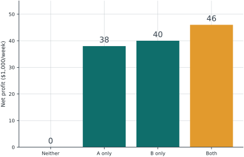{height=320}

::: {.notes}
Now move to our main engineering example. All data are illustrative, and money is measured in thousands of dollars per week. Production contributes eight per tonne on line A and six on line B, after variable costs. Opening a line incurs a weekly fixed cost, ten for A and eight for B. We must decide both whether to open each line and how much to produce.
:::

## Capacity and resource data

A capacity 6 tonnes/week; B capacity 8.

Labor use: 2 units/tonne for A, 1 for B.

Labor ≤ 12 units/week; total sales ≤ 10 tonnes/week.

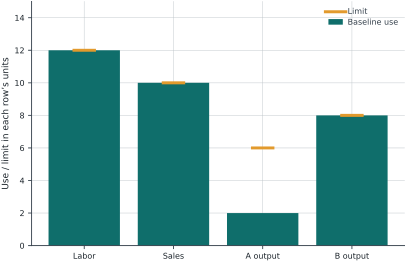{height=320}

::: {.notes}
Line A can produce at most six tonnes and B at most eight. Labor requirements are two units per tonne on A and one on B. Twelve labor units are available. Total sales cannot exceed ten tonnes. This is an upper demand limit, not a requirement to produce ten. No production is feasible, and the model should retain that option if all profitable choices disappear.
:::

## Separate production from opening

a,b ≥ 0: continuous tonnes/week.

yA,yB ∈ {0,1}: whether each line is opened.

Opening permits production; it does not force full output.

::: {.notes}
Use a and b for continuous production amounts. Use y A and y B for binary opening decisions. These variables answer different questions. If a line is open, it can produce any allowed amount within its capacity, including zero unless we impose a minimum batch. If a line is closed, its production must be zero. The next constraints connect the two decisions.
:::

## Linking constraint: a ≤ 6yA

If yA = 0, then 0 ≤ a ≤ 0: a = 0.

If yA = 1, then 0 ≤ a ≤ 6.

Use b ≤ 8yB for line B.

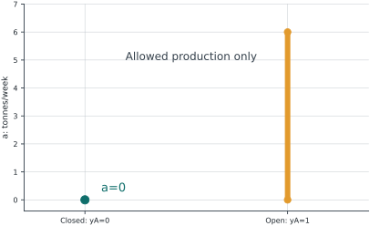{height=320}

::: {.notes}
Read the linking inequality in its two cases. When y A is zero, nonnegativity and the zero upper bound force a to zero. When y A is one, a can range from zero to six. This is a linear inequality because six is a constant. We do not need to multiply two decision variables. Repeat the same reasoning for line B with capacity eight.
:::

## An optional minimum production level

If A opens, require at least 3 tonnes.

Add a ≥ 3yA together with a ≤ 6yA.

Closed: a=0. Open: 3≤a≤6.

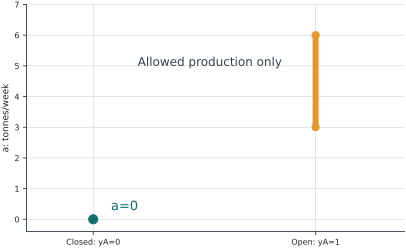{height=320}

::: {.notes}
Suppose opening A is worthwhile operationally only if it produces at least three tonnes. Add the lower linking bound a at least three times y A, while retaining the upper linking bound. The two allowed states are closed with zero production, or open with production between three and six. This is an optional scenario, not part of our baseline model. Keep that distinction when comparing numerical answers.
:::

## Logic with binary variables

At most one line: yA + yB ≤ 1.

Exactly one line: yA + yB = 1.

A requires B: yA ≤ yB.

::: {.notes}
Binary variables also encode logical choices. At most one permits both to be closed. Exactly one removes that option. The implication A requires B means that selecting A forces B to one, which is written y A at most y B. It does not mean B requires A. Test each expression on the four binary pairs. These are alternative policy examples; we do not impose them all on the baseline.
:::

## The complete baseline MILP

Maximize 8a + 6b − 10yA − 8yB.

2a + b ≤ 12; a + b ≤ 10.

a ≤ 6yA; b ≤ 8yB; a,b≥0; yA,yB binary.

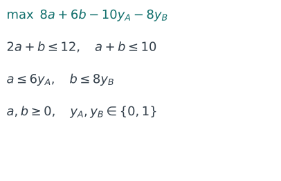{height=320}

::: {.notes}
Read the full baseline model from top to bottom. The objective subtracts each opening cost once. Labor and sales constrain production. Linking inequalities prevent production on a closed line. Production remains continuous, while the opening variables are binary. Before solving, check units: every objective term is thousands of dollars per week, every labor term is labor units per week, and sales are tonnes per week.
:::

## Verify by enumerating opening choices

Neither: profit 0. A only: a=6, profit 38.

B only: b=8, profit 40.

Both: a=2,b=8, profit 46.

{height=320}

::: {.notes}
There are only four opening patterns. For each pattern, fix the binary variables and solve the remaining continuous L P. Neither line gives zero. A alone produces six and earns thirty eight after its fixed cost. B alone produces eight and earns forty. Both produce two and eight, earning forty six. Enumeration provides an independent certificate for this small model and checks our M I L P result.
:::

## Audit the chosen production plan

a=2,b=8,yA=yB=1.

Labor: 2(2)+8=12. Sales: 2+8=10.

Profit: 16+48−10−8=46.

{height=320}

::: {.notes}
Do not stop at a solver message. Insert the proposed solution into the original equations. Labor is exactly twelve and sales exactly ten. Production on A is below six and B is at eight, with both lines open. Variable contribution is sixty four, and total opening cost is eighteen, leaving forty six thousand dollars per week. This audit is also a useful way to find coefficient-order mistakes.
:::

## Choose a meaningful upper bound

Use the physical bound U=6 for a ≤ UyA.

An unnecessarily large U weakens the LP relaxation.

Never choose U so small that valid plans are excluded.

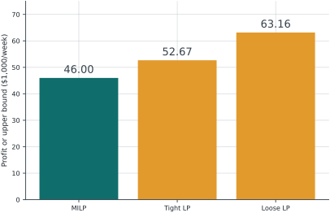{height=320}

::: {.notes}
The constant in a linking inequality should be a valid and reasonably tight upper bound. Six comes directly from A capacity. Replacing it with one hundred, while keeping the physical capacity separately, preserves binary feasibility but lets the relaxation pay a tiny fraction of the opening cost. A bound that is too small causes the opposite problem: it removes real operating plans. Derive U from engineering limits.
:::

## Relax the opening decisions

Allow 0≤yA,yB≤1 temporarily.

Relaxed result: a=2,b=8,yA=1/3,yB=1.

Bound 52.667 versus integer profit 46.

{height=320}

::: {.notes}
Relaxing the binary decisions allows fractional opening. At production two on A, the relaxation chooses y A equal to one third and pays only one third of its fixed cost. B remains fully open. The relaxed value is fifty two point six six seven, above the attainable integer value forty six. One third of an opened line is a mathematical device for bounding, not an allowable purchase or operating decision.
:::

## A loose bound makes the relaxation weaker

Keep a≤6 and b≤8 as physical limits.

Use a≤100yA and b≤100yB only for linking.

Relaxed profit becomes 63.16; the MILP stays at 46.

{height=320}

::: {.notes}
For this comparison, retain the physical production limits six and eight. Only loosen the linking constants to one hundred. The relaxed model can then use y A equal to zero point zero two and y B equal to zero point zero eight. It earns sixty three point one six because it pays too little fixed cost. The binary model is unchanged. Without the separate physical limits, we would be comparing a different problem.
:::

## Branch-and-bound: maintain two values

Incumbent: best feasible integer plan found so far.

Node bound: best value of a restricted LP relaxation.

For max: prune if bound ≤ incumbent, when seeking one optimum.

::: {.notes}
Branch and bound maintains a feasible integer incumbent and optimistic bounds for regions that have not been eliminated. In a maximization problem, a node whose upper bound is no better than the incumbent cannot improve the answer. A node can also close because it is infeasible or its relaxed optimum is already integer. We will illustrate these ideas using the two batch variables, rather than a large industrial tree.
:::

## Root node: split a fractional variable

Batch LP: (x,y)=(2,2.5), upper bound 11.

Every integer y satisfies y≤2 or y≥3.

These two branches cover every integer possibility.

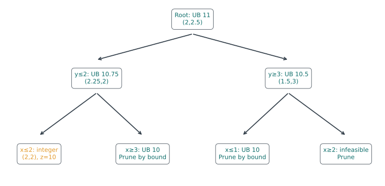{height=320}

::: {.notes}
Return to the batch model with resource limits four point five and six point five. Its root relaxation gives y equal to two point five. Any integer y must lie at most two or at least three. These disjoint branches lose no integer solutions. We keep all original constraints in both branches. Branching is not rounding one candidate; it partitions the remaining search space.
:::

## Left branch: y ≤ 2

LP result: (2.25,2), upper bound 10.75.

x is fractional, so split x≤2 or x≥3.

In the x≤2 child: (2,2), value 10, is integer.

{height=320}

::: {.notes}
In the left branch, the relaxed optimum becomes two point two five, two, with upper bound ten point seven five. Now x is fractional, so split on x. The child with x at most two has the integer optimum two, two and value ten. This gives our incumbent. Its feasibility can be checked directly, and every remaining node must beat ten to matter for the optimal value.
:::

## Prune the other left child

Constraints include y≤2 and x≥3.

Its LP optimum is (3,0.5), bound 10.

Bound equals incumbent 10: no better value is possible.

{height=320}

::: {.notes}
The other child requires x at least three and y at most two. Its relaxed solution has x equals three and y equals zero point five, with objective value ten. Although that point is fractional, its upper bound already equals our incumbent. We can prune if our purpose is to find one optimum and certify the value. If we wanted every alternative optimum, equality pruning would need more careful treatment.
:::

## Right branch: y ≥ 3

LP result: (1.5,3), upper bound 10.5.

Split x≤1 or x≥2.

x≤1 gives bound 10; x≥2 is infeasible.

{height=320}

::: {.notes}
The right branch initially has upper bound ten point five at one point five, three, so it cannot yet be discarded. Split x at one and two. The first child has bound ten and cannot improve the incumbent. The second requires x at least two and y at least three, forcing x plus y at least five, above four point five. No unexplored branch can now beat ten.
:::

## What certifies completion?

Feasible incumbent value: 10.

Every remaining branch is closed or bounded by 10.

Therefore the global integer optimum is 10.

::: {.notes}
The proof combines a feasible plan with bounds covering every alternative. Our incumbent reaches ten. Each branch either has no feasible point or has upper bound at most ten. Therefore no feasible integer plan can be better. This is a global certificate for the linear integer model. Modern solvers add presolve, cuts and heuristics, so their actual node counts need not match our teaching tree.
:::

## Stopping early and reading the gap

A feasible plan may exist before optimality is proved.

For maximization, lower bound = incumbent value.

Negate a minimization dual bound to get a max upper bound.

::: {.notes}
A solver stopped by a time limit may have a useful feasible plan, or it may have none. Inspect status before reading variables. In our code we minimize negative profit. Therefore negative fun is the feasible profit, and negative mip dual bound is an upper bound on maximum profit. The field mip gap describes the solver gap. It is different from comparing the original L P relaxation with the integer optimum.
:::

## Why LP shadow prices need care

Separate example: each machine supplies 4 units and costs 10.

Variable cost = 2 per unit: C(D) = 10 ceil(D/4) + 2D.

For D ≥ 0, machine counts jump. Re-solve MILP after changes.

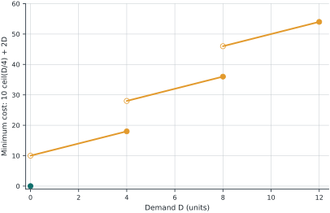{height=320}

::: {.notes}
This figure is a separate machine sizing example, not the two line plant. Demand is D, each machine supplies four units, and each machine costs ten. Producing each unit also costs two. For nonnegative demand, the required machine count is the ceiling of D divided by four. Total minimum cost is ten times that count plus two D. Within a fixed machine count, cost rises with slope two. Crossing capacity requires another machine and a cost jump. Do not extrapolate an L P shadow price across that switch.
:::

## Python lab: predict before running

Download MILP-guided-lab.ipynb.

Use Python with NumPy and SciPy (version 1.9 or later).

Run cells in order; use the separate exercise sheet for practice.

::: {.notes}
Open the guided notebook from the course page. The calculations use Python with NumPy and SciPy, version one point nine or later. No paid solver is required. Run cells from top to bottom and predict each result before executing it. This notebook is a worked tutorial, and an executed reference copy is available. The six independent exercises are on the separate practice page and printable worksheet. Try them before opening the worked solutions.
:::

## Step 1: choose a fixed variable order

v = (a, b, yA, yB).

Minimization coefficients: c = (−8,−6,10,8).

Return to profit with profit = −result.fun.

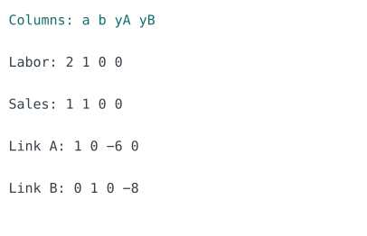{height=320}

::: {.notes}
Start by writing the variable order explicitly: a, b, y A, y B. Every coefficient vector and matrix column must follow that order. SciPy minimizes, so production contribution receives negative coefficients and opening costs positive coefficients. After solving, negate the minimized objective to report profit. Do not negate the constraints, and do not forget the fixed costs when checking the answer.
:::

## Step 2: encode variable domains

integrality = [0,0,1,1].

Lower bounds = [0,0,0,0].

Upper bounds = [6,8,1,1].

::: {.notes}
SciPy uses zero for continuous variables and one for integer variables in this example. To make an integer variable binary, also restrict its lower and upper bounds to zero and one. Setting integrality alone does not make a variable binary. We keep physical upper bounds on production as well. This makes later comparisons with loose linking constraints clear and helps catch mistakes.
:::

## Step 3: build the constraint matrix

Rows: labor, sales, link A, link B.

A v ≤ [12,10,0,0].

LinearConstraint(A, −∞, upper) encodes upper bounds.

{height=320}

::: {.notes}
Write each inequality in the same variable order. The labor row is two, one, zero, zero. The sales row is one, one, zero, zero. Bring linking terms to the left, giving one, zero, minus six, zero, and zero, one, zero, minus eight. Each linking row has right hand side zero. The notebook prints the matrix so you can compare it with the model before solving.
:::

## Step 4: solve and check status

result = milp(c, integrality=…, bounds=…, constraints=…).

Check success, status, and message.

Baseline: v=(2,8,1,1), profit 46.

::: {.notes}
Call milp using the coefficients, domains and linear constraints. First check the status and message. For the baseline, the solver should find production two and eight, with both opening variables one, and profit forty six. Small floating point differences are normal. A result printed near zero should be judged with a numerical tolerance, but you should not round away a large feasibility error.
:::

## Step 5: audit every constraint

Compute resource_use = A @ result.x.

Check resource_use ≤ upper within a small tolerance.

Check binary values and recompute profit independently.

{height=320}

::: {.notes}
Now audit the result independently of the solver status. Multiply the matrix by the variable vector and compare each row with its upper bound. Check lower and upper variable bounds, and check that binary entries are close to zero or one. Finally recompute eight a plus six b minus ten y A minus eight y B. A matching objective alone cannot detect every modeling error.
:::

## Step 6: compare relaxation and MILP

Relaxed profit: 52.667; MILP profit: 46.

Relaxed yA=1/3 is not an opening decision.

Enumerate four binary patterns to verify the MILP.

{height=320}

::: {.notes}
Run the same model with all integrality flags set to zero. Confirm the relaxed value is about fifty two point six seven and y A is one third. Then restore the two integer flags. Finally enumerate the four opening patterns and solve a continuous L P for each. Agreement between enumeration and M I L P is an independent check of this small model, not a proof that all future code is correct.
:::

## Step 7: change one assumption

Sales cap 8: open B only, profit 40.

B opening cost 20: open A only, profit 38.

A minimum batch 3: both open, a=3,b=6, profit 42.

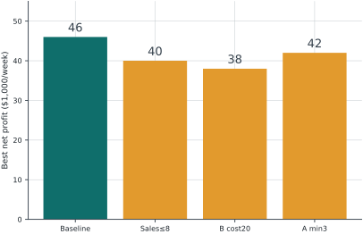{height=320}

::: {.notes}
Change one assumption at a time, resetting all other inputs to baseline. Reducing the sales cap to eight selects only B and gives forty. Raising B opening cost to twenty selects only A and gives thirty eight. Adding A minimum production three gives both lines open, production three and six, and profit forty two. These different decisions show why sensitivity experiments must state exactly what changed.
:::

## Step 8: consider an extra capacity module

k∈{0,1}; labor capacity = 12 + 4k.

Module cost = 7; subtract 7k from profit.

Optimum: k=1,a=6,b=4; net profit 47.

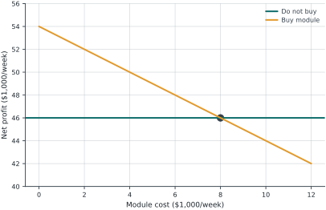{height=320}

::: {.notes}
Introduce another binary decision for one optional labor capacity module. It adds four labor units and costs seven thousand dollars per week. Move minus four k into the labor constraint and add plus seven k to the minimization objective. The best purchase plan produces six and four, with both lines open, and earns forty seven after all costs. Compare with forty six without the module: the net benefit is only one.
:::

## Step 9: compare purchase costs

Without purchase: profit 46.

With module before module cost: profit 54.

Cost 7 → buy; cost 10 → do not buy.

{height=320}

::: {.notes}
Separate the operating improvement from the purchase price. With the module available, the best operating profit after line opening costs is fifty four, compared with forty six without it. The gross improvement is eight. A module cost of seven leaves one of net benefit. A cost of ten is too high, so the optimized decision is not to buy, leaving profit forty six. Never subtract the module cost twice.
:::

## Independent exercises

1. Batch model: reduce the first resource limit to 4.

2. Plant model: reduce the sales cap to 6.

3. Add an at-most-one-line policy to the baseline.

::: {.notes}
Pause and complete the first three exercises on the separate practice page or printable worksheet. The first changes the small integer batch model, not the plant model. The second and third each start from the original plant baseline. Write the changed equation, predict the decision, solve, and check feasibility. For the batch question, enumerate the feasible integer points. For the plant questions, compare the permitted opening patterns. Check whether alternative plans tie.
:::

## Independent exercises: decisions and bounds

4. Module cost 8: compare buying and not buying.

5. A minimum batch 4: find the best opening pattern.

6. With incumbent 46 and max bound 48, what is certified?

::: {.notes}
For exercise four, set the capacity module cost to eight. Check both purchase states because a solver may return only one of multiple best plans. Exercise five adds a minimum batch of four for A. Exercise six is conceptual: an incumbent of forty six and upper bound forty eight does not prove optimality, but it limits the possible improvement. Write the bound interval without confusing it with the final answer.
:::

## Exercise solutions: batch and sales cap

1. First resource limit 4: unique best (2,2), value 10.

2. Sales cap 6: A only, a=6, profit 38.

3. At most one line: B only, b=8, profit 40.

::: {.notes}
Check your reasoning against these answers. With the first batch resource limit at four, two, two remains feasible and gives ten. Enumeration verifies it is best. For plant sales cap six, A alone gives forty eight minus ten, or thirty eight, beating the other patterns. Under the at most one policy at baseline demand, B alone gives forty and beats A at thirty eight. Verify each statement by comparing allowed patterns.
:::

## Exercise solutions: module and minimum batch

4. Cost 8: buy or not buy both give profit 46.

5. A minimum batch 4: choose B only, profit 40.

6. 46 ≤ optimum ≤ 48; possible improvement ≤ 2.

::: {.notes}
At module cost eight, the improved operating profit fifty four minus eight equals forty six, so both purchase states can be optimal. At minimum A production four, opening both gives at most thirty eight, while B alone still gives forty. In the bound question, the optimum lies between forty six and forty eight. The absolute remaining gap is two; no exact optimum is certified until the bounds meet or an acceptable tolerance is justified.
:::

## Exit Ticket: explain, then submit

Complete four questions on the online form.

Use your own calculations and reasoning.

Submit before opening the following solution slides.

{height=320}

::: {.notes}
Use the online exit ticket after completing the lab. There are four required written questions and an optional reflection. Explain the reasoning rather than submitting only numbers. You may answer in Thai or English. The form is anonymous, and the instructor sees your response privately. Wait for the saved receipt before closing the page. Pause now, and do not advance to the solutions until you have attempted all four questions.
:::

## Exit Ticket questions

1. Interpret a≤6yA and a≥3yA for binary yA.

2. Why does relaxed profit 52.667 not beat MILP profit 46?

3. Module cost 9: buy or not? Show net benefit.

4. Incumbent 46: prune nodes with bounds 45,46,48?

::: {.notes}
Question one asks you to interpret the linking inequalities in both binary states. Question two distinguishes a feasible integer decision from an optimistic relaxation. Question three changes the module cost to nine while all other baseline data stay fixed. Question four uses maximization node bounds of forty five, forty six and forty eight with incumbent forty six. Explain which nodes can be pruned if we seek one optimal solution.
:::

## Exit Ticket solutions: linking and relaxation

Q1: yA=0 ⇒ a=0; yA=1 ⇒ 3≤a≤6.

Q2 resets to baseline: relaxed yA=1/3 pays partial fixed cost.

52.667 is an upper bound, not an attainable MILP profit.

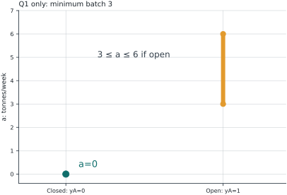{height=320}

::: {.notes}
For question one, substitute zero and one into both linking inequalities. Zero forces a to zero, while one allows production from three to six. The figure illustrates only question one. Question two returns to the baseline without that minimum batch constraint. Its relaxed solution pays only one third of A opening cost. That opening fraction violates the binary rule. The larger relaxed profit is an upper bound from a larger feasible set, not an attainable M I L P outcome.
:::

## Exit Ticket solutions: purchase and pruning

3. Extra operating benefit 54−46=8; cost 9: net −1.

Do not buy; best total profit remains 46.

4. Prune bounds 45 and 46; keep bound 48 for further work.

::: {.notes}
At cost nine, buying the module gives fifty four minus nine, or forty five. Not buying gives forty six, so reject the purchase. The incremental benefit of buying is negative one. For pruning, nodes with bounds forty five and forty six cannot improve incumbent forty six. A node bounded by forty eight might improve it, so it needs further processing. Its upper bound is not a promise that forty eight is attainable.
:::

## A reliable MILP workflow

Define decisions, units, domains, and valid bounds.

Solve; audit feasibility, costs, status, and gap.

Change assumptions one at a time and re-optimize.

::: {.notes}
A reliable model starts with clear decisions and units. Use binary variables for choices, continuous variables for divisible quantities, and tight valid bounds to connect them. After solving, audit the equations and objective rather than trusting a single status message. When assumptions change, reoptimize and compare complete net outcomes. These habits transfer to equipment selection, production scheduling and process network design beyond our small examples.
:::

## Resources and next steps

SciPy milp: coefficients, integrality, bounds, status and gap.

Course page: videos, lab, practice, solutions and Exit Ticket.

Keep your calculations and questions for the next meeting.

::: {.notes}
Use the official SciPy documentation to confirm the exact definitions of solver fields. The course page contains this deck, the five narrated chapters, the guided lab, practice exercises and separate solutions. Save your notebook and your exit ticket receipt. When we meet again, bring an example where your prediction differed from the solver and explain the constraints you checked. That comparison is often where the most useful learning happens.
:::
